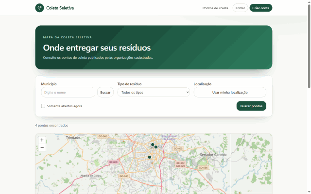
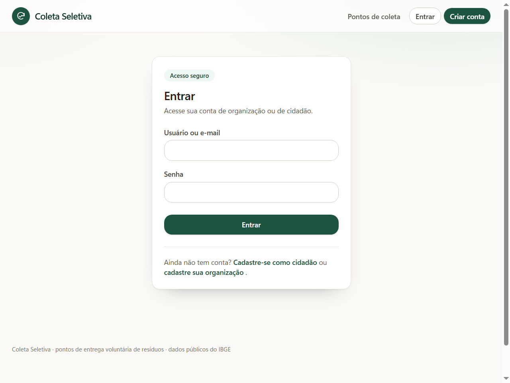
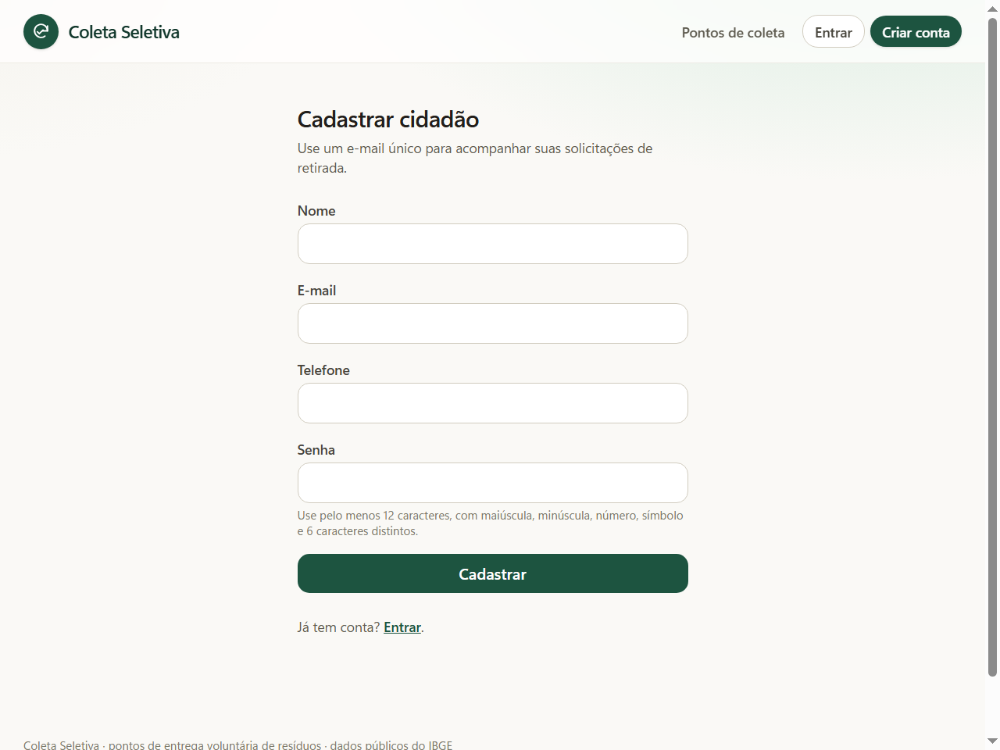

# Coleta Seletiva 2026

Plataforma web de coleta seletiva e pontos de descarte, multi-tenant (um tenant por cooperativa, associação ou prefeitura). Projeto de TCC da Academia do Programador, preparado para ser desenvolvido com o **opencode** no fluxo **PRD → TDD → SDD → Pull Request**.

Esta pasta reúne documentação e ferramentas de governança. O código da aplicação fica em `app/`.

## Aplicação publicada

| O que | Endereço |
| --- | --- |
| Site (SPA Angular + API na mesma origem) | <https://coleta-seletiva.runasp.net> |
| Consulta pública de pontos de coleta | <https://coleta-seletiva.runasp.net/pontos> |
| Entrada de organizações e cidadãos | <https://coleta-seletiva.runasp.net/acesso/login> |
| API (raiz informativa) | <https://coleta-seletiva.runasp.net/api/v1> |
| Documentação interativa (Swagger UI) | <https://coleta-seletiva.runasp.net/swagger> |
| Saúde da API | <https://coleta-seletiva.runasp.net/health> |
| Especificação OpenAPI | <https://coleta-seletiva.runasp.net/openapi/v1.json> |

O site roda no MonsterASP.NET (plano Free, .NET 10) com SQL Server do mesmo provedor.
O passo a passo de publicação, as variáveis de ambiente e a reversão estão em
[`docs/deploy-monsterasp.md`](docs/deploy-monsterasp.md). Para executar a aplicação
localmente, inclusive a API isolada, veja [`app/README.md`](app/README.md).

## Telas

Consulta pública de pontos, com filtros por município e tipo de resíduo, mapa e horários de
funcionamento:



| Entrada de organizações e cidadãos | Cadastro de cidadão |
| --- | --- |
|  |  |

## Estrutura

```text
.
├── AGENTS.md                       # regras do fluxo, commits e PRs (lido pelo opencode)
├── .github/pull_request_template.md
├── .opencode/
│   ├── commands/                   # comandos: /generate-prd, /generate-tdd, /opsx-*
│   └── skills/                     # skills: generate-prd, generate-tdd, openspec-*
├── docs/
│   ├── prd.md                      # requisitos de produto (Validado para TDD)
│   ├── tdd.md                      # design técnico (Validado para SDD)
│   └── prd-desafios.md             # evoluções v1.1 e v2 (Validado para TDD)
└── openspec/
    ├── config.yaml                 # contexto e regras do projeto para o OpenSpec
    ├── specs/
    └── changes/archive/
```

## Estado atual

- `docs/prd.md` está **validado para TDD** (2026-11-10), com o handoff PRD → TDD concluído.
- `docs/tdd.md` está **validado para SDD** (2026-11-10), com as decisões `DT-01` a `DT-23` confirmadas e o handoff ao SDD liberado.
- `docs/prd-desafios.md` e a revisão de v1.1/v2 do `docs/tdd.md` estão **validados** (2026-11-14), com as decisões `DT-24` a `DT-34` e o handoff de F7–F10 liberados; a implementação das evoluções continua condicionada à estabilidade da v1.
- A **F1 — Fundação segura** foi integrada na `main` pelo PR #2 (API ASP.NET Core 10 com SPA Angular 22,
  contas, sessão, papéis, equipe e isolamento entre organizações), com specs em
  `openspec/specs` e o histórico da mudança em `openspec/changes/archive`.
- A **F2 — Organização, catálogo e pontos** está implementada no backend e no frontend
  (perfil, municípios do IBGE, tipos habilitados, publicação, pontos e consulta pública com
  mapa).
- A **F3 — Retiradas e notificações** e a **F4 — Volumes, painel e P0 completo** estão
  implementadas no backend e no frontend (disponibilidade e bloqueios, solicitações, fila e
  execução, notificações internas, recebimentos e ajustes de volume, painel e CSV). Da F5, já
  estão entregues os ajustes de volume e a exportação CSV sem PII; as demais fases seguem
  pendentes.
- A **F11 — Pontos de fontes públicas** lê pontos reais do OpenStreetMap na consulta pública,
  sempre identificados e com atribuição ODbL; a fonte pode ser desligada por
  `FontesPublicas__Pontos__Ativa=false` e a consulta continua apenas com os pontos cadastrados.
- A aplicação está **publicada em produção** no **MonsterASP.NET**; o deploy continua sendo um
  gate manual, sem publicação automática pela CI: veja
  [`docs/deploy-monsterasp.md`](docs/deploy-monsterasp.md).

## Passo a passo

1. **Preparar o repositório.** Crie o repositório no GitHub, copie esta pasta para ele e faça o commit inicial na `main`. A partir daí, todo trabalho acontece em feature branches.
2. **Abrir o opencode na raiz.** Ele lê o `AGENTS.md` automaticamente. O fluxo depende da ferramenta de perguntas (`question`) do opencode; se ela estiver indisponível, os comandos interrompem o fluxo em vez de perguntar no texto.
3. **Validar o PRD.**

   ```text
   /generate-prd Revisar e validar docs/prd.md: plataforma de coleta seletiva e pontos de descarte, multi-tenant, com pontos de descarte, retirada agendada e registro de volume coletado
   ```

   Como o arquivo já existe, a skill pede confirmação antes de atualizá-lo, conduz a entrevista pelas perguntas e, ao final, pede sua aprovação para marcar `Validado para TDD`.
4. **Validar o TDD.**

   ```text
   /generate-tdd Use docs/prd.md como base validada
   ```

   A skill entrevista cada decisão técnica (`DT-*`). O rascunho já traz uma proposta para cada uma, então a conversa serve para confirmar ou trocar.
5. **Instalar a CLI do OpenSpec** conforme a documentação oficial do OpenSpec. As skills `openspec-*` e os comandos `/opsx-*` dependem dela.
6. **Especificar e implementar por fase.** Siga o roadmap do TDD (F0 a F10), uma fase por vez, em uma feature branch. As fases F0–F6 entregam a v1; F7–F10 entregam as evoluções v1.1/v2, após a estabilidade da v1:

   ```text
   /opsx-explore             # pensar e esclarecer antes de propor
   /opsx-propose f1-fundacao-segura
   /opsx-update              # ajustar as specs depois de revisar
   /opsx-apply               # implementar as tarefas aprovadas, dentro de app/
   /opsx-archive             # arquivar a mudança concluída
   ```

7. **Abrir o PR** com o template de `.github/pull_request_template.md`, citando os IDs de `RF-*`, `RNF-*`, `DT-*` e a fase do roadmap.

## Comandos disponíveis

| Comando | Para que serve |
| --- | --- |
| `/generate-prd` | Gera ou valida `docs/prd.md` por entrevista |
| `/generate-tdd` | Gera ou valida `docs/tdd.md` com decisões técnicas entrevistadas |
| `/opsx-explore` | Modo de exploração: investigar e clarear requisitos sem implementar |
| `/opsx-propose` | Cria uma mudança com proposta, specs, design e tarefas |
| `/opsx-update` | Revisa os artefatos de uma mudança sem editar código |
| `/opsx-apply` | Implementa as tarefas de uma mudança |
| `/opsx-sync` | Sincroniza as specs da mudança com as specs principais |
| `/opsx-archive` | Arquiva uma mudança concluída |

## O que vem do modelo e o que foi adaptado

- **Copiados sem alteração** do modelo `locadora-de-veiculos-2026`: comandos e skills de `.opencode/` e o template de PR.
- **Adaptados:** `AGENTS.md` (contexto do projeto e exemplos de título de PR), `openspec/config.yaml` (contexto e regras do domínio).
- **Escritos para o tema:** `docs/prd.md` e `docs/tdd.md`, com a mesma estrutura do modelo.
- **Evoluções:** `docs/prd-desafios.md` detalha as versões v1.1 e v2 (seção 5.2 do PRD), **validado para TDD** desde 2026-11-14, e a revisão correspondente de `docs/tdd.md` está **validada para SDD** na mesma data; a implementação continua condicionada à estabilidade da v1.
