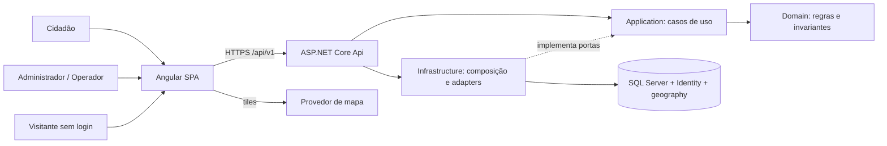
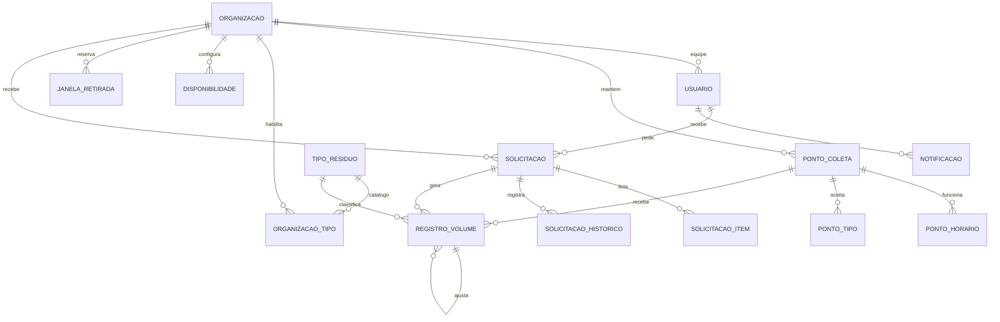
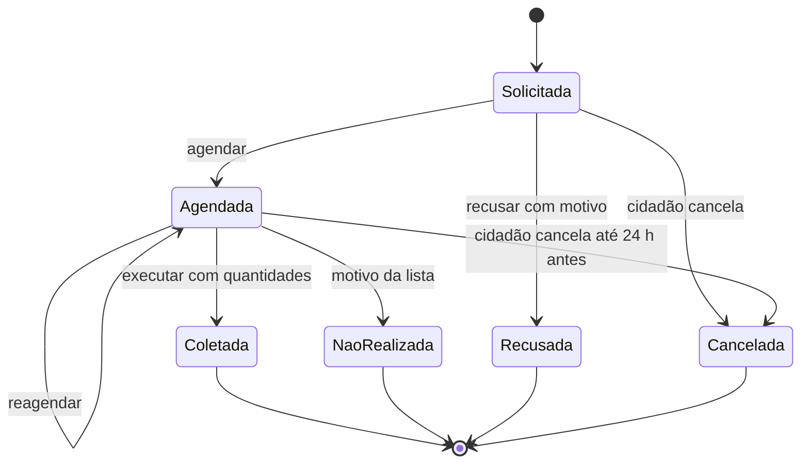

# TDD — Plataforma Web de Coleta Seletiva e Pontos de Descarte

- **Status:** Rascunho técnico com decisões **propostas**. Nenhuma decisão foi confirmada pela ferramenta `question`.
- **Data:** 2026-11-09.
- **Escopo:** desenho da v1 do PRD, sem implementação, instalações, provisionamento, commits ou PR.
- **Fonte de produto:** [docs/prd.md](prd.md), revisão de 2026-11-09, status `Rascunho`. O handoff do PRD está **bloqueado** até sua validação explícita (PRD, seção 12.2). RF-01–RF-22, RNF-01–RNF-08, RN-01–RN-11, J-01–J-06 e CA-01–CA-12 são a referência.
- **Decisor conhecido:** solicitante, a confirmar. Responsáveis nominais de engenharia, segurança, produto e operação não designados.
- **Autoria:** rascunho elaborado por assistente de IA. A stack proposta segue o modelo `locadora-de-veiculos-2026` (Angular e API .NET) e a stack que o solicitante já utiliza. Não houve revisão técnica independente.
- **Governança:** `AGENTS.md` e `openspec/config.yaml` desta pasta. Fluxo PRD → TDD → SDD → PR, implementação somente em `app/`.
- **Como validar:** executar `/generate-tdd Use docs/prd.md como base validada` depois de validar o PRD. A skill entrevistará cada decisão `DT-*` pela ferramenta `question` e pedirá confirmação antes de sobrescrever este arquivo.

## 1. Resumo e objetivos técnicos

Construir uma SPA Angular e uma API .NET para organizações gestoras de resíduos (tenants isolados) e cidadãos: pontos de descarte com geolocalização, consulta pública, janelas de retirada com capacidade, execução de retiradas, registro imutável de volumes, painel e relatórios. O desenho prioriza isolamento entre organizações, consistência da capacidade sob concorrência, privacidade dos dados pessoais e relatórios verificáveis, antes de qualquer otimização de escala não demonstrada.

### 1.1 Restrições

Confirmadas pela governança do repositório (`AGENTS.md`):

- Código, testes e configurações da aplicação ficam em `app/`; documentos e governança permanecem na raiz.
- Artefatos em português do Brasil; fluxo PRD → TDD → SDD → PR.

Propostas (herdadas do PRD ou deste rascunho, a confirmar):

- Todo o escopo P0 integra a v1; P1 também pertence à v1, mas é entregue por último (fase F5).
- Desenvolvimento local primeiro; produção e hospedagem são gates posteriores.
- Fuso por organização, padrão `America/Sao_Paulo`; sem integração externa de negócio.

### 1.2 Limites

Não desenhar: notificações externas, gamificação, rotas, aplicativo nativo, fotos, impacto ambiental, pagamentos, manifestos de destinação, integrações municipais, geocodificação externa, conversão de unidades, administração da plataforma nem recuperação de senha por e-mail. Nenhuma meta de carga, latência, disponibilidade, cobertura percentual, RPO ou RTO foi aprovada. Não se afirma conformidade legal nem prontidão operacional.

## 2. Decisões técnicas centralizadas

Todas as decisões abaixo estão no estado **Proposta**. Versões exatas de pacotes e ferramentas não são fixadas aqui: a matriz é verificada e travada na fase F0, sem instalar nada neste fluxo.

| ID | Tema e decisão | Estado, justificativa e alternativa | Consequências |
| --- | --- | --- | --- |
| DT-01 | Frontend Angular (linha estável vigente; o modelo usa Angular 22, Node 24 e TypeScript 6.0), standalone, zoneless, Signals, RxJS, npm | Proposta. Alinhado ao modelo. Alternativa: ASP.NET Core MVC com Razor, mais simples, porém com menos interatividade para mapa e filtros | Fixar versões compatíveis e lockfile em F0; sem Zone.js |
| DT-02 | Tailwind CSS 4, componentes próprios acessíveis, formulários reativos tipados; mapa com Leaflet e tiles OpenStreetMap (provedor substituível) e lista equivalente sempre disponível | Proposta. Evita kit visual pesado e atende RNF-04. Alternativa: Google Maps, com chave e custo | Equipe assume acessibilidade; política de uso dos tiles precisa de revisão antes do piloto |
| DT-03 | C# e .NET (LTS vigente; o modelo usa .NET 10), ASP.NET Core com controllers REST, monólito modular em Clean Architecture, solução `.slnx` | Proposta. Alinhada à stack conhecida. Microserviços acrescentariam coordenação sem necessidade | Domain e Application independentes de transporte e infraestrutura; uma unidade de deploy |
| DT-04 | EF Core, SQL Server (2022 Developer local em container), ASP.NET Core Identity; NetTopologySuite para tipos espaciais | Proposta. Banco compartilhado facilita transações. Alternativa: PostgreSQL com PostGIS, melhor para GIS, porém fora da stack dominada | Developer não é licença de produção; hospedagem e edição futuras a validar |
| DT-05 | Identity para credenciais; JWT de acesso de 15 minutos; refresh opaco rotativo com hash em SQL, em cookie HttpOnly, Secure e SameSite=Strict; logout revoga a família de refresh; SPA e API na mesma origem | Proposta. Equilíbrio entre segurança e esforço. Alternativa: consultar a sessão em toda chamada, que fecha a janela após logout ao custo de uma consulta por requisição | Após logout, o token de acesso vale até expirar (até 15 min); mesma origem exige proxy ou hospedagem do build pela API, definido em F0 |
| DT-06 | Autorização por policies: papéis Administrador, Operador e Cidadão; claim de organização para os dois primeiros; recursos do cidadão por dono | Proposta. Cobre RNF-01 e RF-04. A UI esconde ações, mas a API é a autoridade | Matriz de acesso testada por rota |
| DT-07 | Multitenancy por `OrganizacaoId`: filtros globais de leitura, guarda de escrita no `SaveChanges` e FKs compostas `(OrganizacaoId, Id)`; solicitações têm também `CidadaoId` | Proposta. Alternativa: banco ou schema por organização, com mais isolamento físico e custo operacional | SQL direto e consultas históricas exigem atenção; identificador recebido nunca determina a organização |
| DT-08 | Histórico: snapshots de endereço e contato na solicitação, histórico de estados, registros de volume append-only com ajustes, exclusão lógica, auditoria transacional | Proposta. Referências vivas sozinhas não preservam RNF-07 e RF-22 | Mais armazenamento; política de retenção a definir |
| DT-09 | Instantes em UTC (`datetimeoffset`); data local e período persistidos; fuso IANA por organização; `TimeProvider`; quantidades `decimal(12,3)` com transporte em string e sem arredondamento silencioso | Proposta. Evita ponto flutuante e dependência do fuso do servidor ou do navegador | Servidor é a autoridade; testes com relógio controlado |
| DT-10 | Transação com `UPDLOCK` e `HOLDLOCK` na linha da janela, contagem sob o lock, ordem determinística no reagendamento, índices únicos, `rowversion` com ETag e `Idempotency-Key` persistida | Proposta. Índice sozinho não protege contagem de capacidade. Alternativa: bloqueio por organização, mais simples e menos paralelo | Paralelismo por janela; medir antes de ajustar granularidade |
| DT-11 | Geolocalização com `geography` SRID 4326 e índice espacial; busca por raio com limite via POST (coordenadas fora de URLs e logs); posição escolhida pelo administrador no mapa; localização do cidadão não persistida; sem geocodificação externa | Proposta. Atende RNF-02. Alternativa: latitude e longitude decimais com Haversine, mais portável e sem índice espacial eficiente | Suporte do provider espacial verificado em F0; endereço textual continua obrigatório |
| DT-12 | DTOs, FluentResults e FluentValidation, mapeamento manual; OpenAPI, `/api/v1`, ProblemDetails | Proposta. Evita AutoMapper e MediatR, cujo licenciamento comercial recente deve ser verificado em F0 | Mais código explícito, menos dependências; invariantes continuam no domínio |
| DT-13 | Rotas `/publico/*` anônimas e somente leitura, com DTOs próprios sem dados pessoais, rate limiting, paginação com teto e cache curto | Proposta. Atende RF-09, RNF-02 e RNF-08 | Superfície pública pequena e auditada |
| DT-14 | Notificações internas: tabela gravada na transação do evento; consulta periódica (polling) com parâmetro `desde` | Proposta. Simples e suficiente para a v1. SignalR fica como evolução | Latência igual ao intervalo de polling, a medir |
| DT-15 | Municípios: tabela global semeada a partir da lista oficial do IBGE (código, nome, UF) por migração versionada | Proposta. Evita texto livre e duplicatas. Fonte e licença a verificar em F0 | Atualizações do IBGE exigem nova migração |
| DT-16 | Relatórios por agregação em SQL sobre `RegistroVolume`; `DataLocal` persistida na gravação; CSV UTF-8 com BOM, separador `;`, decimais com vírgula, neutralização de fórmulas | Proposta. Abre direto no Excel pt-BR; formato a validar com usuários | Mudar o fuso da organização não reescreve o histórico |
| DT-17 | MSTest e Moq (domínio e aplicação), WebApplicationFactory com Testcontainers para SQL Server (integração), Vitest (frontend), Playwright (E2E) | Proposta. SQLite e EF InMemory não comprovam locks nem rowversion. Alternativa: xUnit | Docker necessário em desenvolvimento e CI |
| DT-18 | Serilog estruturado com redação de dados pessoais, health checks, GitHub Actions para CI, execução local primeiro; Azure (App Service e Azure SQL) como alvo de produção a validar; New Relic opcional | Proposta. Destino de logs, custos e SLO permanecem gates de F5 e F6 | Nenhum serviço comercial obrigatório até o piloto |

## 3. Arquitetura e estrutura

### 3.1 Componentes



As setas indicam fluxo ou composição. Dependências de compilação: Application → Domain; Infrastructure → Application e Domain; Api → Application e Infrastructure apenas para composição. Domain não referencia EF, Identity, HTTP nem Angular. A Api não contém regras de negócio. O navegador conversa com o provedor de mapa apenas para tiles e nunca envia dados pessoais a ele.

| Módulo | Responsabilidade | RF |
| --- | --- | --- |
| Acesso | Registro de organização e cidadão, login, refresh, logout, equipe e papéis | RF-01–05 |
| Organização e catálogo | Perfil, municípios, períodos, publicação, tipos habilitados | RF-06–07 |
| Pontos | Pontos, horários, tipos aceitos, consulta pública e proximidade | RF-08–09, RF-22 |
| Retiradas | Disponibilidade, janelas, solicitação, triagem, execução | RF-10–14 |
| Volumes | Registro, ajuste, imutabilidade | RF-15–16 |
| Relatórios | Painel, CSV, transparência | RF-17–19 |
| Notificações e conta | Notificações internas, exclusão com anonimização | RF-20–21 |
| Transversal | Contexto de organização, auditoria, idempotência, relógio, erros | RNF-01–08 |

Um `DbContext` derivado de `IdentityDbContext` abriga identidade e negócio, permitindo transação única no registro. A Application depende de portas específicas de consulta e persistência e de uma unidade de trabalho; evitar repositório genérico que esconda locks. O relógio é abstraído por `TimeProvider`.

### 3.2 Organização futura, não criada nesta entrega

```text
app/
  backend/
    ColetaSeletiva.slnx
    src/ColetaSeletiva.Domain/
    src/ColetaSeletiva.Application/
    src/ColetaSeletiva.Infrastructure/
    src/ColetaSeletiva.Api/
    tests/ColetaSeletiva.Domain.Tests/
    tests/ColetaSeletiva.Application.Tests/
    tests/ColetaSeletiva.IntegrationTests/
    global.json
    Directory.Packages.props
  frontend/
    src/app/core/            # sessão, HTTP, erros
    src/app/shared/          # controles acessíveis, formatação, mapa
    src/app/features/        # publico, acesso, organizacao, pontos, retiradas, volumes, painel, cidadao
    package.json
    package-lock.json
  e2e/
  infra/                     # compose local e exemplos sem segredos
  scripts/                   # verificações da aplicação
docs/prd.md
docs/tdd.md
openspec/
.github/
```

Migrations pertencem à Infrastructure. Um workflow em `.github/workflows/` apenas invocará as verificações de `app/`.

### 3.3 Frontend

Rotas lazy por funcionalidade, três áreas (pública, cidadão, organização), componentes standalone e estado por serviços com Signals. Guards melhoram a navegação, mas não substituem a autorização da API. O interceptor envia o token somente para a origem da API.

O mapa é um componente isolado com alternativa em lista, ambos alimentados pela mesma fonte de dados e com os mesmos filtros. A busca por proximidade só pede a localização do dispositivo após ação explícita e trata a recusa da permissão sem bloquear os demais filtros. Listagens têm estados carregando, vazio e erro, paginação e filtros. Formulários mostram resumo e erros por campo, preservam o foco e não dependem apenas de cor. Moeda não se aplica; quantidades e datas são formatadas em português do Brasil, com datas no fuso da organização. Não há SSR, service worker nem cache offline de dados pessoais.

## 4. Dados e persistência

### 4.1 Convenções

- IDs opacos GUID gerados pelo servidor, sem função de autorização.
- Tabelas da organização: `Id`, `OrganizacaoId`, criação e alteração em UTC e `rowversion` nas entidades mutáveis. Cadastros excluíveis têm `ExcluidoEmUtc`.
- Chave alternativa `(OrganizacaoId, Id)` nas entidades da organização para FKs compostas.
- Textos com tamanhos máximos declarados no schema e no OpenAPI, definidos nas specs; nunca truncar dados silenciosamente. Documentos e nomes comparáveis têm representação normalizada.
- Quantidades `decimal(12,3)`; capacidade e limites inteiros não negativos. Rejeitar excesso de escala em vez de arredondar.
- Instantes `datetimeoffset` em UTC; `DataLocal` como `date` e `Periodo` como enumeração.

### 4.2 Modelo lógico

| Entidade | Campos e relações relevantes |
| --- | --- |
| Organizacao | Nome, tipo, contato público, fuso IANA, publicada, transparência habilitada, limite de solicitações abertas, `slug` público |
| Usuario (Identity) | `OrganizacaoId` (nulo para Cidadão), papel, nome, telefone (Cidadão), ativo, troca de senha pendente |
| RefreshToken | Usuário, família, hash, expiração, consumo e revogação para detectar replay |
| TipoResiduo | Catálogo global: código, nome, categoria, unidade fixa, orientações |
| OrganizacaoTipo | Organização, tipo, aceita retirada domiciliar |
| Municipio / OrganizacaoMunicipio | Catálogo IBGE global; municípios atendidos por organização |
| PeriodoRetirada | Organização, período (Manhã ou Tarde), início e fim locais |
| PontoColeta | Organização, nome, endereço, `Localizacao` geography, observações, status, exclusão lógica |
| PontoHorario / PontoTipo | Intervalos por dia da semana; tipos aceitos subconjunto dos habilitados |
| DisponibilidadeRetirada / BloqueioData | Capacidade por dia da semana e período; datas bloqueadas |
| JanelaRetirada | Organização, `DataLocal`, período; linha criada sob demanda e usada como âncora de lock |
| SolicitacaoRetirada | Organização, cidadão, snapshot de nome, telefone e endereço, janela, estado, motivo, versão |
| SolicitacaoItem / SolicitacaoHistorico | Tipo e quantidade estimada; transições com ator, instante e motivo |
| RegistroVolume | Organização, tipo, `Quantidade` (com sinal apenas em ajuste), origem, referências, operador e nome copiado, `OcorridoEmUtc`, `DataLocal`, motivo |
| Notificacao | Destinatário, evento, referência, lida |
| Auditoria | Organização, ator, instante, ação, entidade e ID, correlação, campos alterados sem valores pessoais |
| ComandoIdempotente | Organização ou cidadão, operação, chave, hash do comando, estado e referência ao resultado |



O diagrama omite tabelas transversais para legibilidade. Em `SOLICITACAO`, o usuário é sempre um Cidadão. Cada solicitação referencia uma organização e uma janela; cada registro de volume referencia exatamente uma origem.

### 4.3 Invariantes e índices

- Índices únicos globais de usuário e e-mail normalizados.
- Nome de ponto único por organização, incluindo excluídos logicamente, sem restaurar nem sobrescrever registros.
- `(OrganizacaoId, DataLocal, Periodo)` único em `JanelaRetirada`.
- `(OrganizacaoId, DiaSemana, Periodo)` único em `DisponibilidadeRetirada`.
- Índices para `(OrganizacaoId, Estado, DataLocal, Periodo)` em solicitações, `(CidadaoId, Estado)` para o limite de abertas, `(OrganizacaoId, TipoResiduoId, DataLocal)` em volumes e índice espacial em `PontoColeta.Localizacao`.
- Checks em `RegistroVolume`: origem Retirada exige `SolicitacaoId`; Recebimento exige `PontoId`; Ajuste exige `RegistroOriginalId` e motivo e `Quantidade <> 0`; nas demais origens `Quantidade > 0`.
- O total de um registro (original mais ajustes) não fica negativo: verificado dentro da transação, com lock sobre a linha do registro original.
- FKs sem cascade físico. Exclusão lógica aplica RF-22 e nunca remove registros de volume.
- `RegistroVolume` é append-only: além da aplicação, avaliar em F2 negar `UPDATE` e `DELETE` ao login da API por permissão SQL ou trigger.

### 4.4 Histórico e privacidade dos dados

Na criação da solicitação, copiar nome, telefone e endereço do cidadão. Edições posteriores do perfil não alteram solicitações existentes. Cada mudança de estado grava uma linha de histórico com ator e instante.

`DataLocal` do volume é calculada na gravação com o fuso vigente da organização e nunca recalculada; mudar o fuso afeta apenas registros futuros e deve ser informado ao administrador.

Na exclusão de conta (RF-21), os campos pessoais do usuário e os snapshots das suas solicitações são anonimizados por valores neutros; registros de volume, que nunca contêm dados pessoais, permanecem. A conta só é anonimizada se não houver solicitação Agendada.

### 4.5 Transações e concorrência

Toda mutação que afeta capacidade (criar, reagendar, cancelar, recusar, concluir ou marcar como não realizada) ocorre em transação que adquire `UPDLOCK` e `HOLDLOCK` na linha de `JanelaRetirada`, criada sob demanda: tentativa de inserção protegida pelo índice único e releitura sob lock. A ocupação é contada sob o lock a partir das solicitações em Solicitada ou Agendada. O reagendamento trava as duas janelas em ordem fixa (`DataLocal`, depois `Periodo`) para evitar deadlock.

A mesma transação grava solicitação, itens, histórico, notificações, auditoria e resultado idempotente. Transações são curtas, sem chamadas externas. Conflitos de constraint viram erro de negócio, nunca resposta SQL crua. Deadlock ou erro transitório permite repetição limitada da transação inteira com a mesma chave idempotente. Conflito de ETag exige recarregar, sem repetição automática.

A execução de retirada grava a mudança de estado e todos os registros de volume na mesma transação (RNF-03). Ajustes travam o registro original antes de verificar o total.

## 5. Regras de domínio e representação temporal

Serviços puros de domínio implementam as regras; somente o servidor é autoridade (DT-09).

| Regra | Desenho e verificação |
| --- | --- |
| RN-01 | A janela é `(Organizacao, DataLocal, Periodo)`. "Hoje" é a data local no fuso da organização obtida de `TimeProvider`. Aceitar `hoje + 1` a `hoje + 30` dias, valores iniciais configuráveis no código e centralizados em uma política |
| RN-02 | Ocupação = contagem sob lock em Solicitada e Agendada. Capacidade efetiva = capacidade do dia da semana, ou zero se a data estiver bloqueada. Reduzir a capacidade não remove solicitações existentes |
| RN-03 | Máquina de estados no domínio, com tabela de transições testada exaustivamente. Prazo de cancelamento: início local do período convertido para UTC menos 24 h; `agora <= prazo` permite cancelar |
| RN-04 | Município do endereço comparado por código IBGE aos atendidos pela organização; tipos checados contra `OrganizacaoTipo` com retirada domiciliar |
| RN-05 | Relatórios consultam somente `RegistroVolume`; itens estimados nunca entram em agregações |
| RN-06 | Agregação por `(TipoResiduoId, unidade)`; totais gerais agrupados por unidade; nenhuma conversão |
| RN-07 | Total do registro = original + soma dos ajustes; relatórios somam todos os lançamentos do período pela `DataLocal` de cada um |
| RN-08 | Instante atual convertido para o fuso da organização; comparar dia da semana e hora com os intervalos, início inclusivo e fim exclusivo; status diferente de Ativo nunca está aberto |
| RN-09 | Consultas públicas usam um filtro único de visibilidade (organização publicada, município e tipo habilitados, ponto Ativo e não excluído) |
| RN-10 | Contagem de Solicitada e Agendada por cidadão e organização dentro da mesma transação da criação |
| RN-11 | Projeções distintas por papel: organização vê snapshot do cidadão apenas das solicitações de sua responsabilidade; público nunca vê dados pessoais |

Datas e horas da API usam ISO 8601 com offset ou campos explícitos de data local e período quando representam janelas. Conversões usam a base IANA do fuso da organização; não fixar o fuso como `UTC−3`. Quantidades trafegam como strings decimais com ponto (por exemplo `"13.750"`) e são rejeitadas se excederem três casas. A interface formata em português sem converter para ponto flutuante.

Busca por proximidade: raio padrão e máximo definidos em configuração (valores iniciais a medir), resultado limitado e ordenado por distância com o ID como desempate.

## 6. Interfaces e fluxos

### 6.1 Convenções de API

Contratos abaixo são de design, não endpoints existentes; a especificação detalhada e o OpenAPI virão na SDD.

- JSON, base `/api/v1`, campos em camelCase, enums com nomes estáveis, IDs como strings. Organização e ator derivados do token, nunca do corpo ou da query.
- Listas com `page`, `pageSize`, filtros permitidos e ordenação estável; envelope `items`, `page`, `pageSize`, `total`. Padrão inicial de 20 e teto de 100, sujeito à medição.
- GET de entidade mutável devolve `ETag` derivado de `rowversion`; PUT e ações de estado exigem `If-Match` (ausente: 428; divergente: 412).
- ProblemDetails com `status`, `title`, `code`, `traceId` e mapa `errors` por campo, sem dados pessoais, stack trace ou SQL.
- 400 validação; 401 sem sessão; 403 sem permissão; 404 inexistente ou de outra organização; 409 conflito (capacidade, estado, limite de abertas, vínculo); 429 limite de taxa. Criação 201 com `Location`; exclusão lógica 204.
- `Idempotency-Key` obrigatório em criar solicitação e registrar execução. Mesma chave e mesmo comando retornam o resultado original; mesma chave com outro comando retorna 409.

### 6.2 Catálogo de contratos

| Rotas | Entradas e saídas principais | Regras |
| --- | --- | --- |
| `POST /auth/registro-organizacao`, `POST /auth/registro-cidadao` | Dados de RF-01 e RF-05 | Públicos, com limite de taxa; não autenticam implicitamente |
| `POST /auth/login`, `/auth/refresh`, `/auth/logout`, `/auth/alterar-senha`; `GET /auth/me` | Credenciais; token de acesso e cookie de refresh | Resposta genérica em falha; refresh rotativo; replay revoga a família; `Cache-Control: no-store` |
| `GET/PUT /organizacao`, `PUT /organizacao/publicacao`, `PUT /organizacao/municipios`, `PUT /organizacao/periodos` | Perfil e configurações | Somente Administrador; publicação valida RN-09 |
| `GET /catalogo/tipos`, `GET /catalogo/municipios` | Catálogo global somente leitura | Municípios com filtro por UF e texto |
| `GET/PUT /organizacao/tipos` | Tipos habilitados e retirada domiciliar | Somente Administrador |
| `/equipe` e `/equipe/{id}` | CRUD lógico de Operadores | Somente Administrador; senha inicial com troca obrigatória |
| `/pontos` e `/pontos/{id}` | CRUD lógico com horários e tipos | Administrador e Operador conforme matriz; tipos limitados aos habilitados |
| `GET/PUT /disponibilidade-retirada`, `/bloqueios-retirada` | Capacidade por dia e período; datas bloqueadas | Somente Administrador |
| `POST /publico/pontos/busca` | Filtros e coordenadas opcionais no corpo → pontos | Anônimo, sem dados pessoais, limite de taxa, coordenadas não registradas |
| `GET /publico/organizacoes`, `GET /publico/organizacoes/{slug}/transparencia` | Organizações por município; indicadores agregados | Somente publicadas; transparência só se habilitada |
| `GET /retiradas/janelas` | Janelas com vagas por organização e intervalo | Cidadão autenticado; sem dados de outros cidadãos |
| `POST /retiradas`, `GET /retiradas/minhas`, `POST /retiradas/{id}/cancelar` | Solicitação do cidadão e acompanhamento | Idempotência; RN-01 a RN-04, RN-10 |
| `GET /retiradas`, `GET /retiradas/{id}` | Fila da organização com filtros | Somente da organização; snapshot do cidadão por RN-11 |
| `POST /retiradas/{id}/agendar`, `/reagendar`, `/recusar`, `/executar`, `/nao-realizada` | Ações de estado | ETag; motivos obrigatórios; `/executar` com itens e idempotência |
| `POST /volumes/recebimentos`, `POST /volumes/{id}/ajustes`, `GET /volumes` | Registros de volume | Ajuste respeita RN-07; sem PUT nem DELETE |
| `GET /painel/resumo`, `GET /painel/serie`, `GET /relatorios/volumes.csv` | Agregações e exportação | Período e filtros; CSV com neutralização de fórmulas |
| `GET /notificacoes`, `POST /notificacoes/{id}/lida`, `POST /notificacoes/lidas` | Lista, marcar lida | Somente do próprio usuário; parâmetro `desde` |
| `GET/PUT /conta`, `DELETE /conta` | Perfil do cidadão; exclusão com anonimização | Bloqueio com solicitação Agendada |

### 6.3 Solicitação e execução de retirada

```mermaid
sequenceDiagram
    actor Cid as Cidadão
    actor Op as Operador
    participant UI as Angular
    participant API as API/Application
    participant DB as SQL Server
    Cid->>UI: Confirmar solicitação
    UI->>API: POST /retiradas + JWT + Idempotency-Key
    API->>DB: Transação; lock da janela; replay, território, tipos, limite, capacidade
    API->>DB: Inserir solicitação, itens, histórico, notificação, auditoria, resultado
    DB-->>API: Commit
    API-->>UI: 201 Solicitada
    Op->>UI: Agendar e, no dia, executar com quantidades reais
    UI->>API: POST agendar / executar + If-Match + chave
    API->>DB: Transação; lock; estado e versão
    API->>DB: Estado Coletada, registros de volume, notificação, auditoria
    DB-->>API: Commit (vaga liberada)
    API-->>UI: 200 Coletada
```



Falha antes do commit não altera vagas nem volumes. Repetir a mesma chave devolve o resultado original; outra chave em estado final gera conflito sem duplicar registros.

### 6.4 Autenticação e sessão

Identity valida usuário, senha, hash e bloqueio por tentativas. O token de acesso é um JWT assinado com algoritmo fixo, `issuer`, `audience` e expiração validados, com claims mínimas (`sub`, papel, organização quando houver, `jti`, `exp`); nenhum dado pessoal nas claims. O refresh é opaco, com entropia criptográfica, armazenado apenas como hash e rotacionado a cada uso; reuso de um refresh consumido revoga a família e exige novo login. Logout revoga a família e limpa o cookie.

Rotas que aceitam o cookie de refresh e logout validam `Origin` e exigem cabeçalho customizado, além de SameSite=Strict. Rotas de negócio aceitam somente o bearer. O token fica em memória no Angular; após recarregar a página, o frontend renova pelo cookie. Contas da organização poderão habilitar TOTP (P1, RNF-01) sobre o Identity.

### 6.5 Notificações internas

Eventos criam linhas em `Notificacao` na mesma transação da mudança de estado. O frontend consulta `GET /notificacoes?desde=` em intervalo configurável (valor inicial a medir) enquanto a aba está visível, e mostra contagem de não lidas. A notificação contém referência e texto genérico, sem dados pessoais além do necessário ao próprio destinatário.

## 7. Segurança e operação

### 7.1 Defesa e privacidade

| Ameaça | Defesa e evidência exigida |
| --- | --- |
| Acesso entre organizações (IDOR) | Contexto de tenant obrigatório, FKs compostas, guarda de escrita; testes A/B em GET, PUT e POST com IDs conhecidos, inclusive em volumes e histórico |
| Cidadão lendo dados de outro | Filtro por dono em todas as rotas do cidadão; testes X/Y |
| Exposição de dados pessoais em rotas públicas | DTOs públicos próprios, revisão de campos, teste de contrato que falha se surgir campo pessoal |
| Roubo de token | TLS, token de acesso curto em memória, refresh HttpOnly rotativo, CSP restritiva (inclui apenas o host de tiles em `img-src`) |
| Credential stuffing e abuso de cadastro | Rate limiting nativo por rota e origem, bloqueio por tentativas do Identity; parâmetros calibrados em F0, sem tratar limites como SLO |
| Raspagem e DoS em consultas públicas | Limite de taxa, paginação com teto, raio máximo, cache curto, índice espacial |
| Injeção de fórmula no CSV | Prefixar com apóstrofo células iniciadas por `=`, `+`, `-` ou `@`; teste dedicado |
| PII em logs | Serilog com redação; sem corpo de login, tokens, telefone ou endereço; coordenadas em POST e fora de URLs |
| Adulteração de volumes | Append-only, auditoria, verificação de total sob lock, permissão SQL a avaliar |
| Organização falsa publicando pontos | Publicação explícita; verificação manual é gate antes de produção (PRD, seção 11) |

`OrganizacaoId` vem da identidade validada, nunca de cabeçalho ou corpo. O `SaveChanges` rejeita entidades de outra organização; filtros não bastam para attach, update ou SQL bruto.

### 7.2 Configuração e observabilidade

- Segredos por secret store ou variáveis não versionadas; exemplos apenas com placeholders. Chaves de assinatura persistentes por ambiente, com rotação.
- Configuração validada na inicialização (SQL, issuer, audience, limites); falhar cedo em configuração insegura.
- Auditoria na mesma transação da alteração crítica: organização, ator, momento, ação, entidade e correlação, sem valores pessoais.
- Logs estruturados com `traceId`, rota parametrizada, duração, status, conflitos e retries. Medir latência (p50, p95, p99), erros, locks e deadlocks, conflitos de capacidade e consultas públicas. Coletar baseline antes de pactuar metas.
- Health checks de processo e de prontidão do SQL, sem detalhes públicos.

### 7.3 Execução, CI, deploy e recuperação

Local: SDK .NET e Node no host; SQL Server 2022 Developer em container com volume persistente e porta restrita ao host; API e SPA na mesma origem via proxy. Sem seed de senha fixa nem dados pessoais reais; dados de demonstração apenas sintéticos.

CI futuro (GitHub Actions): restauração por lockfiles, lint e formatação, build do Angular e do .NET, testes unitários, integração com SQL real, E2E e análise de vulnerabilidades e segredos. Ferramentas e workflows só serão criados na etapa de implementação.

Migrations versionadas e revisadas, aplicadas por job explícito com credencial de schema; a API usa credencial sem permissão de migrar. Banco vazio na v1. Hospedagem de produção (Azure como candidata), edição SQL licenciada, TLS, segredos, backup e retenção permanecem pendentes. Antes do piloto: testar backup e restauração. Antes de produção: aprovar frequência, retenção, criptografia, RPO e RTO. Rollback de binário depende da compatibilidade com o schema; preferir mudanças de schema compatíveis (expansão e contração). Não prometer rollback sem ensaio.

## 8. Qualidade e verificação

Esta seção descreve verificações futuras. Nenhum teste de aplicação foi executado nesta entrega documental.

| Camada | Ferramenta | Cobertura exigida |
| --- | --- | --- |
| Domínio | MSTest | RN-01–RN-11, máquina de estados, prazo de cancelamento, "aberto agora", agregação por unidade, ajuste; relógio controlado |
| Aplicação | MSTest e Moq | Orquestração, erros, gravação atômica de execução e volumes, notificações e auditoria |
| Integração | WebApplicationFactory e Testcontainers (SQL Server) | Migrations, Identity, refresh e replay, constraints, rowversion, tenant, locks de janela, idempotência, geography |
| Contrato | Testes HTTP e OpenAPI | DTOs, strings decimais, datas, erros, paginação, ETag, ausência de dados pessoais em `/publico/*` |
| Frontend | Vitest e TestBed | Signals e zoneless, formulários, interceptors, renovação de sessão, mapa e lista equivalentes |
| Ponta a ponta | Playwright | J-01 a J-06, duas organizações e dois cidadãos, teclado e foco, fluxo completo de retirada |

### 8.1 Casos obrigatórios além do caminho feliz

- CA-05: ponto 08:00–17:00 às 07:59, 08:00 e 17:00; sábado; Indisponível temporariamente.
- CA-06: hoje em 2026-11-09 com datas 2026-11-09 (rejeita), 2026-11-10 e 2026-12-09 (aceitam) e 2026-12-10 (rejeita); limite de três abertas e a quarta rejeitada; território e tipos.
- CA-07: capacidade 2 com três solicitações; três solicitações simultâneas para a última vaga por conexões independentes, com apenas uma aceita; reagendamentos cruzados concorrentes sem deadlock; cancelar libera; reduzir capacidade abaixo do ocupado.
- CA-08: todas as transições válidas e inválidas; cancelamento exatamente 24 h antes (aceito) e 23 h 59 min antes (rejeitado); motivos obrigatórios.
- CA-09: papel com 10,500 kg, 4,250 kg e ajuste de −1,000 kg resulta em 13,750 kg; óleo 8,000 L separado; ajuste que torna o total negativo é rejeitado; tentativa de editar ou apagar volume falha; estimativas não entram no painel.
- Timeout depois de commit com repetição da chave original; mesma chave com corpo diferente; falha entre gravar execução e volumes com rollback conjunto.
- Organização A e B, cidadão X e Y usando IDs conhecidos em todas as rotas; logs sem dados pessoais; resposta pública sem campos pessoais.
- CSV com células iniciadas por `=`, `+`, `-` e `@`; acentos e BOM; concordância entre painel e CSV.
- Mudança de fuso da organização não altera a `DataLocal` de registros antigos.
- Exclusão de conta com e sem solicitação Agendada; anonimização preserva volumes.
- Teclado completo em J-01 a J-06, foco após erros e diálogos, rótulos, contraste e zoom, mapa com lista equivalente. Ferramentas automáticas de acessibilidade complementam, mas não substituem a inspeção manual nem certificam acessibilidade.

### 8.2 Plano de desempenho

Em F5, levantar com um representante de uso o número de organizações, pontos, solicitações e volumes por organização, cidadãos simultâneos, picos e hardware. Gerar dados sintéticos correspondentes e medir busca de proximidade, consulta pública por município, criação concorrente de solicitações na mesma janela, painel e CSV de períodos longos. Registrar ambiente, metodologia, percentis, erros e espera de locks. Definir metas somente após revisão de produto, engenharia e operação. O lock por janela e a agregação de relatórios são pontos de atenção, não gargalos comprovados.

## 9. Roadmap de implementação e gates

Sem datas, duração ou equipe presumidas. Cada fase depende da anterior e dos gates indicados; responsáveis são papéis propostos, sem designação nominal. Toda implementação ocorre em feature branch, após specs SDD revisadas e aprovadas, com PRD, TDD e tarefas coerentes.

| Fase | Escopo e entregáveis, com rastreabilidade | Pré-requisitos e critério de saída |
| --- | --- | --- |
| F0 — Preparação e SDD | Validar PRD e TDD; fixar a matriz de versões (Angular, Node, TypeScript, Tailwind, .NET, EF Core, provider espacial); verificar licenças de AutoMapper e MediatR, política de tiles e fonte de municípios; specs e tarefas OpenSpec rastreadas. DT-01–DT-18 | PRD `Validado para TDD`; decisões DT confirmadas pela `question`; CLI do OpenSpec verificada. Specs aprovadas antes de qualquer código |
| F1 — Fundação segura | Projetos em `app/`, migrations iniciais, Identity, papéis, registro de organização e cidadão, login, refresh, logout, contexto de tenant, auditoria, infraestrutura de testes e CI. RF-01–05; RNF-01–03, RNF-05, RNF-08; DT-03–07, DT-10, DT-12, DT-17–18 | F0. CA-01 e CA-02 (sem publicação) passam, inclusive isolamento A/B e X/Y; CI executa SQL real |
| F2 — Organização, catálogo e pontos | Perfil, municípios, períodos, publicação, tipos habilitados, equipe, pontos com geography, consulta pública e proximidade. RF-06–09, RF-22; RNF-02, RNF-04; DT-02, DT-08, DT-11, DT-13, DT-15 | F1. CA-02–CA-05 passam; consulta pública sem dados pessoais; mapa com lista equivalente |
| F3 — Retiradas e notificações | Disponibilidade, janelas, solicitação, cancelamento, triagem, agendamento, execução com gravação atômica dos registros de volume de origem retirada, histórico e notificações. RF-10–14, RF-15 (origem retirada), RF-20; RN-01–RN-04, RN-07, RN-10–RN-11; DT-08–10, DT-14 | F2. CA-06–CA-08 passam, inclusive concorrência por conexões independentes e idempotência |
| F4 — Volumes, painel e P0 completo | Recebimentos em ponto, painel, séries e relatórios sobre todos os registros de volume (o schema já suporta ajuste). RF-15 (recebimento), RF-17, RF-22; RN-05–RN-07; DT-08, DT-16 | F3. CA-09 (sem ajuste) e CA-10 (painel) passam; **P0 é a v1 funcional em ambiente de teste**, não liberação operacional |
| F5 — P1 e piloto | Ajustes, exportação CSV, transparência, exclusão de conta com anonimização, TOTP; provedor de mapa e observabilidade definitivos; medição de desempenho; validação com organização real. RF-16, RF-18, RF-19, RF-21; RNF-01, RNF-04, RNF-06; DT-16, DT-18 | F4. CA-09 completo, CA-10, CA-11 e CA-12 passam; política de retenção definida para o piloto; limites e metas propostos registrados |
| F6 — Produção | Hospedagem e licenciamento, TLS, segredos, retenção, verificação de organizações, RPO, RTO e SLO, monitoramento e runbooks; migrations, rollout e rollback ensaiados | F5; gates operacionais aprovados por produto, segurança e operação designados. Nenhuma pendência tratada como cumprida; merges somente via PR autorizado |

PRs de implementação devem ser pequenos e coesos, usar o template do repositório e citar RF, RNF, DT, fase e tarefas SDD reais. Nenhum subconjunto de F1 a F3 pode ser anunciado como v1 pronta.

## 10. Riscos, alternativas e pendências

| Item | Estado e impacto | Condição de resolução e responsável proposto |
| --- | --- | --- |
| Matriz de versões | Não bloqueia o desenho; bloqueia código dependente de compatibilidade não verificada | Engenharia fixa versões em F0, sem contornar peer dependencies |
| Provider espacial do EF Core e SQL Server | Suporte a `geography` e a índices espaciais precisa de verificação | Engenharia testa em F0; alternativa é latitude e longitude com Haversine |
| Tiles e provedor de mapa | Política de uso do OpenStreetMap limita uso pesado | Engenharia e produto escolhem provedor antes do piloto |
| Licenciamento de bibliotecas | AutoMapper e MediatR mudaram de licença recentemente; fato a verificar | Engenharia confirma em F0; o desenho já evita ambos |
| Sessão sem consulta por chamada | Token de acesso vale até expirar após logout | Aceitar a janela de 15 min ou adotar verificação de sessão por chamada, decidido em F0 |
| Lock por janela | Trade-off entre consistência e paralelismo | Medir em F5; manter testes de corrida e índices em qualquer mudança |
| Organizações não verificadas | Risco de pontos falsos | Produto e operação definem verificação antes de F6 |
| Dados pessoais e retenção | Sem prazo aprovado; anonimização não é política | Produto, privacidade e operação definem base, prazos e atendimento a titulares |
| Catálogo e resíduos regulados | Lista inicial é proposta | Solicitante e organização parceira validam; regras de logística reversa fora da v1 |
| Qualidade das coordenadas | Pontos mal posicionados reduzem a utilidade | Conferência no mapa e endereço textual obrigatório; revisão no piloto |
| Escala, SLO, RPO e RTO | Não há números aprovados | Produto, engenharia e operação medem e pactuam antes de compromissos |
| Hospedagem e licença | Só o ambiente local foi desenhado | Operação define ambiente licenciado e custo antes de F6 |

Não há bloqueio de produto novo identificado para este desenho, mas o PRD ainda precisa ser validado. Este rascunho não equivale a especificações SDD aprovadas nem autoriza produção.

### 10.1 Mapa de rastreabilidade

| Requisitos | Componentes e contratos | Decisões | Verificações do PRD | Fases |
| --- | --- | --- | --- | --- |
| RF-01–05 | Acesso, Identity, sessão, `/auth/*`, `/equipe` | DT-03–07, DT-12 | CA-01, CA-02 | F1 |
| RF-06–07 | Organização, catálogo e tipos habilitados | DT-07, DT-15 | CA-02, CA-03 | F2 |
| RF-08–09; RN-08–09 | Pontos, `/publico/*`, geography | DT-02, DT-11, DT-13 | CA-03–CA-05 | F2 |
| RF-10–14; RN-01–04, RN-10 | Disponibilidade, janelas, retiradas | DT-08–10 | CA-06–CA-08 | F3 |
| RF-15–17; RN-05–07 | Volumes, painel | DT-08, DT-09, DT-16 | CA-09, CA-10 | F3–F5 |
| RF-18–19 | CSV e transparência | DT-13, DT-16 | CA-10 | F5 |
| RF-20 | Notificações internas | DT-14 | CA-08 | F3 |
| RF-21–22; RNF-07 | Anonimização, exclusão lógica, histórico | DT-07–08 | CA-11 | F2, F5 |
| RNF-01–03 | Autorização, privacidade, locks e idempotência | DT-05–07, DT-10–11 | CA-01, CA-04, CA-07 | F1–F5 |
| RNF-04 | Frontend acessível, mapa e lista | DT-01–02 | CA-12 | F2–F5 |
| RNF-05 | Auditoria transacional | DT-08, DT-18 | CA-11 | F1–F5 |
| RNF-06, RNF-08 | Medição, limites de taxa, proteção do CSV | DT-13, DT-16, DT-18 | CA-10, CA-12 | F1, F5–F6 |

## 11. Fontes técnicas e revisão documental

A documentação oficial **não foi consultada** na geração deste rascunho; nenhuma versão, API ou compatibilidade foi verificada em fontes atuais. Os links abaixo são pontos de partida para a fase F0 e não foram auditados:

- Angular — versões e compatibilidade: https://angular.dev/reference/versions
- EF Core — tipos espaciais: https://learn.microsoft.com/ef/core/modeling/spatial
- EF Core — concorrência e transações: https://learn.microsoft.com/ef/core/saving/concurrency e https://learn.microsoft.com/ef/core/saving/transactions
- ASP.NET Core — rate limiting, JWT bearer e Identity (documentação em https://learn.microsoft.com/aspnet/core)
- Leaflet: https://leafletjs.com/
- Política de uso dos tiles do OpenStreetMap: https://operations.osmfoundation.org/policies/tiles/
- Testcontainers para SQL Server: https://dotnet.testcontainers.org/modules/mssql/
- Playwright — locators: https://playwright.dev/docs/locators

Revisão desta entrega: coerência entre PRD e TDD, IDs `DT-*` distintos e tabela de rastreabilidade conferidas na geração. Diagramas Mermaid não foram renderizados. Não foram executados testes, build, lint ou CI.

### 11.1 Validação e handoff

- Estado: **rascunho não validado**. A validação do PRD é pré-requisito; as decisões `DT-*` precisam de confirmação pela ferramenta `question`.
- Entrada da próxima etapa: `docs/prd.md` e `docs/tdd.md`, preservando IDs RF, RNF, RN, CA e DT, pendências e gates F0–F6.
- Depois da validação, preparar as especificações SDD com OpenSpec (por exemplo `/opsx-propose`), verificando antes a disponibilidade da CLI conforme o `AGENTS.md`.
- Esta entrega não aprova especificações inexistentes, não resolve gates operacionais e não autoriza implementação, produção ou merge. Nenhum código, commit ou PR foi produzido.
