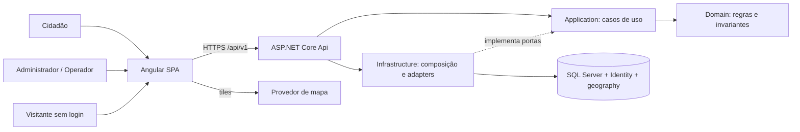
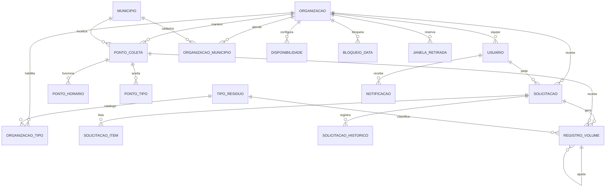
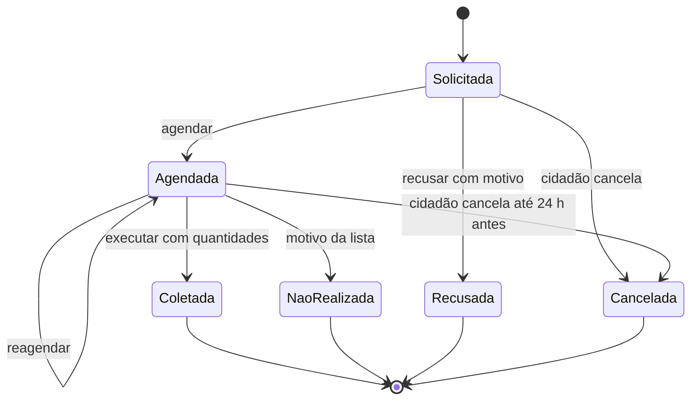

# TDD — Plataforma Web de Coleta Seletiva e Pontos de Descarte

- **Status:** Validado para SDD em 2026-11-10, por aprovação explícita do solicitante pela ferramenta `question`; handoff ao SDD liberado (ver 11.1).
- **Data:** 2026-11-10 (rascunho original de 2026-11-09; revisão e entrevista técnica em 2026-11-10).
- **Escopo:** desenho da v1 do PRD, sem implementação, instalações, provisionamento, commits ou PR.
- **Fonte de produto:** [docs/prd.md](prd.md), revisão de 2026-11-10, status `Validado para TDD`; handoff do PRD liberado (PRD, seção 12.2). RF-01–RF-22, RNF-01–RNF-08, RN-01–RN-12, J-01–J-06 e CA-01–CA-12 são a referência.
- **Pendências herdadas do PRD:** catálogo inicial de tipos e unidades, baseline e metas, retenção/base legal, verificação de organizações, fonte de municípios e provedor de mapa. Não bloqueiam o desenho; condicionam piloto e produção (PRD, seção 12.1).
- **Divergências PRD/TDD:** nenhuma identificada após esta revisão. As regras novas do PRD (RN-11, RN-12, gestão de pontos pelo Administrador, exclusão de conta e CSV sem PII) foram incorporadas ao desenho.
- **Decisor conhecido:** solicitante, que respondeu à entrevista técnica de 2026-11-10. Responsáveis nominais de engenharia, segurança, produto e operação não designados.
- **Autoria:** rascunho elaborado por assistente de IA. Decisões técnicas confirmadas pelo solicitante pela ferramenta `question` em 2026-11-10, em duas rodadas nesta etapa, complementando a entrevista anterior, com aprovação final do documento na mesma data. A stack segue o modelo `locadora-de-veiculos-2026` (Angular e API .NET) e a stack que o solicitante já utiliza. Não houve revisão técnica independente.
- **Governança:** `AGENTS.md` e `openspec/config.yaml` desta pasta. Fluxo PRD → TDD → SDD → PR, implementação somente em `app/`.
- **Como foi validado:** entrevista técnica pela ferramenta `question` em duas rodadas nesta etapa, seguida de aprovação explícita do documento em 2026-11-10. As decisões `DT-*` foram confirmadas e as versões exatas serão travadas na fase F0.

## 1. Resumo e objetivos técnicos

Construir uma SPA Angular e uma API .NET para organizações gestoras de resíduos (tenants isolados) e cidadãos: pontos de descarte com geolocalização, consulta pública, janelas de retirada com capacidade, execução de retiradas, registro imutável de volumes, painel e relatórios. O desenho prioriza isolamento entre organizações, consistência da capacidade sob concorrência, privacidade dos dados pessoais — incluindo o mascaramento da PII da organização após o estado final — e relatórios verificáveis, antes de qualquer otimização de escala não demonstrada.

### 1.1 Restrições

Confirmadas pela governança do repositório (`AGENTS.md`):

- Código, testes e configurações da aplicação ficam em `app/`; documentos e governança permanecem na raiz.
- Artefatos em português do Brasil; fluxo PRD → TDD → SDD → PR.

Confirmadas na entrevista técnica de 2026-11-10:

- Todo o escopo P0 integra a v1; P1 também pertence à v1, mas é entregue por último (fase F5).
- Desenvolvimento local primeiro; produção e hospedagem são gates posteriores.
- Fuso por organização, padrão `America/Sao_Paulo`; sem integração externa de negócio.
- O roadmap F0–F6 será mantido, com P0 em F4, P1 e piloto em F5 e produção em F6.

### 1.2 Limites

Não desenhar: notificações externas, gamificação, rotas, aplicativo nativo, fotos, impacto ambiental, pagamentos, manifestos de destinação, integrações municipais, geocodificação externa, conversão de unidades, administração da plataforma nem recuperação de senha por e-mail. Nenhuma meta de carga, latência, disponibilidade, cobertura percentual, RPO ou RTO foi aprovada. Não se afirma conformidade legal nem prontidão operacional.

## 2. Decisões técnicas centralizadas

Todas as decisões abaixo estão **Confirmadas** pela entrevista técnica de 2026-11-10, conduzida pela ferramenta `question`. Versões exatas de pacotes e ferramentas não são fixadas aqui: a matriz é verificada e travada na fase F0, sem instalar nada neste fluxo.

| ID | Tema e decisão | Estado, justificativa e alternativa | Consequências |
| --- | --- | --- | --- |
| DT-01 | Frontend Angular (linha estável vigente; o modelo usa Angular 22, Node 24 e TypeScript 6.0), standalone, zoneless, Signals, RxJS, npm | Confirmada (2026-11-10). Alinhado ao modelo. Alternativa: ASP.NET Core MVC com Razor, mais simples, porém com menos interatividade para mapa e filtros | Fixar versões compatíveis e lockfile em F0; sem Zone.js |
| DT-02 | Tailwind CSS 4, componentes próprios acessíveis, formulários reativos tipados; mapa com Leaflet e tiles OpenStreetMap (provedor substituível) e lista equivalente sempre disponível | Confirmada (2026-11-10). Evita kit visual pesado e atende RNF-04. Alternativa: Angular Material ou Google Maps, com mais componentes ou chave e custo | Equipe assume acessibilidade e testes de componentes; política de uso dos tiles precisa de revisão antes do piloto |
| DT-03 | C# e .NET (LTS vigente; o modelo usa .NET 10), ASP.NET Core com controllers REST, monólito modular em Clean Architecture, solução `.slnx` | Confirmada (2026-11-10). Alinhada à stack conhecida. Microserviços acrescentariam coordenação sem necessidade | Domain e Application independentes de transporte e infraestrutura; uma unidade de deploy |
| DT-04 | EF Core, SQL Server (2022 Developer local em container), ASP.NET Core Identity; NetTopologySuite para tipos espaciais | Confirmada (2026-11-10). Banco compartilhado facilita transações e locks. Alternativa: PostgreSQL com PostGIS, melhor para GIS, porém fora da stack dominada | Developer não é licença de produção; hospedagem e edição futuras a validar em F6 |
| DT-05 | Identity para credenciais; JWT de acesso de 15 minutos; refresh opaco rotativo com hash em SQL, em cookie HttpOnly, Secure e SameSite=Strict; logout revoga a família de refresh; SPA e API na mesma origem | Confirmada (2026-11-10). Equilíbrio entre segurança e esforço. Alternativa: consultar a sessão em toda chamada, que fecha a janela após logout ao custo de uma consulta por requisição | Após logout, o token de acesso vale até expirar (até 15 min); mesma origem exige proxy local e hospedagem do build pela API ou proxy equivalente (DT-20) |
| DT-06 | Autorização por policies: papéis Administrador, Operador e Cidadão; claim de organização para os dois primeiros; recursos do cidadão por dono; projeções de PII condicionadas ao estado da solicitação | Confirmada (2026-11-10). Cobre RNF-01, RF-03, RF-04 e RN-11. A UI esconde ações, mas a API é a autoridade | Matriz de acesso testada por rota, incluindo pontos e relatórios exclusivos do Administrador e mascaramento de PII após estado final |
| DT-07 | Multitenancy por `OrganizacaoId`: filtros globais de leitura, guarda de escrita no `SaveChanges` e FKs compostas `(OrganizacaoId, Id)`; solicitações têm também `CidadaoId` | Confirmada (2026-11-10). Alternativa: banco ou schema por organização, com mais isolamento físico e custo operacional | SQL direto e consultas históricas exigem atenção; identificador recebido nunca determina a organização |
| DT-08 | Histórico: snapshots de endereço e contato na solicitação, histórico de estados, registros de volume append-only com ajustes, exclusão lógica, auditoria transacional; PII mascarada nas projeções da organização após o estado final | Confirmada (2026-11-10). Referências vivas sozinhas não preservam RNF-07, RF-22 e RN-11 | Mais armazenamento; política de retenção a definir; o cidadão continua vendo os próprios dados |
| DT-09 | Instantes em UTC (`datetimeoffset`); data local e período persistidos; fuso IANA por organização; `TimeProvider`; quantidades `decimal(12,3)` com transporte em string e sem arredondamento silencioso | Confirmada (2026-11-10). Evita ponto flutuante e dependência do fuso do servidor ou do navegador | Servidor é a autoridade; testes com relógio controlado |
| DT-10 | Transação com `UPDLOCK` e `HOLDLOCK` na linha da janela, contagem sob o lock, ordem determinística no reagendamento, índices únicos, `rowversion` com ETag e `Idempotency-Key` persistida | Confirmada (2026-11-10). Índice sozinho não protege contagem de capacidade. Alternativa: bloqueio por organização, mais simples e menos paralelo | Paralelismo por janela; medir antes de ajustar granularidade |
| DT-11 | Geolocalização com `geography` SRID 4326 e índice espacial; busca por raio com limite via POST (coordenadas fora de URLs e logs); posição escolhida pelo administrador no mapa; localização do cidadão não persistida; sem geocodificação externa | Confirmada (2026-11-10). Atende RNF-02. Alternativa: latitude e longitude decimais com Haversine, mais portável e sem índice espacial eficiente | Suporte do provider espacial verificado em F0; endereço textual continua obrigatório |
| DT-12 | DTOs, FluentResults e FluentValidation, com mapeamento manual (sem AutoMapper e sem MediatR); OpenAPI, `/api/v1`, ProblemDetails | Confirmada (2026-11-10). Na entrevista o solicitante escolheu AutoMapper e, depois, decidiu voltar ao mapeamento manual da proposta original. Evita dependência com licenciamento comercial recente (fato a verificar caso a escolha seja reconsiderada) | Mais código explícito e menos dependências; mapeamentos em métodos ou extensões dedicados, restritos a DTOs e cobertos por teste; invariantes continuam no domínio |
| DT-13 | Rotas `/publico/*` anônimas e somente leitura, com DTOs próprios sem dados pessoais, rate limiting, paginação com teto e cache curto | Confirmada (2026-11-10). Atende RF-09, RF-18, RNF-02 e RNF-08 | Superfície pública pequena e auditada; o CSV usa contrato próprio sem nome, telefone ou endereço |
| DT-14 | Notificações internas: tabela gravada na transação do evento; consulta periódica (polling) com parâmetro `desde` | Confirmada (2026-11-10). Simples e suficiente para a v1. SignalR fica como evolução | Latência igual ao intervalo de polling, a medir |
| DT-15 | Municípios: tabela global semeada a partir da lista oficial do IBGE (código, nome, UF) por migração versionada | Confirmada (2026-11-10). Evita texto livre e duplicatas. Fonte e licença a verificar em F0 | Atualizações do IBGE exigem nova migração |
| DT-16 | Relatórios por agregação em SQL sobre `RegistroVolume`; `DataLocal` persistida na gravação; CSV UTF-8 com BOM, separador `;`, decimais com vírgula, neutralização de fórmulas | Confirmada (2026-11-10). Abre direto no Excel pt-BR; formato a validar com usuários | Mudar o fuso da organização não reescreve o histórico |
| DT-17 | MSTest e Moq (domínio e aplicação), WebApplicationFactory com Testcontainers para SQL Server (integração), Vitest (frontend), Playwright (E2E) | Confirmada (2026-11-10). SQLite e EF InMemory não comprovam locks nem rowversion. Alternativa: xUnit | Docker necessário em desenvolvimento e CI |
| DT-18 | Serilog estruturado com redação de dados pessoais, health checks, New Relic opcional; Azure (App Service e Azure SQL) como alvo de produção a validar | Confirmada (2026-11-10). Destino de logs, custos e SLO permanecem gates de F5 e F6 | Nenhum serviço comercial obrigatório até o piloto |
| DT-19 | Repositório da aplicação em `app/backend`, `app/frontend`, `app/e2e` e `app/infra`, com CI coordenada | Confirmada (2026-11-10). Separação clara entre API, SPA, testes ponta a ponta e infraestrutura. Alternativa: apenas backend e frontend, com testes e infraestrutura acoplados | Mais pastas e ferramentas; scripts e configuração de aplicação permanecem dentro de `app/` |
| DT-20 | Execução local com SDK .NET e Node no host, SQL Server 2022 Developer em container e SPA/API na mesma origem via proxy | Confirmada (2026-11-10). Compatível com cookie SameSite=Strict e depuração no host. Alternativa: Docker Compose para tudo, mais reproduzível e com mais overhead | Docker necessário para o SQL; a configuração de proxy será criada na implementação e verificada em F1 |
| DT-21 | GitHub Actions somente para CI; deploy posterior em Azure App Service e Azure SQL como candidatos, sem provisionar ou publicar nesta etapa | Confirmada (2026-11-10). Separa qualidade de deploy e evita custos e credenciais antes de haver produto estável. Alternativa: deploy contínuo desde as primeiras fases | Nenhum ambiente de produção ou credencial de nuvem é criado por este TDD; deploy é gate de F6 |
| DT-22 | Segredos com user-secrets no desenvolvimento, variáveis de ambiente na CI e cofre gerenciado em produção; nenhum segredo versionado | Confirmada (2026-11-10). Configuração por ambiente sem credenciais no repositório. Alternativa: variáveis em todos os ambientes, com proteção dependente da plataforma | Cofre gerenciado e rotação são gates de F6; exemplos usam apenas placeholders |
| DT-23 | Backup e restauração como gate de F5/F6, com teste de restore; frequência, retenção, RPO e RTO definidos por produto, segurança e operação antes de produção | Confirmada (2026-11-10). Evita inventar números sem contexto operacional. Alternativa: definir RPO/RTO agora, sem base de uso | Não há garantia de recuperação declarada neste TDD; o ensaio de restore é pré-requisito do piloto e da produção |

### 2.1 Registro da entrevista técnica

A entrevista técnica foi conduzida pela ferramenta `question` em 2026-11-10, em duas rodadas nesta etapa, complementando a rodada anterior que confirmou 14 decisões. Todas as decisões `DT-01` a `DT-23` estão confirmadas; nenhuma escolha estrutural permanece como proposta. No backend, o solicitante escolheu AutoMapper em rodada anterior e voltou ao mapeamento manual; as demais respostas desta etapa coincidiram com as recomendações apresentadas.

| Tema | Resposta do solicitante | DT |
| --- | --- | --- |
| Linguagem e frontend | C# + API .NET com Angular standalone, zoneless, Signals e RxJS | DT-01, DT-03 |
| UI e componentes | Tailwind CSS 4, componentes próprios acessíveis e Leaflet/OpenStreetMap com lista equivalente | DT-02 |
| Bibliotecas do backend | FluentResults + FluentValidation + mapeamento manual | DT-12 |
| Arquitetura | Clean Architecture, monólito modular | DT-03 |
| Persistência e identidade | EF Core + SQL Server 2022 Developer + ASP.NET Core Identity + NetTopologySuite | DT-04 |
| Autenticação e sessão | Identity + JWT de 15 min + refresh rotativo em cookie | DT-05 |
| Autorização | Policies + claims + ownership, com projeção de PII por estado | DT-06 |
| Isolamento entre organizações | `OrganizacaoId` + filtros globais + FKs compostas | DT-07 |
| Histórico e volumes | Snapshots + histórico de estados + volume append-only + auditoria transacional | DT-08 |
| Geolocalização e mapa | `geography` no SQL Server + Leaflet/OpenStreetMap | DT-02, DT-11 |
| Fonte de municípios | Tabela global semeada com a lista oficial do IBGE | DT-15 |
| Concorrência de capacidade | Lock na linha da janela (`UPDLOCK`/`HOLDLOCK`) + idempotência | DT-10 |
| Precisão de quantidades | `decimal(12,3)`, transporte em string, sem arredondamento | DT-09 |
| Relatórios e CSV | Agregação em SQL; UTF-8 com BOM, `;`, vírgula decimal e neutralização de fórmulas | DT-16 |
| Notificações internas | Tabela + polling com parâmetro `desde` | DT-14 |
| API pública | DTOs públicos, rate limiting, paginação com teto e cache curto | DT-13 |
| Observabilidade | Serilog + health checks, New Relic opcional | DT-18 |
| Testes | MSTest + Moq, Testcontainers, Vitest e Playwright | DT-17 |
| Estrutura em `app/` | `app/backend`, `app/frontend`, `app/e2e` e `app/infra` | DT-19 |
| Execução local | SDK no host + SQL Server em container + SPA e API na mesma origem | DT-20 |
| CI e deploy | GitHub Actions somente para CI; Azure App Service/Azure SQL como gate posterior | DT-21 |
| Segredos | User-secrets no desenvolvimento, variáveis na CI e cofre gerenciado em produção | DT-22 |
| Backup e recuperação | Baseline em F5/F6, com teste de restore e RPO/RTO definidos antes de produção | DT-23 |
| Roadmap | Manter F0–F6, com P0 em F4, P1/piloto em F5 e produção em F6 | seção 9 |

As versões exatas de Angular, Node, TypeScript, Tailwind, .NET, EF Core, provider espacial e demais pacotes serão verificadas em fontes oficiais e travadas na fase F0 (seção 11).

## 3. Arquitetura e estrutura

### 3.1 Componentes



As setas indicam fluxo ou composição. Dependências de compilação: Application → Domain; Infrastructure → Application e Domain; Api → Application e Infrastructure apenas para composição. Domain não referencia EF, Identity, HTTP nem Angular. A Api não contém regras de negócio. O navegador conversa com o provedor de mapa apenas para tiles e nunca envia dados pessoais a ele.

| Módulo | Responsabilidade | RF |
| --- | --- | --- |
| Acesso | Registro de organização e cidadão, login, refresh, logout, equipe e papéis | RF-01–05 |
| Organização e catálogo | Perfil, municípios, períodos, publicação, tipos habilitados | RF-06–07 |
| Pontos | Gestão de pontos, horários, tipos aceitos e município atendido pelo Administrador; consulta pública e proximidade; leitura de opções para recebimento pelo Operador | RF-08–09, RF-22 |
| Retiradas | Disponibilidade, bloqueios, janelas, solicitação, triagem, execução e mascaramento de PII após estado final | RF-10–14; RN-11–12 |
| Volumes | Registro, ajuste, imutabilidade | RF-15–16 |
| Relatórios | Painel e CSV exclusivos do Administrador; transparência pública | RF-17–19 |
| Notificações e conta | Notificações internas; exclusão com anonimização e bloqueio por solicitação aberta | RF-20–21 |
| Transversal | Contexto de organização, auditoria, idempotência, relógio, erros | RNF-01–08 |

Um `DbContext` derivado de `IdentityDbContext` abriga identidade e negócio, permitindo transação única no registro. A Application depende de portas específicas de consulta e persistência e de uma unidade de trabalho; evitar repositório genérico que esconda locks. O relógio é abstraído por `TimeProvider`.

### 3.2 Organização futura, não criada nesta entrega

```text
app/
  backend/
    ColetaSeletiva.slnx
    src/ColetaSeletiva.Domain/
    src/ColetaSeletiva.Application/
    src/ColetaSeletiva.Infrastructure/
    src/ColetaSeletiva.Api/
    tests/ColetaSeletiva.Domain.Tests/
    tests/ColetaSeletiva.Application.Tests/
    tests/ColetaSeletiva.IntegrationTests/
    global.json
    Directory.Packages.props
  frontend/
    src/app/core/            # sessão, HTTP, erros
    src/app/shared/          # controles acessíveis, formatação, mapa
    src/app/features/        # publico, acesso, organizacao, pontos, retiradas, volumes, painel, cidadao
    package.json
    package-lock.json
  e2e/
    tests/
  infra/
    compose.yaml             # SQL Server local e volumes; sem segredos reais
  scripts/                   # verificações da aplicação
# raiz do repositório
.github/workflows/           # CI que invoca as verificações de app/
docs/prd.md
docs/tdd.md
openspec/
```

Migrations pertencem à Infrastructure. Um workflow em `.github/workflows/` apenas invocará as verificações de `app/`, conforme DT-19 e DT-21. A solução não cria contêineres de API ou SPA no desenvolvimento; o SQL Server local é o único serviço em contêiner (DT-20).

### 3.3 Frontend

Rotas lazy por funcionalidade, três áreas (pública, cidadão, organização), componentes standalone e estado por serviços com Signals. Guards melhoram a navegação, mas não substituem a autorização da API. O interceptor envia o token somente para a origem da API. A área da organização esconde do Operador a gestão de pontos, equipe, configurações e relatórios, mas a API continua sendo a autoridade; após o estado final de uma solicitação, a tela da organização não exibe nome, telefone ou endereço do cidadão, e o cidadão continua vendo os próprios dados.

O mapa é um componente isolado com alternativa em lista, ambos alimentados pela mesma fonte de dados e com os mesmos filtros. A busca por proximidade só pede a localização do dispositivo após ação explícita e trata a recusa da permissão sem bloquear os demais filtros. Listagens têm estados carregando, vazio e erro, paginação e filtros. Formulários mostram resumo e erros por campo, preservam o foco e não dependem apenas de cor. Moeda não se aplica; quantidades e datas são formatadas em português do Brasil, com datas no fuso da organização. Não há SSR, service worker nem cache offline de dados pessoais.

## 4. Dados e persistência

### 4.1 Convenções

- IDs opacos GUID gerados pelo servidor, sem função de autorização.
- Tabelas da organização: `Id`, `OrganizacaoId`, criação e alteração em UTC e `rowversion` nas entidades mutáveis. Cadastros excluíveis têm `ExcluidoEmUtc`.
- Chave alternativa `(OrganizacaoId, Id)` nas entidades da organização para FKs compostas.
- Textos com tamanhos máximos declarados no schema e no OpenAPI, definidos nas specs; nunca truncar dados silenciosamente. Documentos e nomes comparáveis têm representação normalizada.
- Quantidades `decimal(12,3)`; capacidade e limites inteiros não negativos. Rejeitar excesso de escala em vez de arredondar.
- Instantes `datetimeoffset` em UTC; `DataLocal` como `date` e `Periodo` como enumeração.
- Endereços de ponto e de retirada usam UF e município do catálogo IBGE; bairro, rua, número, complemento, CEP e referência permanecem textuais e são copiados no snapshot da solicitação quando aplicável.

### 4.2 Modelo lógico

| Entidade | Campos e relações relevantes |
| --- | --- |
| Organizacao | Nome, tipo, contato público, fuso IANA, publicada, transparência habilitada, limite de solicitações abertas, `slug` público |
| Usuario (Identity) | `OrganizacaoId` (nulo para Cidadão), papel, nome, telefone (Cidadão), ativo, troca de senha pendente, anonimização e data |
| RefreshToken | Usuário, família, hash, expiração, consumo e revogação para detectar replay |
| TipoResiduo | Catálogo global: código, nome, categoria, unidade fixa, orientações |
| OrganizacaoTipo | Organização, tipo, aceita retirada domiciliar |
| Municipio / OrganizacaoMunicipio | Catálogo IBGE global; municípios atendidos por organização |
| PeriodoRetirada | Organização, período (Manhã 08:00–12:00 e Tarde 13:00–17:00 por padrão), início e fim locais |
| PontoColeta | Organização, nome, município atendido, endereço, `Localizacao` geography, observações, status, exclusão lógica |
| PontoHorario / PontoTipo | Um ou mais intervalos no mesmo dia da semana, sem atravessar a meia-noite; tipos aceitos como subconjunto não vazio dos habilitados |
| DisponibilidadeRetirada / BloqueioData | Capacidade por dia da semana e período; datas bloqueadas; bloqueio não cancela solicitações existentes |
| JanelaRetirada | Organização, `DataLocal`, período; linha criada sob demanda e usada como âncora de lock |
| SolicitacaoRetirada | Organização, cidadão, snapshot de nome, telefone e endereço, janela, estado, motivo, versão; PII visível à organização somente em Solicitada ou Agendada |
| SolicitacaoItem / SolicitacaoHistorico | Tipo e quantidade estimada; transições com ator, instante e motivo |
| RegistroVolume | Organização, tipo, `Quantidade` (com sinal apenas em ajuste), origem, referências, operador e nome copiado, `OcorridoEmUtc`, `DataLocal`, motivo |
| Notificacao | Destinatário, evento, referência, lida |
| Auditoria | Organização, ator, instante, ação, entidade e ID, correlação, campos alterados sem valores pessoais |
| ComandoIdempotente | Organização ou cidadão, operação, chave, hash do comando, estado e referência ao resultado |



O diagrama omite tabelas transversais para legibilidade. Em `SOLICITACAO`, o usuário é sempre um Cidadão. Cada solicitação referencia uma organização e uma janela; cada registro de volume referencia exatamente uma origem.

### 4.3 Invariantes e índices

- Índices únicos globais de usuário e e-mail normalizados.
- Nome de ponto único por organização, incluindo excluídos logicamente, sem restaurar nem sobrescrever registros.
- `(OrganizacaoId, DataLocal, Periodo)` único em `JanelaRetirada`.
- `(OrganizacaoId, DiaSemana, Periodo)` único em `DisponibilidadeRetirada`.
- `(OrganizacaoId, MunicipioId)` único em `OrganizacaoMunicipio` e `(OrganizacaoId, TipoResiduoId)` único em `OrganizacaoTipo`, permitindo FKs compostas.
- `PontoColeta` referencia `(OrganizacaoId, MunicipioId)` de `OrganizacaoMunicipio`, impedindo ponto em município não atendido; `PontoTipo` referencia `(OrganizacaoId, TipoResiduoId)` de `OrganizacaoTipo` e `(OrganizacaoId, PontoId)` de `PontoColeta`.
- `PontoHorario` exige `HoraFim > HoraInicio` no mesmo dia; intervalos não podem atravessar a meia-noite. Vários intervalos no mesmo dia são permitidos.
- A existência de ao menos um `PontoTipo` e de ao menos um `PontoHorario` é validada na transação de criação e edição, pois não é expressável como check de linha.
- Remover um município atendido ou desabilitar um tipo é bloqueado enquanto houver ponto que o referencie; a resposta orienta a retirar ou ajustar os pontos antes, sem apagar histórico.
- Índices para `(OrganizacaoId, Estado, DataLocal, Periodo)` em solicitações, `(CidadaoId, Estado)` para o limite de abertas, `(OrganizacaoId, TipoResiduoId, DataLocal)` em volumes e índice espacial em `PontoColeta.Localizacao`.
- Checks em `RegistroVolume`: origem Retirada exige `SolicitacaoId`; Recebimento exige `PontoId`; Ajuste exige `RegistroOriginalId` e motivo e `Quantidade <> 0`; nas demais origens `Quantidade > 0`.
- O total de um registro (original mais ajustes) não fica negativo: verificado dentro da transação, com lock sobre a linha do registro original.
- FKs sem cascade físico. Exclusão lógica aplica RF-22 e nunca remove registros de volume.
- `RegistroVolume` é append-only: além da aplicação, avaliar em F2 negar `UPDATE` e `DELETE` ao login da API por permissão SQL ou trigger.

### 4.4 Histórico e privacidade dos dados

Na criação da solicitação, copiar nome, telefone e endereço do cidadão. Edições posteriores do perfil não alteram solicitações existentes. Cada mudança de estado grava uma linha de histórico com ator e instante.

A visibilidade da PII segue RN-11 e é aplicada na projeção da API, não no armazenamento: a organização vê nome, telefone e endereço apenas enquanto a solicitação está em Solicitada ou Agendada; após Coletada, Não realizada, Recusada ou Cancelada, as respostas da organização omitem ou mascaram esses campos e mantêm os dados operacionais, o histórico e os volumes. O cidadão continua vendo os próprios dados em qualquer estado. Rotas públicas e CSV nunca usam o modelo com PII. Consultas da organização não devem reutilizar DTO interno completo nem permitir exclusão de campos na UI como única proteção.

`DataLocal` do volume é calculada na gravação com o fuso vigente da organização e nunca recalculada; mudar o fuso afeta apenas registros futuros e deve ser informado ao administrador.

Na exclusão de conta (RF-21), os campos pessoais do usuário e os snapshots das suas solicitações são anonimizados por valores neutros; registros de volume, que nunca contêm dados pessoais, permanecem. A conta só pode ser anonimizada se não houver solicitação em Solicitada ou Agendada; a resposta explica o bloqueio. O e-mail anonimizado recebe valor sintético único para preservar a restrição de unicidade.

Bloquear uma data e despublicar a organização não alteram o estado nem anonimizam solicitações existentes; apenas impedem novas solicitações e removem a visibilidade pública, respectivamente (RN-12).

### 4.5 Transações e concorrência

Toda mutação que afeta capacidade (criar, reagendar, cancelar, recusar, concluir ou marcar como não realizada) ocorre em transação que adquire `UPDLOCK` e `HOLDLOCK` na linha de `JanelaRetirada`, criada sob demanda: tentativa de inserção protegida pelo índice único e releitura sob lock. A ocupação é contada sob o lock a partir das solicitações em Solicitada ou Agendada. O reagendamento trava as duas janelas em ordem fixa (`DataLocal`, depois `Periodo`) para evitar deadlock.

A mesma transação grava solicitação, itens, histórico, notificações, auditoria e resultado idempotente. Transações são curtas, sem chamadas externas. Conflitos de constraint viram erro de negócio, nunca resposta SQL crua. Deadlock ou erro transitório permite repetição limitada da transação inteira com a mesma chave idempotente. Conflito de ETag exige recarregar, sem repetição automática.

A criação ou edição de ponto valida, na mesma transação, município atendido e ao menos um tipo habilitado; horários são validados quanto ao mesmo dia e à ordem entre início e fim. A retirada lógica de ponto ou operador não apaga histórico nem volumes.

Bloqueio de data e despublicação são atualizações de configuração que não percorrem nem alteram solicitações existentes. A consulta de novas solicitações passa a considerar a data bloqueada; a despublicação remove a organização da consulta pública. Solicitações em Solicitada ou Agendada continuam acessíveis à organização e ao cidadão.

A execução de retirada grava a mudança de estado e todos os registros de volume na mesma transação (RNF-03). Ajustes travam o registro original antes de verificar o total.

## 5. Regras de domínio e representação temporal

Serviços puros de domínio implementam as regras; somente o servidor é autoridade (DT-09).

| Regra | Desenho e verificação |
| --- | --- |
| RN-01 | A janela é `(Organizacao, DataLocal, Periodo)`. "Hoje" é a data local no fuso da organização obtida de `TimeProvider`. Aceitar `hoje + 1` a `hoje + 30` dias, valores iniciais configuráveis no código e centralizados em uma política |
| RN-02 | Ocupação = contagem sob lock em Solicitada e Agendada. Capacidade efetiva = capacidade do dia da semana, ou zero se a data estiver bloqueada. Reduzir a capacidade não remove solicitações existentes |
| RN-03 | Máquina de estados no domínio, com tabela de transições testada exaustivamente. Prazo de cancelamento: início local do período convertido para UTC menos 24 h; `agora <= prazo` permite cancelar; após o prazo, somente a organização encerra como Não realizada |
| RN-04 | Município do endereço comparado por código IBGE aos atendidos pela organização; tipos solicitados checados contra `OrganizacaoTipo` com retirada domiciliar; na execução, o operador pode incluir tipos habilitados para retirada domiciliar que o cidadão não listou |
| RN-05 | Relatórios consultam somente `RegistroVolume`; itens estimados nunca entram em agregações |
| RN-06 | Agregação por `(TipoResiduoId, unidade)`; totais gerais agrupados por unidade; nenhuma conversão |
| RN-07 | Total do registro = original + soma dos ajustes; relatórios somam todos os lançamentos do período pela `DataLocal` de cada um |
| RN-08 | Instante atual convertido para o fuso da organização; comparar dia da semana e hora com os intervalos, início inclusivo e fim exclusivo; status diferente de Ativo nunca está aberto; intervalos devem começar e terminar no mesmo dia |
| RN-09 | Consultas públicas usam um filtro único de visibilidade (organização publicada, município e tipo habilitados, ponto Ativo e não excluído); despublicar não apaga dados nem cancela solicitações (RN-12) |
| RN-10 | Contagem de Solicitada e Agendada por cidadão e organização dentro da mesma transação da criação |
| RN-11 | Projeções distintas por papel: a organização vê o snapshot do cidadão apenas das solicitações de sua responsabilidade e somente em Solicitada ou Agendada; após estado final, a projeção omite ou mascara nome, telefone e endereço, preservando histórico operacional e volumes; o cidadão vê os próprios dados em qualquer estado; público e CSV nunca veem PII |
| RN-12 | Bloquear data preserva solicitações em Solicitada ou Agendada e impede apenas novas; despublicar remove a visibilidade pública sem cancelar solicitações existentes; histórico e compromissos permanecem |

Validações de ponto (RF-08, CA-03): somente o Administrador cria, edita, publica ou retira pontos; o município deve constar entre os atendidos; os tipos aceitos formam subconjunto não vazio dos tipos habilitados; coordenadas, ao menos um intervalo de funcionamento e nome único por organização são obrigatórios; horários não atravessam a meia-noite. O Operador recebe apenas uma lista de opções de pontos ativos para registrar recebimentos, sem acesso à configuração.

Datas e horas da API usam ISO 8601 com offset ou campos explícitos de data local e período quando representam janelas. Conversões usam a base IANA do fuso da organização; não fixar o fuso como `UTC−3`. Quantidades trafegam como strings decimais com ponto (por exemplo `"13.750"`) e são rejeitadas se excederem três casas. A interface formata em português sem converter para ponto flutuante.

Busca por proximidade: raio padrão e máximo definidos em configuração (valores iniciais a medir), resultado limitado e ordenado por distância com o ID como desempate.

## 6. Interfaces e fluxos

### 6.1 Convenções de API

Contratos abaixo são de design, não endpoints existentes; a especificação detalhada e o OpenAPI virão na SDD.

- JSON, base `/api/v1`, campos em camelCase, enums com nomes estáveis, IDs como strings. Organização e ator derivados do token, nunca do corpo ou da query.
- Gestão de pontos, equipe, configurações, painel e CSV são exclusivos do Administrador; o Operador atende solicitações e registra volumes e ajustes. A API nega por política, mesmo que a UI esconda a ação.
- As respostas de solicitações destinadas à organização aplicam RN-11: em Solicitada ou Agendada, devolvem o snapshot pessoal; após estado final, omitem ou mascaram nome, telefone e endereço. Respostas do cidadão sobre as próprias solicitações preservam seus dados. CSV e `/publico/*` nunca incluem PII.
- Listas com `page`, `pageSize`, filtros permitidos e ordenação estável; envelope `items`, `page`, `pageSize`, `total`. Padrão inicial de 20 e teto de 100, sujeito à medição.
- GET de entidade mutável devolve `ETag` derivado de `rowversion`; PUT e ações de estado exigem `If-Match` (ausente: 428; divergente: 412).
- ProblemDetails com `status`, `title`, `code`, `traceId` e mapa `errors` por campo, sem dados pessoais, stack trace ou SQL.
- 400 validação; 401 sem sessão; 403 sem permissão ou papel não autorizado; 404 inexistente ou de outra organização; 409 conflito (capacidade, estado, limite de abertas, vínculo, data bloqueada, exclusão de conta com solicitação aberta); 429 limite de taxa. Criação 201 com `Location`; exclusão lógica 204.
- `Idempotency-Key` obrigatório em criar solicitação e registrar execução. Mesma chave e mesmo comando retornam o resultado original; mesma chave com outro comando retorna 409.

### 6.2 Catálogo de contratos

| Rotas | Entradas e saídas principais | Regras |
| --- | --- | --- |
| `POST /auth/registro-organizacao`, `POST /auth/registro-cidadao` | Dados de RF-01 e RF-05 | Públicos, com limite de taxa; não autenticam implicitamente; a organização nasce não publicada |
| `POST /auth/login`, `/auth/refresh`, `/auth/logout`, `/auth/alterar-senha`; `GET /auth/me` | Credenciais; token de acesso e cookie de refresh | Resposta genérica em falha; refresh rotativo; replay revoga a família; `Cache-Control: no-store` |
| `GET/PUT /organizacao`, `PUT /organizacao/publicacao`, `PUT /organizacao/municipios`, `PUT /organizacao/periodos` | Perfil e configurações | Somente Administrador; publicação valida RN-09 |
| `GET /catalogo/tipos`, `GET /catalogo/municipios` | Catálogo global somente leitura | Municípios com filtro por UF e texto |
| `GET/PUT /organizacao/tipos` | Tipos habilitados e retirada domiciliar | Somente Administrador |
| `/equipe` e `/equipe/{id}` | CRUD lógico de Operadores | Somente Administrador; senha inicial com troca obrigatória |
| `/pontos` e `/pontos/{id}` | CRUD lógico com município atendido, horários, tipos e status | Somente Administrador; tipos limitados aos habilitados; município entre os atendidos; ao menos um tipo e um horário; sem horário overnight |
| `GET /pontos/opcoes` | Lista enxuta de pontos ativos para seleção no recebimento | Administrador e Operador; sem configuração editável nem dados pessoais |
| `GET/PUT /disponibilidade-retirada`, `/bloqueios-retirada` | Capacidade por dia e período; datas bloqueadas | Somente Administrador; bloqueio preserva solicitações existentes (RN-12) |
| `POST /publico/pontos/busca` | Filtros e coordenadas opcionais no corpo → pontos | Anônimo, sem dados pessoais, limite de taxa, coordenadas não registradas |
| `GET /publico/organizacoes`, `GET /publico/organizacoes/{slug}/transparencia` | Organizações por município; indicadores agregados | Somente publicadas; transparência só se habilitada |
| `GET /retiradas/janelas` | Janelas com vagas por organização e intervalo | Cidadão autenticado; sem dados de outros cidadãos; datas bloqueadas não aparecem como disponíveis |
| `POST /retiradas`, `GET /retiradas/minhas`, `POST /retiradas/{id}/cancelar` | Solicitação do cidadão e acompanhamento | Idempotência; RN-01 a RN-04, RN-10, RN-12 |
| `GET /retiradas`, `GET /retiradas/{id}` | Fila da organização com filtros | Administrador e Operador da organização; snapshot do cidadão somente em Solicitada ou Agendada; após estado final, PII omitida ou mascarada (RN-11) |
| `POST /retiradas/{id}/agendar`, `/reagendar`, `/recusar`, `/executar`, `/nao-realizada` | Ações de estado | Administrador e Operador; ETag; motivos obrigatórios; `/executar` com itens de quantidade real maior que zero e idempotência; datas bloqueadas e organização despublicada não cancelam solicitações existentes |
| `POST /volumes/recebimentos`, `POST /volumes/{id}/ajustes`, `GET /volumes` | Registros de volume | Administrador e Operador; ajuste respeita RN-07; sem PUT nem DELETE |
| `GET /painel/resumo`, `GET /painel/serie`, `GET /relatorios/volumes.csv` | Agregações, quantidade por status, volume por origem, série por dia/semana/mês e exportação | Somente Administrador; período, tipo e origem; CSV com neutralização de fórmulas e sem nome, telefone ou endereço |
| `GET /notificacoes`, `POST /notificacoes/{id}/lida`, `POST /notificacoes/lidas` | Lista, marcar lida | Somente do próprio usuário; parâmetro `desde` |
| `GET/PUT /conta`, `DELETE /conta` | Perfil do cidadão; exclusão com anonimização | Bloqueio com solicitação em Solicitada ou Agendada; após estados finais, exclusão permitida com anonimização |

### 6.3 Solicitação e execução de retirada

```mermaid
sequenceDiagram
    actor Cid as Cidadão
    actor Op as Operador
    participant UI as Angular
    participant API as API/Application
    participant DB as SQL Server
    Cid->>UI: Confirmar solicitação
    UI->>API: POST /retiradas + JWT + Idempotency-Key
    API->>DB: Transação; lock da janela; replay, território, tipos, limite, capacidade
    API->>DB: Inserir solicitação, itens, histórico, notificação, auditoria, resultado
    DB-->>API: Commit
    API-->>UI: 201 Solicitada
    Op->>UI: Agendar e, no dia, executar com quantidades reais
    UI->>API: POST agendar / executar + If-Match + chave
    API->>DB: Transação; lock; estado e versão
    API->>DB: Estado Coletada, registros de volume, notificação, auditoria
    DB-->>API: Commit (vaga liberada)
    API-->>UI: 200 Coletada
```



Falha antes do commit não altera vagas nem volumes. Repetir a mesma chave devolve o resultado original; outra chave em estado final gera conflito sem duplicar registros. A transição para um estado final não apaga o histórico: a partir dele, a API da organização deixa de devolver nome, telefone e endereço, enquanto o cidadão continua vendo os próprios dados. Bloquear a data não impede o agendamento, a execução ou o encerramento de solicitações existentes, mas impede novas solicitações naquela data; despublicar remove a organização da consulta pública sem cancelar solicitações existentes.

### 6.4 Autenticação e sessão

Identity valida usuário, senha, hash, conta ativa e bloqueio por tentativas. Conta inativa não autentica e permanece referenciada no histórico. Administrador e Operador autenticam por usuário ou e-mail; o Cidadão autentica somente por e-mail. O token de acesso é um JWT assinado com algoritmo fixo, `issuer`, `audience` e expiração validados, com claims mínimas (`sub`, papel, organização quando houver, `jti`, `exp`); nenhum dado pessoal nas claims. O refresh é opaco, com entropia criptográfica, armazenado apenas como hash e rotacionado a cada uso; reuso de um refresh consumido revoga a família e exige novo login. Logout revoga a família e limpa o cookie.

Rotas que aceitam o cookie de refresh e logout validam `Origin` e exigem cabeçalho customizado, além de SameSite=Strict. Rotas de negócio aceitam somente o bearer. O token fica em memória no Angular; após recarregar a página, o frontend renova pelo cookie. Contas da organização poderão habilitar TOTP (P1, RNF-01) sobre o Identity.

### 6.5 Notificações internas

Eventos criam linhas em `Notificacao` na mesma transação da mudança de estado: o cidadão é notificado em Agendada, Reagendada, Recusada, Coletada e Não realizada; Administrador e Operador, de nova solicitação e cancelamento. O frontend consulta `GET /notificacoes?desde=` em intervalo configurável (valor inicial a medir) enquanto a aba está visível, e mostra contagem de não lidas. A notificação contém referência e texto genérico, sem dados pessoais além do necessário ao próprio destinatário.

## 7. Segurança e operação

### 7.1 Defesa e privacidade

| Ameaça | Defesa e evidência exigida |
| --- | --- |
| Acesso entre organizações (IDOR) | Contexto de tenant obrigatório, FKs compostas, guarda de escrita; testes A/B em GET, PUT e POST com IDs conhecidos, inclusive em volumes e histórico |
| Cidadão lendo dados de outro | Filtro por dono em todas as rotas do cidadão; testes X/Y |
| PII visível à organização após o estado final | Projeção própria por estado (RN-11), sem reutilizar DTO interno completo; testes de contrato em Coletada, Não realizada, Recusada e Cancelada; cidadão continua vendo os próprios dados |
| Exposição de dados pessoais em rotas públicas ou CSV | DTOs públicos próprios, contrato de CSV sem nome, telefone ou endereço, revisão de campos e teste que falha se surgir campo pessoal |
| Operador executando ação de Administrador | Policies por rota para pontos, equipe, configurações, painel e CSV; testes negativos com o papel Operador |
| Roubo de token | TLS, token de acesso curto em memória, refresh HttpOnly rotativo, CSP restritiva (inclui apenas o host de tiles em `img-src`) |
| Credential stuffing e abuso de cadastro | Rate limiting nativo por rota e origem, bloqueio por tentativas do Identity; parâmetros calibrados em F0, sem tratar limites como SLO |
| Raspagem e DoS em consultas públicas | Limite de taxa, paginação com teto, raio máximo, cache curto, índice espacial |
| Injeção de fórmula no CSV | Prefixar com apóstrofo células iniciadas por `=`, `+`, `-` ou `@`; teste dedicado |
| PII em logs | Serilog com redação; sem corpo de login, tokens, telefone ou endereço; coordenadas em POST e fora de URLs |
| Adulteração de volumes | Append-only, auditoria, verificação de total sob lock, permissão SQL a avaliar |
| Organização falsa publicando pontos | Publicação explícita; verificação manual é gate antes de produção (PRD, seção 11) |

`OrganizacaoId` vem da identidade validada, nunca de cabeçalho ou corpo. O `SaveChanges` rejeita entidades de outra organização; filtros não bastam para attach, update ou SQL bruto.

### 7.2 Configuração e observabilidade

- Segredos: user-secrets no desenvolvimento, variáveis de ambiente na CI e cofre gerenciado em produção (DT-22); exemplos apenas com placeholders e nenhum segredo versionado. Chaves de assinatura persistentes por ambiente, com rotação; o cofre e a rotação são configurados em F6.
- Configuração validada na inicialização (SQL, issuer, audience, limites); falhar cedo em configuração insegura.
- Auditoria na mesma transação da alteração crítica: organização, ator, momento, ação, entidade e correlação, sem valores pessoais.
- Logs estruturados com `traceId`, rota parametrizada, duração, status, conflitos e retries. Medir latência (p50, p95, p99), erros, locks e deadlocks, conflitos de capacidade e consultas públicas. Coletar baseline antes de pactuar metas.
- Health checks de processo e de prontidão do SQL, sem detalhes públicos.

### 7.3 Execução, CI, deploy e recuperação

Local (DT-20): SDK .NET e Node no host; SQL Server 2022 Developer em container definido em `app/infra/compose.yaml`, com volume persistente e porta restrita ao host; API e SPA na mesma origem via proxy. Sem seed de senha fixa nem dados pessoais reais; dados de demonstração apenas sintéticos. O código segue a estrutura de `app/` de DT-19.

CI futuro (DT-21, GitHub Actions, somente CI): restauração por lockfiles, lint e formatação, build do Angular e do .NET, testes unitários, integração com SQL real, E2E e análise de vulnerabilidades e segredos. Ferramentas e workflows só serão criados na etapa de implementação; nenhum deploy é executado nesta etapa.

Migrations versionadas e revisadas, aplicadas por job explícito com credencial de schema; a API usa credencial sem permissão de migrar. Banco novo na v1, sem dados legados; catálogo de municípios e tipos é semeado por migração versionada. Hospedagem de produção (Azure App Service e Azure SQL como candidatos, DT-21), edição SQL licenciada, TLS, cofre de segredos (DT-22), backup e retenção permanecem pendentes.

Backup e restauração (DT-23): antes do piloto em F5, executar e registrar um teste de restore; antes de produção em F6, produto, segurança e operação aprovam frequência, retenção, criptografia, RPO e RTO. Nenhum número de RPO/RTO é assumido neste TDD. Rollback de binário depende da compatibilidade com o schema; preferir mudanças de schema compatíveis (expansão e contração) e não prometer rollback sem ensaio.

## 8. Qualidade e verificação

Esta seção descreve verificações futuras. Nenhum teste de aplicação foi executado nesta entrega documental.

| Camada | Ferramenta | Cobertura exigida |
| --- | --- | --- |
| Domínio | MSTest | RN-01–RN-12, máquina de estados, prazo de cancelamento, "aberto agora", validação de horários no mesmo dia, agregação por unidade, ajuste; relógio controlado |
| Aplicação | MSTest e Moq | Orquestração, erros, gravação atômica de execução e volumes, notificações e auditoria; projeção de PII por estado; bloqueio/despublicação sem cancelamento; restrições de papel |
| Integração | WebApplicationFactory e Testcontainers (SQL Server) | Migrations, Identity, refresh e replay, constraints, FKs de município e tipo, rowversion, tenant, locks de janela, idempotência, geography, mascaramento de PII e bloqueio de exclusão de conta |
| Contrato | Testes HTTP e OpenAPI | DTOs, strings decimais, datas, erros, paginação, ETag, ausência de PII em `/publico/*` e no CSV, ausência de PII da organização após estado final, negação de pontos/painel ao Operador |
| Frontend | Vitest e TestBed | Signals e zoneless, formulários, interceptors, renovação de sessão, mapa e lista equivalentes, ocultação de PII após estado final e de ações exclusivas do Administrador |
| Ponta a ponta | Playwright | J-01 a J-06, duas organizações e dois cidadãos, teclado e foco, fluxo completo de retirada, CA-02, CA-03, CA-07, CA-10 e CA-11 |

### 8.1 Casos obrigatórios além do caminho feliz

- CA-01: registro cria organização e Administrador com organização não publicada; usuário ou e-mail duplicado é rejeitado; senha incorreta não autentica; operações protegidas são negadas sem sessão; organização A e cidadão X não leem nem alteram dados de B e Y, mesmo com IDs conhecidos.
- CA-02: Administrador cria e inativa Operador; troca de senha inicial exigida; Operador não gerencia equipe, pontos, configurações nem relatórios; publicar sem município ou tipo é rejeitado; despublicar remove a organização da consulta pública sem apagar dados e sem cancelar solicitações existentes.
- CA-03: ponto sem coordenadas, sem horário, sem tipo aceito, com tipo não habilitado, em município não atendido ou com horário que atravessa a meia-noite é rejeitado; nome repetido na organização é rejeitado; ponto com recebimentos só é retirado logicamente.
- CA-04: consulta pública sem login retorna somente pontos ativos de organizações publicadas; filtros por município, tipo e proximidade; mapa e lista com as mesmas informações; resposta sem campo pessoal.
- CA-05: ponto 08:00–17:00 às 07:59, 08:00 e 17:00; sábado; Indisponível temporariamente; dois intervalos no mesmo dia.
- CA-06: hoje em 2026-11-10 com datas 2026-11-10 (rejeita), 2026-11-11 e 2026-12-10 (aceitam) e 2026-12-11 (rejeita); limite de três abertas e a quarta rejeitada; território e tipos.
- CA-07: capacidade 2 com três solicitações; três solicitações simultâneas para a última vaga por conexões independentes, com apenas uma aceita; reagendamentos cruzados concorrentes sem deadlock; cancelar libera; reduzir capacidade abaixo do ocupado preserva as agendadas e bloqueia novas; bloquear data com solicitações existentes preserva essas solicitações e impede apenas novas.
- CA-08: todas as transições válidas e inválidas; cancelamento exatamente 24 h antes (aceito) e 23 h 59 min antes (rejeitado); motivos obrigatórios; notificações geradas.
- CA-09: papel com 10,500 kg, 4,250 kg e ajuste de −1,000 kg resulta em 13,750 kg; óleo 8,000 L separado; ajuste que torna o total negativo é rejeitado; tentativa de editar ou apagar volume falha; estimativas não entram no painel.
- CA-10: painel e CSV concordam em total por tipo e período; filtros por tipo e origem; ajustes identificados; CSV e transparência sem nome, telefone ou endereço; CSV com células iniciadas por `=`, `+`, `-` e `@` neutralizadas, acentos e BOM; Operador recebe 403 em painel e CSV.
- CA-11: após Coletada, Não realizada, Recusada ou Cancelada, a organização não recebe nome, telefone nem endereço, mas o cidadão continua vendo os próprios dados; exclusão de conta bloqueada com solicitação Solicitada ou Agendada e permitida após estado final, com anonimização que preserva volumes; auditoria sem segredos; excluir ponto ou operador não altera relatórios nem histórico.
- Timeout depois de commit com repetição da chave original; mesma chave com corpo diferente; falha entre gravar execução e volumes com rollback conjunto.
- Organização A e B, cidadão X e Y usando IDs conhecidos em todas as rotas; logs sem dados pessoais; resposta pública sem campos pessoais.
- Mudança de fuso da organização não altera a `DataLocal` de registros antigos.
- CA-12: teclado completo em J-01 a J-06, foco após erros e diálogos, rótulos, contraste e zoom, mapa com lista equivalente; ausência de metas quantitativas registrada na seção 8.2. Ferramentas automáticas de acessibilidade complementam, mas não substituem a inspeção manual nem certificam acessibilidade.

### 8.2 Plano de desempenho

Em F5, levantar com um representante de uso o número de organizações, pontos, solicitações e volumes por organização, cidadãos simultâneos, picos e hardware. Gerar dados sintéticos correspondentes e medir busca de proximidade, consulta pública por município, criação concorrente de solicitações na mesma janela, painel e CSV de períodos longos. Registrar ambiente, metodologia, percentis, erros e espera de locks. Definir metas somente após revisão de produto, engenharia e operação. O lock por janela e a agregação de relatórios são pontos de atenção, não gargalos comprovados.

## 9. Roadmap de implementação e gates

Sem datas, duração ou equipe presumidas. O roadmap F0–F6 foi confirmado em 2026-11-10. Cada fase depende da anterior e dos gates indicados; responsáveis são papéis propostos, sem designação nominal. Toda implementação ocorre em feature branch, após specs SDD revisadas e aprovadas, com PRD, TDD e tarefas coerentes.

| Fase | Escopo e entregáveis, com rastreabilidade | Pré-requisitos e critério de saída |
| --- | --- | --- |
| F0 — Preparação e SDD | Validar PRD e TDD; fixar a matriz de versões (Angular, Node, TypeScript, Tailwind, .NET, EF Core, provider espacial); verificar a política de tiles e a fonte de municípios; preparar user-secrets e esqueleto de CI; specs e tarefas OpenSpec rastreadas. DT-01–DT-23 | PRD `Validado para TDD`; TDD `Validado para SDD`; decisões DT confirmadas pela `question`; CLI do OpenSpec verificada. Specs aprovadas antes de qualquer código |
| F1 — Fundação segura | Projetos em `app/`, migrations iniciais, Identity, papéis, registro de organização e cidadão, login, refresh, logout, contexto de tenant, auditoria, infraestrutura de testes, proxy local e CI. RF-01–05; RNF-01–03, RNF-05, RNF-08; DT-03–07, DT-10, DT-12, DT-17–22 | F0. CA-01 e CA-02 (sem publicação) passam, inclusive isolamento A/B e X/Y; CI executa SQL real |
| F2 — Organização, catálogo e pontos | Perfil, municípios, períodos, publicação, tipos habilitados, equipe, pontos com geography (gestão exclusiva do Administrador, município atendido, ao menos um tipo e horários no mesmo dia), consulta pública e proximidade. RF-06–09, RF-22; RNF-02, RNF-04; DT-02, DT-08, DT-11, DT-13, DT-15, DT-19 | F1. CA-02–CA-05 passam; consulta pública sem dados pessoais; mapa com lista equivalente; Operador sem gestão de pontos |
| F3 — Retiradas e notificações | Disponibilidade, bloqueios, janelas, solicitação, cancelamento, triagem, agendamento, execução com gravação atômica dos registros de volume de origem retirada, histórico, notificações e mascaramento de PII após estado final. RF-10–14, RF-15 (origem retirada), RF-20; RN-01–RN-04, RN-07, RN-10–RN-12; DT-08–10, DT-14 | F2. CA-06–CA-08 e a parte de RN-11 de CA-11 passam, inclusive concorrência por conexões independentes, bloqueio de data sem cancelamento e idempotência |
| F4 — Volumes, painel e P0 completo | Recebimentos em ponto, painel, séries e relatórios sobre todos os registros de volume (o schema já suporta ajuste). RF-15 (recebimento), RF-17, RF-22; RN-05–RN-07; DT-08, DT-16 | F3. CA-09 (sem ajuste) e CA-10 (painel) passam; **P0 é a v1 funcional em ambiente de teste**, não liberação operacional |
| F5 — P1 e piloto | Ajustes, exportação CSV sem PII, transparência, exclusão de conta com anonimização, TOTP; provedor de mapa e observabilidade definitivos; medição de desempenho; validação com organização real; teste de restore. RF-16, RF-18, RF-19, RF-21; RNF-01, RNF-04, RNF-06; DT-16, DT-18, DT-23 | F4. CA-09 completo, CA-10, CA-11 e CA-12 passam; política de retenção definida para o piloto; restore registrado; limites e metas propostos registrados |
| F6 — Produção | Hospedagem e licenciamento, TLS, cofre de segredos, retenção, verificação de organizações, RPO, RTO e SLO, monitoramento e runbooks; migrations, rollout e rollback ensaiados. DT-21–DT-23 | F5; gates operacionais aprovados por produto, segurança e operação designados. Nenhuma pendência tratada como cumprida; merges somente via PR autorizado |

PRs de implementação devem ser pequenos e coesos, usar o template do repositório e citar RF, RNF, DT, fase e tarefas SDD reais. Nenhum subconjunto de F1 a F3 pode ser anunciado como v1 pronta.

## 10. Riscos, alternativas e pendências

| Item | Estado e impacto | Condição de resolução e responsável proposto |
| --- | --- | --- |
| Matriz de versões | Não bloqueia o desenho; bloqueia código dependente de compatibilidade não verificada | Engenharia fixa versões em F0, sem contornar peer dependencies |
| Provider espacial do EF Core e SQL Server | Suporte a `geography` e a índices espaciais precisa de verificação | Engenharia testa em F0; alternativa é latitude e longitude com Haversine |
| Tiles e provedor de mapa | Política de uso do OpenStreetMap limita uso pesado | Engenharia e produto escolhem provedor antes do piloto |
| Sessão sem consulta por chamada | Token de acesso vale até expirar após logout | Aceitar a janela de 15 min ou adotar verificação de sessão por chamada, decidido em F0 |
| Lock por janela | Trade-off entre consistência e paralelismo | Medir em F5; manter testes de corrida e índices em qualquer mudança |
| Organizações não verificadas | Risco de pontos falsos | Produto e operação definem verificação antes de F6 |
| Dados pessoais e retenção | A v1 mascara PII da organização após o estado final, mas não há prazo de retenção nem base legal aprovada | Produto, privacidade e operação definem base, prazos e atendimento a titulares antes de produção |
| Gestão de pontos exclusiva do Administrador | Pode concentrar trabalho e atrasar a configuração operacional | Operador recebe apenas `GET /pontos/opcoes` para recebimentos; validar volume de trabalho no piloto |
| Bloqueio de data e despublicação | Solicitações existentes continuam válidas e precisam de tratamento operacional | Produto e operação validam o fluxo no piloto; RN-12 coberta por CA-02 e CA-07 |
| Cofre de segredos e rotação | Ainda não configurado; produção depende disso | Engenharia e operação configuram e testam em F6 (DT-22) |
| Catálogo e resíduos regulados | Lista inicial é proposta | Solicitante e organização parceira validam; regras de logística reversa fora da v1 |
| Qualidade das coordenadas | Pontos mal posicionados reduzem a utilidade | Conferência no mapa e endereço textual obrigatório; revisão no piloto |
| Escala, SLO, RPO e RTO | Não há números aprovados; backup e restore são gates | Produto, engenharia e operação medem e pactuam antes de compromissos; teste de restore em F5 (DT-23) |
| Hospedagem e licença | Só o ambiente local foi desenhado | Operação define ambiente licenciado e custo antes de F6 |

O PRD está validado para TDD em 2026-11-10 e este TDD está validado para SDD na mesma data. O documento não equivale a especificações SDD aprovadas nem autoriza produção, deploy ou merge. As pendências de produto herdadas permanecem não bloqueantes para o desenho e bloqueantes para os gates indicados.

### 10.1 Mapa de rastreabilidade

| Requisitos | Componentes e contratos | Decisões | Verificações do PRD | Fases |
| --- | --- | --- | --- | --- |
| RF-01–05 | Acesso, Identity, sessão, `/auth/*`, `/equipe` | DT-03–07, DT-12 | CA-01, CA-02 | F1 |
| RF-06–07; RN-09, RN-12 | Organização, catálogo, tipos habilitados e despublicação | DT-06–07, DT-15 | CA-02, CA-03 | F2 |
| RF-08–09; RN-08–09 | Pontos, `/publico/*`, geography e horários | DT-02, DT-06, DT-11, DT-13 | CA-03–CA-05 | F2 |
| RF-10–14; RN-01–04, RN-10–12 | Disponibilidade, bloqueios, janelas, retiradas e PII por estado | DT-06, DT-08–10 | CA-06–CA-08, CA-11 (parcial) | F3 |
| RF-15–17; RN-05–07 | Volumes, painel e relatórios exclusivos do Administrador | DT-06, DT-08, DT-09, DT-16 | CA-09, CA-10 | F3–F5 |
| RF-18–19; RNF-02 | CSV sem PII e transparência | DT-13, DT-16 | CA-10 | F5 |
| RF-20 | Notificações internas | DT-14 | CA-08 | F3 |
| RF-21–22; RN-11; RNF-07 | Anonimização, bloqueio por solicitação aberta, exclusão lógica e histórico | DT-06–08 | CA-11 | F2, F5 |
| RNF-01–03 | Autorização, privacidade, locks e idempotência | DT-05–07, DT-10–11 | CA-01, CA-04, CA-07, CA-11 | F1–F5 |
| RNF-04 | Frontend acessível, mapa e lista | DT-01–02 | CA-12 | F2–F5 |
| RNF-05 | Auditoria transacional | DT-08, DT-18 | CA-11 | F1–F5 |
| RNF-06, RNF-08 | Medição, limites de taxa, proteção do CSV | DT-13, DT-16, DT-18 | CA-10, CA-12 | F1, F5–F6 |
| Transversal de entrega | Estrutura, execução local, CI, segredos e backup/restore | DT-19–DT-23 | Verificações de build, restore e operação | F0–F6 |

## 11. Fontes técnicas e revisão documental

A documentação oficial **não foi consultada** nesta revisão; nenhuma versão, API ou compatibilidade foi verificada em fontes atuais. Os links abaixo são pontos de partida para a fase F0 e não foram auditados:

- Angular — versões e compatibilidade: https://angular.dev/reference/versions
- Tailwind CSS: https://tailwindcss.com/docs
- EF Core — tipos espaciais: https://learn.microsoft.com/ef/core/modeling/spatial
- EF Core — concorrência e transações: https://learn.microsoft.com/ef/core/saving/concurrency e https://learn.microsoft.com/ef/core/saving/transactions
- ASP.NET Core — rate limiting, JWT bearer e Identity: https://learn.microsoft.com/aspnet/core
- SQL Server 2022: https://learn.microsoft.com/sql/sql-server/
- Leaflet: https://leafletjs.com/
- Política de uso dos tiles do OpenStreetMap: https://operations.osmfoundation.org/policies/tiles/
- Testcontainers para SQL Server: https://dotnet.testcontainers.org/modules/mssql/
- Playwright — locators: https://playwright.dev/docs/locators
- GitHub Actions: https://docs.github.com/actions
- Azure App Service e Azure SQL: https://learn.microsoft.com/azure/

Revisão desta entrega: coerência entre PRD validado e TDD, decisões `DT-01` a `DT-23` confirmadas pela ferramenta `question`, IDs distintos e tabela de rastreabilidade conferida. Aprovação final do solicitante registrada em 2026-11-10. Diagramas Mermaid não foram renderizados. Não foram executados testes, build, lint ou CI.

### 11.1 Validação e handoff

- Estado: **validado para SDD em 2026-11-10**, com PRD validado e todas as decisões `DT-01` a `DT-23` confirmadas pela ferramenta `question`. O handoff documental está liberado.
- Entrada da próxima etapa: `docs/prd.md` e `docs/tdd.md`, preservando IDs RF, RNF, RN, CA e DT, pendências e gates F0–F6.
- Próximo passo: preparar as especificações SDD com OpenSpec (por exemplo `/opsx-propose`), verificando antes a disponibilidade da CLI conforme o `AGENTS.md`. Nenhum artefato OpenSpec foi criado nesta entrega.
- Esta entrega não aprova especificações inexistentes, não resolve gates operacionais e não autoriza implementação, produção ou merge. Nenhum código, commit ou PR foi produzido.
