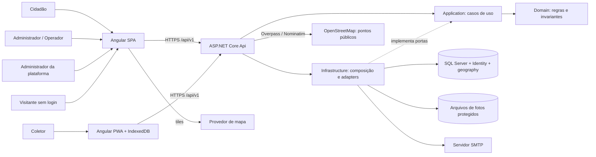
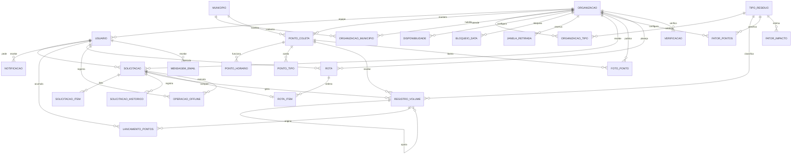
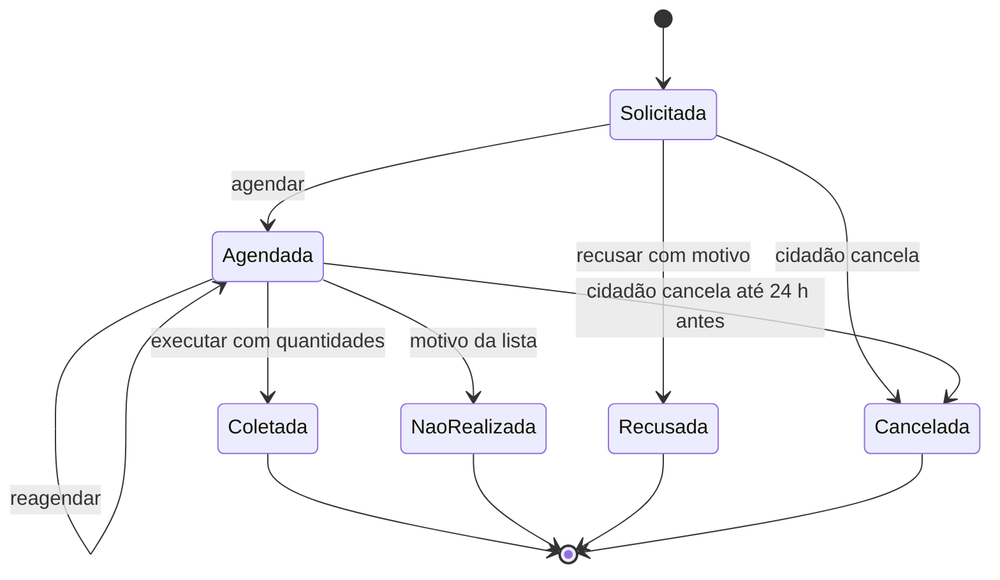
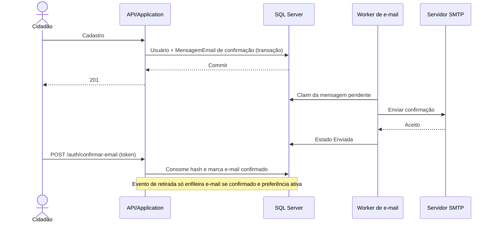
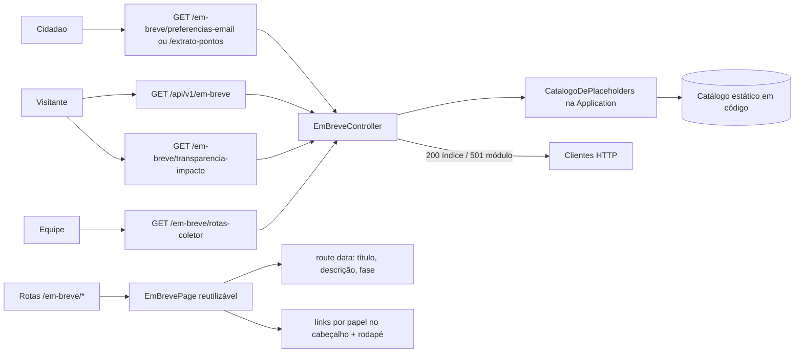

# TDD — Plataforma Web de Coleta Seletiva e Pontos de Descarte

- **Status:** v1 validada para SDD em 2026-11-10; **v1.1 e v2 validadas para SDD em 2026-11-14**, com aprovação explícita do documento completo. **Revisão de 2026-11-16:** acrescenta DT-35 (pontos de fontes públicas), validada pela ferramenta `question`. **Revisão de 2026-11-19:** acrescenta a seção 12 (placeholders de roadmap, DT-36 a DT-42), validada pela mesma ferramenta.
- **Data:** 2026-11-10 (v1, rascunho original de 2026-11-09); revisão de 2026-11-14 (v1.1 e v2).
- **Escopo:** desenho da v1, v1.1 e v2 do produto, sem implementação, instalações, provisionamento, commits ou PR.
- **Fonte de produto:** [docs/prd.md](prd.md) (v1, validado para TDD em 2026-11-10) e [docs/prd-desafios.md](prd-desafios.md) (v1.1 e v2, validado para TDD em 2026-11-14). Na v1: RF-01–RF-22, RNF-01–RNF-08, RN-01–RN-12, J-01–J-06 e CA-01–CA-12. Nos desafios: RF-01–RF-22, RNF-01–RNF-08, RN-01–RN-10, J-01–J-07 e CA-01–CA-12. Como os IDs locais se repetem entre os dois PRDs, este documento qualifica a origem (`docs/prd-desafios.md:RF-01`, por exemplo).
- **Pendências herdadas do PRD:** catálogo inicial de tipos e unidades, baseline e metas, retenção/base legal, fonte de municípios, provedor de mapa e fonte validada dos fatores de impacto. Não bloqueiam o desenho; condicionam piloto e produção.
- **Divergências PRD/TDD:** a v1 tratava Azure App Service/Azure SQL como candidatos (DT-18, DT-21); em 2026-11-14 o solicitante confirmou **MonsterASP.NET** com SQL Server do provedor. A decisão está registrada em DT-18, DT-21 e DT-33. Nenhuma divergência de produto.
- **Decisor conhecido:** solicitante, que respondeu às entrevistas técnicas de 2026-11-10 (v1) e 2026-11-14 (v1.1 e v2). Responsáveis nominais de engenharia, segurança, produto e operação não designados.
- **Autoria:** rascunho elaborado por assistente de IA. Decisões da v1 confirmadas pela ferramenta `question` em 2026-11-10; decisões de v1.1/v2 confirmadas pela mesma ferramenta em 2026-11-14. A stack segue o modelo `locadora-de-veiculos-2026` e a stack já usada no repositório. Não houve revisão técnica independente.
- **Governança:** `AGENTS.md` e `openspec/config.yaml` desta pasta. Fluxo PRD → TDD → SDD → PR, implementação somente em `app/`.
- **Como foi validado:** entrevistas técnicas pela ferramenta `question`, em 2026-11-10 (v1) e 2026-11-14 (v1.1/v2), com aprovação explícita do documento completo em cada etapa; o handoff das evoluções ao SDD foi liberado em 2026-11-14.

## 1. Resumo e objetivos técnicos

Construir uma SPA Angular e uma API .NET para organizações gestoras de resíduos (tenants isolados) e cidadãos: pontos de descarte com geolocalização, consulta pública, janelas de retirada com capacidade, execução de retiradas, registro imutável de volumes, painel e relatórios. O desenho prioriza isolamento entre organizações, consistência da capacidade sob concorrência, privacidade dos dados pessoais — incluindo o mascaramento da PII da organização após o estado final — e relatórios verificáveis, antes de qualquer otimização de escala não demonstrada.

A revisão de 2026-11-14 estende o mesmo desenho para as evoluções v1.1 e v2: e-mail transacional, pontos e níveis, fotos de pontos, Coletor com PWA offline, rotas, impacto estimado e verificação de organizações. Essas evoluções preservam as decisões da v1 (isolamento, idempotência, PII mínima e auditoria) e acrescentam portas próprias para e-mail e arquivos, ledger de pontos, sincronização offline idempotente e um papel de administração da plataforma sem acesso a dados pessoais.

### 1.1 Restrições

Confirmadas pela governança do repositório (`AGENTS.md`):

- Código, testes e configurações da aplicação ficam em `app/`; documentos e governança permanecem na raiz.
- Artefatos em português do Brasil; fluxo PRD → TDD → SDD → PR.

Confirmadas na entrevista técnica de 2026-11-10:

- Todo o escopo P0 integra a v1; P1 também pertence à v1, mas é entregue por último (fase F5).
- Desenvolvimento local primeiro; produção e hospedagem são gates posteriores.
- Fuso por organização, padrão `America/Sao_Paulo`; sem integração externa de negócio, exceto a leitura somente leitura de pontos públicos do OpenStreetMap (DT-35).
- O roadmap F0–F6 foi mantido para a v1, com P0 em F4, P1 e piloto em F5 e produção em F6.

Confirmadas na entrevista técnica de 2026-11-14 (v1.1 e v2):

- v1.1 e v2 são desenhadas em conjunto, com escopo P0/P1 do PRD de desafios e roadmap F7–F10.
- Produção no **MonsterASP.NET**, com SQL Server do provedor e SPA servido pela própria API na mesma origem.
- E-mail transacional por porta própria com adapter SMTP; fotos em arquivos locais protegidos com metadados no SQL; demais recomendações técnicas confirmadas em bloco (seção 2.2).
- A implementação de v1.1/v2 continua condicionada à estabilidade da v1 e a especificações SDD próprias.

### 1.2 Limites

O desenho cobre a v1 (F0–F6) e as evoluções v1.1/v2 (F7–F10): e-mail transacional, pontos e níveis, fotos de pontos, perfil e PWA do Coletor com execução offline, rotas, impacto estimado e verificação de organizações.

Ficam fora do desenho: resgate de pontos por dinheiro, descontos ou prêmios; ranking público com nome real; SMS e aplicativos de mensagem; aplicativo nativo de loja; otimização exata de rotas ou roteirização com trânsito em tempo real; emissão de certificados ou manifestos de destinação; integrações municipais; marketplace de materiais; pagamentos; geocodificação de endereços; conversão de unidades; recuperação de senha por e-mail.

A leitura de pontos do OpenStreetMap (DT-35) é somente leitura, opcional por configuração e nunca substitui o cadastro das organizações. Importar pontos externos para o banco, permitir sua edição ou usá-los em retiradas e volumes permanece fora do escopo.
Nenhuma meta de carga, latência, disponibilidade, cobertura percentual, RPO ou RTO foi aprovada. Não se afirma conformidade legal, acessibilidade certificada nem prontidão operacional. Valores de fatores de impacto não são definidos neste documento; apenas o mecanismo versionado e a exigência de fonte validada.

## 2. Decisões técnicas centralizadas

Todas as decisões abaixo estão **Confirmadas** pelas entrevistas técnicas de 2026-11-10 (DT-01 a DT-23) e de 2026-11-14 (DT-24 a DT-34), conduzidas pela ferramenta `question`. Versões exatas de pacotes e ferramentas não são fixadas aqui: a matriz é verificada e travada nas fases F0 e F7–F10, sem instalar nada neste fluxo.

| ID | Tema e decisão | Estado, justificativa e alternativa | Consequências |
| --- | --- | --- | --- |
| DT-01 | Frontend Angular (linha estável vigente; o modelo usa Angular 22, Node 24 e TypeScript 6.0), standalone, zoneless, Signals, RxJS, npm | Confirmada (2026-11-10). Alinhado ao modelo. Alternativa: ASP.NET Core MVC com Razor, mais simples, porém com menos interatividade para mapa e filtros | Fixar versões compatíveis e lockfile em F0; sem Zone.js |
| DT-02 | Tailwind CSS 4, componentes próprios acessíveis, formulários reativos tipados; mapa com Leaflet e tiles OpenStreetMap (provedor substituível) e lista equivalente sempre disponível | Confirmada (2026-11-10). Evita kit visual pesado e atende RNF-04. Alternativa: Angular Material ou Google Maps, com mais componentes ou chave e custo | Equipe assume acessibilidade e testes de componentes; política de uso dos tiles precisa de revisão antes do piloto |
| DT-03 | C# e .NET (LTS vigente; o modelo usa .NET 10), ASP.NET Core com controllers REST, monólito modular em Clean Architecture, solução `.slnx` | Confirmada (2026-11-10). Alinhada à stack conhecida. Microserviços acrescentariam coordenação sem necessidade | Domain e Application independentes de transporte e infraestrutura; uma unidade de deploy |
| DT-04 | EF Core, SQL Server (2022 Developer local em container; produção no SQL Server 2025 do provedor), ASP.NET Core Identity; NetTopologySuite para tipos espaciais | Confirmada (2026-11-10), com produção ajustada em 2026-11-14. Banco compartilhado facilita transações e locks. Alternativa: PostgreSQL com PostGIS, melhor para GIS, porém fora da stack dominada | Developer não é licença de produção; compatibilidade com SQL Server 2025 do provedor será ensaiada antes do rollout (DT-33) |
| DT-05 | Identity para credenciais; JWT de acesso de 15 minutos; refresh opaco rotativo com hash em SQL, em cookie HttpOnly, Secure e SameSite=Strict; logout revoga a família de refresh; SPA e API na mesma origem | Confirmada (2026-11-10). Equilíbrio entre segurança e esforço. Alternativa: consultar a sessão em toda chamada, que fecha a janela após logout ao custo de uma consulta por requisição | Após logout, o token de acesso vale até expirar (até 15 min); mesma origem exige proxy local e hospedagem do build pela API ou proxy equivalente (DT-20) |
| DT-06 | Autorização por policies: papéis Administrador, Operador, Cidadão, Coletor e Administrador da plataforma; claim de organização para os três primeiros papéis de organização; recursos do cidadão por dono; projeções de PII condicionadas ao estado da solicitação | Confirmada (2026-11-10), ampliada em 2026-11-14 com Coletor e Administrador da plataforma. Cobre RNF-01, RF-03, RF-04, RN-11 e RNF-06. A UI esconde ações, mas a API é a autoridade | Matriz de acesso testada por rota, incluindo pontos, relatórios, coletores, rotas e verificação; Coletor restrito às próprias rotas; Administrador da plataforma sem PII |
| DT-07 | Multitenancy por `OrganizacaoId`: filtros globais de leitura, guarda de escrita no `SaveChanges` e FKs compostas `(OrganizacaoId, Id)`; solicitações têm também `CidadaoId` | Confirmada (2026-11-10). Alternativa: banco ou schema por organização, com mais isolamento físico e custo operacional | SQL direto e consultas históricas exigem atenção; identificador recebido nunca determina a organização |
| DT-08 | Histórico: snapshots de endereço e contato na solicitação, histórico de estados, registros de volume append-only com ajustes, exclusão lógica, auditoria transacional; PII mascarada nas projeções da organização após o estado final | Confirmada (2026-11-10). Referências vivas sozinhas não preservam RNF-07, RF-22 e RN-11 | Mais armazenamento; política de retenção a definir; o cidadão continua vendo os próprios dados |
| DT-09 | Instantes em UTC (`datetimeoffset`); data local e período persistidos; fuso IANA por organização; `TimeProvider`; quantidades `decimal(12,3)` com transporte em string e sem arredondamento silencioso | Confirmada (2026-11-10). Evita ponto flutuante e dependência do fuso do servidor ou do navegador | Servidor é a autoridade; testes com relógio controlado |
| DT-10 | Transação com `UPDLOCK` e `HOLDLOCK` na linha da janela, contagem sob o lock, ordem determinística no reagendamento, índices únicos, `rowversion` com ETag e `Idempotency-Key` persistida | Confirmada (2026-11-10). Índice sozinho não protege contagem de capacidade. Alternativa: bloqueio por organização, mais simples e menos paralelo | Paralelismo por janela; medir antes de ajustar granularidade |
| DT-11 | Geolocalização com `geography` SRID 4326 e índice espacial; busca por raio com limite via POST (coordenadas fora de URLs e logs); posição escolhida pelo administrador no mapa; localização do cidadão não persistida; sem geocodificação externa | Confirmada (2026-11-10). Atende RNF-02. Alternativa: latitude e longitude decimais com Haversine, mais portável e sem índice espacial eficiente | Suporte do provider espacial verificado em F0; endereço textual continua obrigatório |
| DT-12 | DTOs, FluentResults e FluentValidation, com mapeamento manual (sem AutoMapper e sem MediatR); OpenAPI, `/api/v1`, ProblemDetails | Confirmada (2026-11-10). Na entrevista o solicitante escolheu AutoMapper e, depois, decidiu voltar ao mapeamento manual da proposta original. Evita dependência com licenciamento comercial recente (fato a verificar caso a escolha seja reconsiderada) | Mais código explícito e menos dependências; mapeamentos em métodos ou extensões dedicados, restritos a DTOs e cobertos por teste; invariantes continuam no domínio |
| DT-13 | Rotas `/publico/*` anônimas e somente leitura, com DTOs próprios sem dados pessoais, rate limiting, paginação com teto e cache curto | Confirmada (2026-11-10). Atende RF-09, RF-18, RNF-02 e RNF-08 | Superfície pública pequena e auditada; o CSV usa contrato próprio sem nome, telefone ou endereço |
| DT-14 | Notificações internas: tabela gravada na transação do evento; consulta periódica (polling) com parâmetro `desde` | Confirmada (2026-11-10). Simples e suficiente para a v1. SignalR fica como evolução | Latência igual ao intervalo de polling, a medir |
| DT-15 | Municípios: tabela global semeada a partir da lista oficial do IBGE (código, nome, UF) por migração versionada | Confirmada (2026-11-10). Evita texto livre e duplicatas. Fonte e licença a verificar em F0 | Atualizações do IBGE exigem nova migração |
| DT-16 | Relatórios por agregação em SQL sobre `RegistroVolume`; `DataLocal` persistida na gravação; CSV UTF-8 com BOM, separador `;`, decimais com vírgula, neutralização de fórmulas | Confirmada (2026-11-10). Abre direto no Excel pt-BR; formato a validar com usuários | Mudar o fuso da organização não reescreve o histórico |
| DT-17 | MSTest e Moq (domínio e aplicação), WebApplicationFactory com Testcontainers para SQL Server (integração), Vitest (frontend), Playwright (E2E) | Confirmada (2026-11-10). SQLite e EF InMemory não comprovam locks nem rowversion. Alternativa: xUnit | Docker necessário em desenvolvimento e CI |
| DT-18 | Serilog estruturado com redação de dados pessoais, health checks, New Relic opcional; **MonsterASP.NET** como alvo de produção, com SQL Server do provedor (DT-33) | Confirmada em 2026-11-10 e alterada em 2026-11-14: o alvo inicialmente indicado era Azure App Service/Azure SQL; o solicitante confirmou MonsterASP.NET para hospedagem e banco. Destino de logs, custos e SLO permanecem gates de F6 | Nenhum serviço comercial obrigatório até o piloto; observabilidade do provedor e retenção de logs a validar em F6 |
| DT-19 | Repositório da aplicação em `app/backend`, `app/frontend`, `app/e2e` e `app/infra`, com CI coordenada | Confirmada (2026-11-10). Separação clara entre API, SPA, testes ponta a ponta e infraestrutura. Alternativa: apenas backend e frontend, com testes e infraestrutura acoplados | Mais pastas e ferramentas; scripts e configuração de aplicação permanecem dentro de `app/` |
| DT-20 | Execução local com SDK .NET e Node no host, SQL Server 2022 Developer em container e SPA/API na mesma origem via proxy | Confirmada (2026-11-10). Compatível com cookie SameSite=Strict e depuração no host. Alternativa: Docker Compose para tudo, mais reproduzível e com mais overhead | Docker necessário para o SQL; a configuração de proxy será criada na implementação e verificada em F1 |
| DT-21 | GitHub Actions somente para CI; deploy de produção no **MonsterASP.NET** por Web Deploy ou pacote ZIP, com SQL Server do provedor e migrations aplicadas por script explícito (DT-33); sem provisionar ou publicar nesta etapa documental | Confirmada em 2026-11-10 e alterada em 2026-11-14: Azure App Service/Azure SQL deixaram de ser o alvo confirmado. A CI continua sem deploy automático. Alternativa: Git deploy do provedor, que exige repositório e credenciais adicionais | Nenhum ambiente de produção ou credencial é criado por este TDD; deploy é gate de F6 (v1) e F10 (v2), com autorização explícita |
| DT-22 | Segredos com user-secrets no desenvolvimento, variáveis de ambiente na CI e variáveis protegidas do painel do provedor em produção; nenhum segredo versionado | Confirmada (2026-11-10), com a produção ajustada ao MonsterASP.NET em 2026-11-14. Alternativa: cofre externo, que adiciona integração e custo | Chaves, connection strings e senhas ficam fora do repositório; rotação e acesso ao painel são gates de F6/F10 |
| DT-23 | Backup e restauração como gate de F5/F6, com teste de restore; frequência, retenção, RPO e RTO definidos por produto, segurança e operação antes de produção | Confirmada (2026-11-10). Evita inventar números sem contexto operacional. Alternativa: definir RPO/RTO agora, sem base de uso | Não há garantia de recuperação declarada neste TDD; o ensaio de restore é pré-requisito do piloto e da produção |
| DT-24 | E-mail transacional por porta `IEnvioDeEmail` na Application, com outbox `MensagemEmail` gravada na transação do evento, worker de envio com retry e adapter SMTP (MailKit) configurável; fake/outbox em testes e MailHog no desenvolvimento | Confirmada (2026-11-14). Mantém o domínio independente de provedor e evita envio dentro da transação de negócio. Alternativa: SDK de provedor por API, com mais recursos e dependência externa | Envio é assíncrono e nunca altera o estado da solicitação; falha esgotada vira estado de erro visível, sem perder a mensagem; token de confirmação é opaco e armazenado apenas como hash |
| DT-25 | Pontos por ledger append-only `LancamentoPontos`: crédito por volume real, fator vigente copiado no lançamento, correção por lançamento compensatório, idempotência por registro de volume e saldo calculado por soma; níveis por faixas configuráveis com vigência | Confirmada (2026-11-14). Auditoria e correção sem editar nem apagar; atende RN-01–RN-04 e RNF-04. Alternativa: saldo materializado, mais rápido porém sujeito a divergência | Crédito ocorre na mesma transação do registro de volume; sem fator não há pontos; saldo nunca fica negativo e o excedente de correção é registrado como pendência |
| DT-26 | Fotos de pontos em arquivos locais fora de `wwwroot`, caminho configurável, nomes opacos, metadados no SQL, validação por assinatura e decodificação com SkiaSharp, reencode para remover EXIF/GPS, limite por ponto e serving somente de fotos aprovadas | Confirmada (2026-11-14). Evita executar conteúdo enviado e não depende de storage externo. Alternativa: `varbinary` no SQL, com backup único e banco maior; ou object storage, com custo e credenciais | Pasta protegida entra no backup do site; original descartado após processamento; remoção é lógica para preservar auditoria e some imediatamente da consulta pública |
| DT-27 | Papel Coletor vinculado à organização; área do Coletor como PWA Angular instalável, com app shell em cache, IndexedDB via `idb` e dados locais cifrados com AES-GCM e chave não exportável mantida no dispositivo | Confirmada (2026-11-14). Atende RF-11, RF-14 e RNF-05. Alternativa: aplicativo nativo, fora do escopo; ou dados em claro, recusados por RNF-05 | Offline limita-se a rotas atribuídas e dados mínimos; logout apaga banco e chave; expiração por tempo; sem cache de dados pessoais de outros cidadãos ou de outras rotas |
| DT-28 | Rotas por organização, data e período, com estados Planejada/Em andamento/Concluída/Cancelada, itens ordenados por vizinho mais próximo (Haversine) e reordenação manual; vínculo ativo único por retirada | Confirmada (2026-11-14). Heurística simples e determinística, sem prometer ótimo. Alternativa: otimização exata, fora do escopo por custo e complexidade | Retiradas sem coordenadas ficam ao final; mudanças em retiradas atualizam a rota e notificam o coletor; concorrência protegida por versão e constraint |
| DT-29 | Sincronização offline em lote, com chave única gerada no dispositivo por operação, idempotência persistida no servidor, resultado por item e conflito que preserva a execução local até decisão | Confirmada (2026-11-14). Atende RF-15, RF-16, RN-07 e RN-08. Alternativa: fila única por requisição, com mais chamadas e pior experiência em rede instável | Reprocessar a mesma chave não duplica volume nem pontos; conflito não é aplicado automaticamente; ordem e versão do servidor prevalecem |
| DT-30 | Fatores de impacto globais e versionados por tipo, com valor, unidade, fonte, versão e vigência; cálculo na leitura sobre `RegistroVolume` real, com fator vigente na data de cada registro; tipos de unidades diferentes nunca são somados | Confirmada (2026-11-14). Atende RF-17–RF-19, RN-09 e RNF-07. Alternativa: gravar o impacto no volume, que engessa correções e mudanças de fator | Fatores são imutáveis: corrigir exige nova versão; estimativa sempre rotulada, com fonte, versão e limitação; sem fator não há estimativa |
| DT-31 | Novo papel Administrador da plataforma, sem organização e sem acesso a dados pessoais, com policies próprias para fila de verificação e fatores de impacto; primeiro usuário criado por configuração, sem rota pública | Confirmada (2026-11-14). Atende RF-20, RNF-06 e CA-09. Alternativa: papel acumulado com Administrador de organização, recusada por violar isolamento | Auditoria de todas as decisões; nenhuma rota de cidadão ou de organização é liberada por esse papel; provisionamento e rotação documentados no deploy |
| DT-32 | Verificação de organizações com estados Não verificada, Em análise, Verificada e Rejeitada; motivo obrigatório em rejeição/revogação, histórico append-only e auditoria; selo e prioridade na listagem pública | Confirmada (2026-11-14). Atende RF-21, RF-22 e RN-10. Alternativa: verificação automática, sem base de confiança suficiente | Organizações não verificadas continuam consultáveis e identificadas; rejeição e revogação exigem motivo; estado nunca é apagado |
| DT-33 | Deploy de produção no MonsterASP.NET: API .NET publicada com o build Angular em `wwwroot`, fallback de SPA excluindo `/api`, `/health` e `/swagger`, SQL Server do provedor, migrations por script idempotente com credencial de schema e segredos em variáveis do painel | Confirmada (2026-11-14). Mantém a mesma origem exigida por DT-05/DT-20 e evita proxy adicional. Alternativa: site IIS separado com proxy, mais peças e mesma origem a manter | Publicação por Web Deploy ou ZIP; rollback por pacote anterior e migrations compatíveis; banco do provedor é SQL Server 2025 e a compatibilidade será ensaiada antes do rollout |
| DT-34 | Código pessoal do cidadão opaco, em Crockford Base32 com dígito verificador, gerado pelo servidor, único e sem dados pessoais; QR Code renderizado no cliente; consulta pelo Operador com limite de taxa e sem expor o cadastro | Confirmada (2026-11-14). Atende RF-06 (P1) e RNF-02. Alternativa: usar e-mail ou CPF, recusada por privacidade | Regenerar invalida o código anterior; código nunca é usado como autenticação; leitura por câmera é conveniência e exige confirmação do operador |
| DT-35 | Pontos de fontes públicas: porta `IFontePublicaDePontos` na Application, adaptador `OverpassFontePublicaDePontos` na Infrastructure lendo `amenity=recycling` do OpenStreetMap via Overpass, Nominatim apenas para resolver o município em caixa geográfica, mescla na consulta pública antes da paginação, cache em memória, timeout curto, deduplicação por nome e proximidade, atribuição ODbL e degradação para apenas os pontos cadastrados | Confirmada (2026-11-16). Atende RF-23 e mantém RF-09. Alternativa: dataset municipal por cidade, com cobertura limitada; ou importar para o banco, que voltaria a depender de dados criados no banco | Nenhum ponto externo é persistido, editável ou usado em retiradas; a fonte só é consultada com recorte geográfico; indisponibilidade vira aviso, nunca erro da consulta |

### 2.1 Registro da entrevista técnica

A entrevista técnica foi conduzida pela ferramenta `question` em 2026-11-10, em duas rodadas nesta etapa, complementando a rodada anterior que confirmou 14 decisões. Todas as decisões `DT-01` a `DT-23` estão confirmadas; nenhuma escolha estrutural permanece como proposta. No backend, o solicitante escolheu AutoMapper em rodada anterior e voltou ao mapeamento manual; as demais respostas desta etapa coincidiram com as recomendações apresentadas.

| Tema | Resposta do solicitante | DT |
| --- | --- | --- |
| Linguagem e frontend | C# + API .NET com Angular standalone, zoneless, Signals e RxJS | DT-01, DT-03 |
| UI e componentes | Tailwind CSS 4, componentes próprios acessíveis e Leaflet/OpenStreetMap com lista equivalente | DT-02 |
| Bibliotecas do backend | FluentResults + FluentValidation + mapeamento manual | DT-12 |
| Arquitetura | Clean Architecture, monólito modular | DT-03 |
| Persistência e identidade | EF Core + SQL Server 2022 Developer + ASP.NET Core Identity + NetTopologySuite | DT-04 |
| Autenticação e sessão | Identity + JWT de 15 min + refresh rotativo em cookie | DT-05 |
| Autorização | Policies + claims + ownership, com projeção de PII por estado | DT-06 |
| Isolamento entre organizações | `OrganizacaoId` + filtros globais + FKs compostas | DT-07 |
| Histórico e volumes | Snapshots + histórico de estados + volume append-only + auditoria transacional | DT-08 |
| Geolocalização e mapa | `geography` no SQL Server + Leaflet/OpenStreetMap | DT-02, DT-11 |
| Fonte de municípios | Tabela global semeada com a lista oficial do IBGE | DT-15 |
| Concorrência de capacidade | Lock na linha da janela (`UPDLOCK`/`HOLDLOCK`) + idempotência | DT-10 |
| Precisão de quantidades | `decimal(12,3)`, transporte em string, sem arredondamento | DT-09 |
| Relatórios e CSV | Agregação em SQL; UTF-8 com BOM, `;`, vírgula decimal e neutralização de fórmulas | DT-16 |
| Notificações internas | Tabela + polling com parâmetro `desde` | DT-14 |
| API pública | DTOs públicos, rate limiting, paginação com teto e cache curto | DT-13 |
| Observabilidade | Serilog + health checks, New Relic opcional | DT-18 |
| Testes | MSTest + Moq, Testcontainers, Vitest e Playwright | DT-17 |
| Estrutura em `app/` | `app/backend`, `app/frontend`, `app/e2e` e `app/infra` | DT-19 |
| Execução local | SDK no host + SQL Server em container + SPA e API na mesma origem | DT-20 |
| CI e deploy | GitHub Actions somente para CI; MonsterASP.NET com Web Deploy/ZIP como gate posterior | DT-21, DT-33 |
| Segredos | User-secrets no desenvolvimento, variáveis na CI e cofre gerenciado em produção | DT-22 |
| Backup e recuperação | Baseline em F5/F6, com teste de restore e RPO/RTO definidos antes de produção | DT-23 |
| Roadmap | Manter F0–F6, com P0 em F4, P1/piloto em F5 e produção em F6 | seção 9 |

As versões exatas de Angular, Node, TypeScript, Tailwind, .NET, EF Core, provider espacial e demais pacotes serão verificadas em fontes oficiais e travadas na fase F0 (seção 11).

### 2.2 Registro da entrevista técnica de 2026-11-14 (v1.1 e v2)

A entrevista de 2026-11-14 confirmou as decisões estruturais das evoluções e autorizou as recomendações técnicas restantes em bloco. Todas as decisões `DT-24` a `DT-34` estão **Confirmadas**; não há escolha estrutural proposta.

| Tema | Resposta do solicitante | DT |
| --- | --- | --- |
| Documento e escopo | Mesclar em `docs/tdd.md`, preservando a v1; v1.1 e v2 juntas | Cabeçalho, seção 9 |
| Hospedagem e deploy | MonsterASP.NET como alvo de produção, com o build Angular servido pela API na mesma origem; SQL Server do provedor; deploy manual por Web Deploy/ZIP; CI apenas | DT-18, DT-21, DT-33 |
| Roadmap | Quatro fases F7–F10: e-mail; pontos e fotos; coletor, rotas e offline; impacto, verificação e administração da plataforma | seção 9 |
| E-mail | Porta própria com outbox e adapter SMTP, fake em testes e MailHog no desenvolvimento | DT-24 |
| Fotos | Arquivos locais protegidos, metadados no SQL, serving somente de aprovadas | DT-26 |
| Demais decisões | Ledger de pontos, faixas configuráveis, código Crockford Base32 com QR no cliente, SkiaSharp, IndexedDB/idb, sincronização idempotente, vizinho mais próximo com Haversine, administrador da plataforma por configuração, fatores versionados e testes com MailHog | DT-25, DT-27–DT-34 |

As versões de MailKit, SkiaSharp, `idb`, biblioteca de QR Code e ferramentas de PWA serão verificadas em fontes oficiais e travadas nas fases F7–F10, sem contornar compatibilidade com Angular 22 e .NET 10.

### 2.3 Registro da entrevista técnica de 2026-11-16 (fontes públicas)

A revisão de RF-23 foi decidida pela ferramenta `question` em 2026-11-16, com quatro respostas.

| Tema | Resposta do solicitante | DT |
| --- | --- | --- |
| Fonte real de pontos | OpenStreetMap via Overpass API, sem chave de API e com licença ODbL | DT-35 |
| Exibição | Sempre mesclados aos pontos cadastrados, identificados como fonte externa | DT-35 |
| Recorte geográfico | Apenas com município selecionado ou localização e raio informados | DT-35 |
| Fluxo | PRD → TDD → SDD → PR em feature branch, sem abrir PR sem autorização | Governança |

## 3. Arquitetura e estrutura

### 3.1 Componentes



As setas indicam fluxo ou composição. Dependências de compilação: Application → Domain; Infrastructure → Application e Domain; Api → Application e Infrastructure apenas para composição. Domain não referencia EF, Identity, HTTP, SMTP, arquivos nem Angular. A Api não contém regras de negócio. O navegador conversa com o provedor de mapa apenas para tiles e nunca envia dados pessoais a ele. O PWA do Coletor é o mesmo projeto Angular, com service worker e armazenamento local; não há backend separado.

| Módulo | Responsabilidade | RF |
| --- | --- | --- |
| Acesso | Registro de organização e cidadão, login, refresh, logout, equipe e papéis | RF-01–05 |
| Organização e catálogo | Perfil, municípios, períodos, publicação, tipos habilitados | RF-06–07 |
| Pontos | Gestão de pontos, horários, tipos aceitos e município atendido pelo Administrador; consulta pública e proximidade; leitura de opções para recebimento pelo Operador | RF-08–09, RF-22 |
| Retiradas | Disponibilidade, bloqueios, janelas, solicitação, triagem, execução e mascaramento de PII após estado final | RF-10–14; RN-11–12 |
| Volumes | Registro, ajuste, imutabilidade | RF-15–16 |
| Relatórios | Painel e CSV exclusivos do Administrador; transparência pública | RF-17–19 |
| Notificações e conta | Notificações internas; exclusão com anonimização e bloqueio por solicitação aberta | RF-20–21 |
| E-mail | Confirmação de endereço, preferências, outbox e envio assíncrono de eventos | RF-01–03 |
| Pontos e níveis | Fatores por tipo, ledger de pontos, correções, extrato e faixas de nível | RF-04–08 |
| Fotos | Upload, validação, remoção de metadados, aprovação e serving público de fotos aprovadas | RF-09–10 |
| Coletor e rotas | Papel Coletor, PWA instalável, rotas e ordem sugerida | RF-11–14 |
| Offline e sincronização | Execução local, chave idempotente, sincronização em lote e conflitos | RF-15–16 |
| Impacto | Fatores versionados, estimativa e transparência | RF-17–19 |
| Administração da plataforma | Verificação de organizações, selo e prioridade | RF-20–22 |
| Transversal | Contexto de organização, auditoria, idempotência, relógio, erros | RNF-01–08 |

Um `DbContext` derivado de `IdentityDbContext` abriga identidade e negócio, permitindo transação única no registro. A Application depende de portas específicas de consulta e persistência e de uma unidade de trabalho; evitar repositório genérico que esconda locks. O relógio é abstraído por `TimeProvider`. Portas próprias isolam e-mail e armazenamento de fotos da infraestrutura.

### 3.2 Organização futura, não criada nesta entrega

```text
app/
  backend/
    ColetaSeletiva.slnx
    src/ColetaSeletiva.Domain/
    src/ColetaSeletiva.Application/
    src/ColetaSeletiva.Infrastructure/
    src/ColetaSeletiva.Api/
    tests/ColetaSeletiva.Domain.Tests/
    tests/ColetaSeletiva.Application.Tests/
    tests/ColetaSeletiva.IntegrationTests/
    global.json
    Directory.Packages.props
  frontend/
    src/app/core/            # sessão, HTTP, erros, offline
    src/app/shared/          # controles acessíveis, formatação, mapa, fotos
    src/app/features/        # publico, acesso, organizacao, pontos, retiradas, volumes, painel, cidadao, email, pontos, fotos, coletor, rotas, impacto, plataforma
    public/manifest.webmanifest
    src/service-worker.ts
    package.json
    package-lock.json
  e2e/
    tests/
  infra/
    compose.yaml             # SQL Server local e volumes; sem segredos reais
  scripts/                   # verificações da aplicação
# raiz do repositório
.github/workflows/           # CI que invoca as verificações de app/
docs/prd.md
docs/prd-desafios.md
docs/tdd.md
openspec/
```

Migrations pertencem à Infrastructure. Um workflow em `.github/workflows/` apenas invocará as verificações de `app/`, conforme DT-19 e DT-21. A solução não cria contêineres de API ou SPA no desenvolvimento; o SQL Server local é o único serviço em contêiner (DT-20).

### 3.3 Frontend

Rotas lazy por funcionalidade, quatro áreas (pública, cidadão, organização e coletor) e administração da plataforma, componentes standalone e estado por serviços com Signals. Guards melhoram a navegação, mas não substituem a autorização da API. O interceptor envia o token somente para a origem da API. A área da organização esconde do Operador a gestão de pontos, equipe, configurações, fatores de pontos e relatórios, mas a API continua sendo a autoridade; após o estado final de uma solicitação, a tela da organização não exibe nome, telefone ou endereço do cidadão, e o cidadão continua vendo os próprios dados. O Coletor vê somente as rotas atribuídas a ele e nunca a gestão da organização.

O mapa é um componente isolado com alternativa em lista, ambos alimentados pela mesma fonte de dados e com os mesmos filtros. A busca por proximidade só pede a localização do dispositivo após ação explícita e trata a recusa da permissão sem bloquear os demais filtros. Listagens têm estados carregando, vazio e erro, paginação e filtros. Formulários mostram resumo e erros por campo, preservam o foco e não dependem apenas de cor. Moeda não se aplica; quantidades e datas são formatadas em português do Brasil, com datas no fuso da organização. Não há SSR.

A área do Coletor é um PWA instalável: manifest, service worker com app shell versionado, tela de estado offline e contador de sincronizações pendentes. O service worker nunca cacheia respostas autenticadas de `/api`; os dados da rota vêm de IndexedDB cifrado (DT-27). A instalação é opcional e a área web continua funcional sem ela. Quando não há rede, a execução usa os dados baixados; ao reconectar, a fila é enviada em lote e cada item mostra aplicado, conflito ou erro. Conflitos permanecem no dispositivo até decisão explícita do Coletor (DT-29).

## 4. Dados e persistência

### 4.1 Convenções

- IDs opacos GUID gerados pelo servidor, sem função de autorização.
- Tabelas da organização: `Id`, `OrganizacaoId`, criação e alteração em UTC e `rowversion` nas entidades mutáveis. Cadastros excluíveis têm `ExcluidoEmUtc`.
- Chave alternativa `(OrganizacaoId, Id)` nas entidades da organização para FKs compostas.
- Textos com tamanhos máximos declarados no schema e no OpenAPI, definidos nas specs; nunca truncar dados silenciosamente. Documentos e nomes comparáveis têm representação normalizada.
- Quantidades `decimal(12,3)`; capacidade e limites inteiros não negativos. Rejeitar excesso de escala em vez de arredondar.
- Instantes `datetimeoffset` em UTC; `DataLocal` como `date` e `Periodo` como enumeração.
- Endereços de ponto e de retirada usam UF e município do catálogo IBGE; bairro, rua, número, complemento, CEP e referência permanecem textuais e são copiados no snapshot da solicitação quando aplicável.

### 4.2 Modelo lógico

| Entidade | Campos e relações relevantes |
| --- | --- |
| Organizacao | Nome, tipo, contato público, fuso IANA, publicada, transparência habilitada, limite de solicitações abertas, `slug` público, estado de verificação e motivo |
| Usuario (Identity) | `OrganizacaoId` (nulo para Cidadão e Administrador da plataforma), papel (Administrador, Operador, Coletor, Cidadão ou Administrador da plataforma), nome, telefone (Cidadão), ativo, troca de senha pendente, anonimização e data |
| RefreshToken | Usuário, família, hash, expiração, consumo e revogação para detectar replay |
| TipoResiduo | Catálogo global: código, nome, categoria, unidade fixa, orientações |
| OrganizacaoTipo | Organização, tipo, aceita retirada domiciliar |
| Municipio / OrganizacaoMunicipio | Catálogo IBGE global; municípios atendidos por organização |
| PeriodoRetirada | Organização, período (Manhã 08:00–12:00 e Tarde 13:00–17:00 por padrão), início e fim locais |
| PontoColeta | Organização, nome, município atendido, endereço, `Localizacao` geography, observações, status, exclusão lógica |
| PontoHorario / PontoTipo | Um ou mais intervalos no mesmo dia da semana, sem atravessar a meia-noite; tipos aceitos como subconjunto não vazio dos habilitados |
| DisponibilidadeRetirada / BloqueioData | Capacidade por dia da semana e período; datas bloqueadas; bloqueio não cancela solicitações existentes |
| JanelaRetirada | Organização, `DataLocal`, período; linha criada sob demanda e usada como âncora de lock |
| SolicitacaoRetirada | Organização, cidadão, snapshot de nome, telefone e endereço, janela, estado, motivo, versão; PII visível à organização somente em Solicitada ou Agendada |
| SolicitacaoItem / SolicitacaoHistorico | Tipo e quantidade estimada; transições com ator, instante e motivo |
| RegistroVolume | Organização, tipo, `Quantidade` (com sinal apenas em ajuste), origem, referências, operador e nome copiado, `OcorridoEmUtc`, `DataLocal`, motivo |
| Notificacao | Destinatário, evento, referência, lida |
| Auditoria | Organização, ator, instante, ação, entidade e ID, correlação, campos alterados sem valores pessoais |
| ComandoIdempotente | Organização ou cidadão, operação, chave, hash do comando, estado e referência ao resultado |
| ConfirmacaoEmail | Cidadão, e-mail normalizado, hash do token, expiração, confirmado em; token de uso único |
| PreferenciaEmail | Cidadão, tipo de evento, ativo; opt-out global para link de cancelamento |
| MensagemEmail | Organização (quando houver), destinatário, tipo, referência, chave idempotente, template e versão, estado, tentativas, próxima tentativa, último erro sanitizado |
| FatorPontos | Organização, tipo, fator `decimal(12,3)`, vigência inicial e final; sem sobreposição por tipo |
| LancamentoPontos | Cidadão, organização, `RegistroVolumeId`, fator copiado, pontos inteiros, tipo (crédito, correção, pendência), instante e motivo |
| FaixaNivel | Nome, pontos mínimos, ordem; faixas globais configuradas pela plataforma, sem valores fixos neste TDD |
| CodigoCidadao | Cidadão, código opaco único com dígito verificador, ativo e data de geração; regeneração invalida o anterior |
| FotoPonto | Organização, ponto, nome opaco do arquivo, tipo e tamanho, largura e altura, hash, estado (pendente, aprovada, rejeitada, removida), motivo, autor e datas |
| Rota | Organização, `DataLocal`, período, coletor atribuído, estado, versão, instante de início e conclusão |
| RotaItem | Rota, solicitação, ordem, distância sugerida; vínculo ativo único por solicitação |
| OperacaoOffline | Organização, coletor, chave do dispositivo, solicitação, quantidades, versão esperada, instante local, resultado e motivo do conflito |
| FatorImpacto | Tipo, valor `decimal(18,6)`, unidade, fonte, versão, vigência; imutável |
| VerificacaoOrganizacao | Organização, estado, motivo, responsável, instante; histórico append-only |



O diagrama omite tabelas transversais para legibilidade. Em `SOLICITACAO`, o usuário é sempre um Cidadão. Cada solicitação referencia uma organização e uma janela; cada registro de volume referencia exatamente uma origem. `ROTA` pertence a uma organização e é executada por um Coletor da mesma organização; `OPERACAO_OFFLINE` pertence ao Coletor e à solicitação, com chave única por dispositivo. `LANCAMENTO_PONTOS` referencia um registro de volume e copia o fator usado; `FATOR_IMPACTO` é global e não pertence a organização.

### 4.3 Invariantes e índices

- Índices únicos globais de usuário e e-mail normalizados.
- Nome de ponto único por organização, incluindo excluídos logicamente, sem restaurar nem sobrescrever registros.
- `(OrganizacaoId, DataLocal, Periodo)` único em `JanelaRetirada`.
- `(OrganizacaoId, DiaSemana, Periodo)` único em `DisponibilidadeRetirada`.
- `(OrganizacaoId, MunicipioId)` único em `OrganizacaoMunicipio` e `(OrganizacaoId, TipoResiduoId)` único em `OrganizacaoTipo`, permitindo FKs compostas.
- `PontoColeta` referencia `(OrganizacaoId, MunicipioId)` de `OrganizacaoMunicipio`, impedindo ponto em município não atendido; `PontoTipo` referencia `(OrganizacaoId, TipoResiduoId)` de `OrganizacaoTipo` e `(OrganizacaoId, PontoId)` de `PontoColeta`.
- `PontoHorario` exige `HoraFim > HoraInicio` no mesmo dia; intervalos não podem atravessar a meia-noite. Vários intervalos no mesmo dia são permitidos.
- A existência de ao menos um `PontoTipo` e de ao menos um `PontoHorario` é validada na transação de criação e edição, pois não é expressável como check de linha.
- Remover um município atendido ou desabilitar um tipo é bloqueado enquanto houver ponto que o referencie; a resposta orienta a retirar ou ajustar os pontos antes, sem apagar histórico.
- Índices para `(OrganizacaoId, Estado, DataLocal, Periodo)` em solicitações, `(CidadaoId, Estado)` para o limite de abertas, `(OrganizacaoId, TipoResiduoId, DataLocal)` em volumes e índice espacial em `PontoColeta.Localizacao`.
- Checks em `RegistroVolume`: origem Retirada exige `SolicitacaoId`; Recebimento exige `PontoId`; Ajuste exige `RegistroOriginalId` e motivo e `Quantidade <> 0`; nas demais origens `Quantidade > 0`.
- O total de um registro (original mais ajustes) não fica negativo: verificado dentro da transação, com lock sobre a linha do registro original.
- FKs sem cascade físico. Exclusão lógica aplica RF-22 e nunca remove registros de volume.
- `RegistroVolume` é append-only: além da aplicação, avaliar em F2 negar `UPDATE` e `DELETE` ao login da API por permissão SQL ou trigger.
- `ConfirmacaoEmail`: token armazenado apenas como hash, uso único, expiração configurável; um endereço confirmado por cidadão não pode ser reutilizado para confirmar outro cadastro; e-mail normalizado é único globalmente, como na v1.
- `MensagemEmail`: chave idempotente única por `(Tipo, ReferenciaId, DestinatarioId, TemplateVersao)`; índices para estado e próxima tentativa; mensagem enviada não é reenviada; falha esgotada fica em estado `Falhou` e pode ser reenfileirada por operação administrativa auditada.
- `FatorPontos`: vigência sem sobreposição por `(OrganizacaoId, TipoResiduoId)`; fator não é editado após gerar lançamento, apenas encerrado e substituído; fator maior ou igual a zero.
- `LancamentoPontos`: append-only; `(RegistroVolumeId, TipoLancamento)` lógico único para o crédito inicial e chave idempotente por operação; correções referenciam o lançamento ou o registro original; saldo é a soma dos lançamentos e nunca é persistido como campo editável.
- Ajuste de volume que reduziria o saldo abaixo de zero gera lançamento de correção até zero e um lançamento de pendência com o excedente; a pendência não é somada ao saldo nem ao nível e exige tratamento administrativo.
- `FaixaNivel`: pontos mínimos únicos e crescentes; faixas globais sem valores fixos no TDD; nível é derivado por consulta, não gravado no usuário.
- `CodigoCidadao`: código único global, imutável enquanto ativo; regeneração marca o anterior como inativo na mesma transação; código não é credencial de autenticação.
- `FotoPonto`: no máximo N fotos ativas por ponto, com N configurável; `(PontoId, Hash)` evita duplicata idêntica; o nome do arquivo é opaco e não contém nome do ponto, do cidadão ou da organização.
- `Rota`: `(OrganizacaoId, DataLocal, Periodo, ColetorId)` pode se repetir apenas se as rotas anteriores estiverem canceladas/concluídas; `RotaItem` tem `(RotaId, Ordem)` única e vínculo ativo único por `SolicitacaoId`.
- `OperacaoOffline`: chave única por `(OrganizacaoId, ColetorId, ChaveDispositivo)`; reenvio retorna o resultado original; conflito não altera a solicitação, o volume nem os pontos.
- `FatorImpacto`: versão única por `(TipoResiduoId, Versao)`; vigência sem sobreposição por tipo; imutável após uso; unidade obrigatória e igual à unidade do tipo.
- `VerificacaoOrganizacao`: histórico append-only; estado corrente na organização é derivado do último registro; toda transição exige ator e motivo quando rejeita ou revoga.
- `Auditoria` cobre e-mail (envio, falha, opt-out), pontos (crédito, correção, pendência), fotos (upload, aprovação, rejeição, remoção), rotas, sincronizações, fatores de impacto e verificação, sem conteúdo pessoal em campos de valores.

### 4.4 Histórico e privacidade dos dados

Na criação da solicitação, copiar nome, telefone e endereço do cidadão. Edições posteriores do perfil não alteram solicitações existentes. Cada mudança de estado grava uma linha de histórico com ator e instante.

A visibilidade da PII segue RN-11 e é aplicada na projeção da API, não no armazenamento: a organização vê nome, telefone e endereço apenas enquanto a solicitação está em Solicitada ou Agendada; após Coletada, Não realizada, Recusada ou Cancelada, as respostas da organização omitem ou mascaram esses campos e mantêm os dados operacionais, o histórico e os volumes. O cidadão continua vendo os próprios dados em qualquer estado. Rotas públicas e CSV nunca usam o modelo com PII. Consultas da organização não devem reutilizar DTO interno completo nem permitir exclusão de campos na UI como única proteção.

`DataLocal` do volume é calculada na gravação com o fuso vigente da organização e nunca recalculada; mudar o fuso afeta apenas registros futuros e deve ser informado ao administrador.

Na exclusão de conta (RF-21), os campos pessoais do usuário e os snapshots das suas solicitações são anonimizados por valores neutros; registros de volume, que nunca contêm dados pessoais, permanecem. A conta só pode ser anonimizada se não houver solicitação em Solicitada ou Agendada; a resposta explica o bloqueio. O e-mail anonimizado recebe valor sintético único para preservar a restrição de unicidade.

Bloquear uma data e despublicar a organização não alteram o estado nem anonimizam solicitações existentes; apenas impedem novas solicitações e removem a visibilidade pública, respectivamente (RN-12).

E-mail: o conteúdo usa apenas o mínimo necessário (nome de tratamento, tipo de evento, data/período e link), nunca endereço completo, telefone, coordenadas ou dados de outra pessoa. O token de confirmação e o de opt-out são opacos, de uso único e armazenados como hash; links não carregam e-mail em claro. O opt-out global desativa todos os eventos, mas mantém mensagens transacionais de segurança quando aplicáveis.

Pontos: o extrato é visível somente ao próprio cidadão. O lançamento guarda o fator copiado e o instante, sem recalcular com fator futuro. O código do cidadão não contém nome, e-mail, CPF, telefone nem organização; a consulta pelo Operador retorna apenas o necessário para creditar um recebimento.

Fotos: a imagem publicada é uma versão reencodada sem EXIF, GPS, data ou identificação do aparelho. O original não é servido nem mantido após o processamento; a foto rejeitada ou removida não aparece em nenhuma rota pública. O upload é acessível apenas a Administrador e Operador da organização do ponto.

Coletor e offline: o dispositivo guarda somente as rotas atribuídas ao Coletor e os dados mínimos para executá-las (nome, endereço e telefone do cidadão daquela retirada), cifrados em repouso com AES-GCM e chave não exportável. Logout, expiração configurada ou remoção da instalação apagam banco, chave e fila de pendências. Não há cache de dados de outras rotas, outros coletores ou outras organizações; o service worker não cacheia respostas autenticadas da API.

Administrador da plataforma: não recebe PII de cidadãos, não acessa solicitações, volumes, endereços nem contatos; vê apenas dados cadastrais públicos da organização, a fila de verificação e fatores de impacto. O provisionamento do primeiro usuário é feito por configuração e auditado, sem rota pública de cadastro.

Impacto: a estimativa é agregada por tipo e período, sem identificação de cidadão, endereço ou retirada individual na resposta pública.

### 4.5 Transações e concorrência

Toda mutação que afeta capacidade (criar, reagendar, cancelar, recusar, concluir ou marcar como não realizada) ocorre em transação que adquire `UPDLOCK` e `HOLDLOCK` na linha de `JanelaRetirada`, criada sob demanda: tentativa de inserção protegida pelo índice único e releitura sob lock. A ocupação é contada sob o lock a partir das solicitações em Solicitada ou Agendada. O reagendamento trava as duas janelas em ordem fixa (`DataLocal`, depois `Periodo`) para evitar deadlock.

A mesma transação grava solicitação, itens, histórico, notificações, auditoria e resultado idempotente. Transações são curtas, sem chamadas externas. Conflitos de constraint viram erro de negócio, nunca resposta SQL crua. Deadlock ou erro transitório permite repetição limitada da transação inteira com a mesma chave idempotente. Conflito de ETag exige recarregar, sem repetição automática.

A criação ou edição de ponto valida, na mesma transação, município atendido e ao menos um tipo habilitado; horários são validados quanto ao mesmo dia e à ordem entre início e fim. A retirada lógica de ponto ou operador não apaga histórico nem volumes.

Bloqueio de data e despublicação são atualizações de configuração que não percorrem nem alteram solicitações existentes. A consulta de novas solicitações passa a considerar a data bloqueada; a despublicação remove a organização da consulta pública. Solicitações em Solicitada ou Agendada continuam acessíveis à organização e ao cidadão.

A execução de retirada grava a mudança de estado e todos os registros de volume na mesma transação (RNF-03). Ajustes travam o registro original antes de verificar o total.

Crédito de pontos ocorre na mesma transação do registro de volume de origem retirada (RNF-04): ou o volume e o lançamento são gravados juntos, ou nenhum é. O fator vigente é lido e copiado sob a mesma transação; fator encerrado concorrentemente não pode ser usado para um crédito novo. Correção por ajuste trava o registro original, calcula a diferença e grava o lançamento compensatório na mesma transação.

A outbox `MensagemEmail` é gravada na transação do evento, mas o envio SMTP ocorre após o commit, em worker separado com retry exponencial e limite de tentativas. Falha de envio não faz rollback da solicitação, do volume ou dos pontos. A chave idempotente evita duplicação quando o evento ou o worker é reprocessado.

A montagem de rota trava a janela e as solicitações candidatas em ordem determinística, valida que cada uma está Agendada na organização/data/período e grava rota, itens, histórico e notificação do Coletor na mesma transação. Reagendar ou cancelar uma retirada atualiza a rota ativa na mesma transação da mudança de estado.

A sincronização offline processa cada item em transação própria, com `ComandoIdempotente` e versão esperada. Um item com conflito não altera nada e é devolvido com o estado atual do servidor; os demais itens do lote continuam. O servidor é a autoridade de tempo; o instante local é registrado apenas para auditoria e diagnóstico.

O processamento da foto (validação, reencode e remoção de metadados) ocorre fora da transação de upload, em área temporária; somente a foto válida gera metadados e arquivo definitivo. A aprovação/rejeição é transacional e auditada. Arquivos órfãos de uploads interrompidos são removidos por rotina de limpeza.

## 5. Regras de domínio e representação temporal

Serviços puros de domínio implementam as regras; somente o servidor é autoridade (DT-09).

| Regra | Desenho e verificação |
| --- | --- |
| RN-01 | A janela é `(Organizacao, DataLocal, Periodo)`. "Hoje" é a data local no fuso da organização obtida de `TimeProvider`. Aceitar `hoje + 1` a `hoje + 30` dias, valores iniciais configuráveis no código e centralizados em uma política |
| RN-02 | Ocupação = contagem sob lock em Solicitada e Agendada. Capacidade efetiva = capacidade do dia da semana, ou zero se a data estiver bloqueada. Reduzir a capacidade não remove solicitações existentes |
| RN-03 | Máquina de estados no domínio, com tabela de transições testada exaustivamente. Prazo de cancelamento: início local do período convertido para UTC menos 24 h; `agora <= prazo` permite cancelar; após o prazo, somente a organização encerra como Não realizada |
| RN-04 | Município do endereço comparado por código IBGE aos atendidos pela organização; tipos solicitados checados contra `OrganizacaoTipo` com retirada domiciliar; na execução, o operador pode incluir tipos habilitados para retirada domiciliar que o cidadão não listou |
| RN-05 | Relatórios consultam somente `RegistroVolume`; itens estimados nunca entram em agregações |
| RN-06 | Agregação por `(TipoResiduoId, unidade)`; totais gerais agrupados por unidade; nenhuma conversão |
| RN-07 | Total do registro = original + soma dos ajustes; relatórios somam todos os lançamentos do período pela `DataLocal` de cada um |
| RN-08 | Instante atual convertido para o fuso da organização; comparar dia da semana e hora com os intervalos, início inclusivo e fim exclusivo; status diferente de Ativo nunca está aberto; intervalos devem começar e terminar no mesmo dia |
| RN-09 | Consultas públicas usam um filtro único de visibilidade (organização publicada, município e tipo habilitados, ponto Ativo e não excluído); despublicar não apaga dados nem cancela solicitações (RN-12) |
| RN-10 | Contagem de Solicitada e Agendada por cidadão e organização dentro da mesma transação da criação |
| RN-11 | Projeções distintas por papel: a organização vê o snapshot do cidadão apenas das solicitações de sua responsabilidade e somente em Solicitada ou Agendada; após estado final, a projeção omite ou mascara nome, telefone e endereço, preservando histórico operacional e volumes; o cidadão vê os próprios dados em qualquer estado; público e CSV nunca veem PII |
| RN-12 | Bloquear data preserva solicitações em Solicitada ou Agendada e impede apenas novas; despublicar remove a visibilidade pública sem cancelar solicitações existentes; histórico e compromissos permanecem |

#### Regras das evoluções (v1.1 e v2)

Os IDs `RN-*` se repetem entre os dois PRDs. Nesta seção, cada regra é qualificada como `docs/prd-desafios.md:RN-01` a `RN-10`.

| Regra | Desenho e verificação |
| --- | --- |
| `docs/prd-desafios.md:RN-01` — Pontos | No momento do volume de origem retirada, calcular `piso(total do registro × fator vigente na data)`, em inteiros, e gravar o fator copiado. O total inclui ajustes, conforme a RN-07 da v1. O cálculo e a gravação ocorrem na mesma transação do volume; fator ausente gera zero pontos, sem erro |
| `docs/prd-desafios.md:RN-02` — Imutabilidade | Lançamentos não são editados nem apagados. Correção cria lançamento com a diferença entre os pontos recalculados e os já creditados do registro. Se a correção tornar o saldo negativo, o saldo é limitado a zero e o excedente vira lançamento de pendência, sem somar ao saldo nem ao nível |
| `docs/prd-desafios.md:RN-03` — Elegibilidade | Só gera pontos o registro de origem retirada com solicitação de cidadão identificado, ou recebimento em ponto com código do cidadão confirmado na operação. Registro anônimo nunca gera pontos |
| `docs/prd-desafios.md:RN-04` — Níveis | Nível = faixa de pontos acumulados (créditos menos correções), nunca o saldo após resgate, pois não há resgate. Faixas vêm de `FaixaNivel`, configuradas pela plataforma; mudança de faixa não reescreve lançamentos e o nível é recalculado na leitura |
| `docs/prd-desafios.md:RN-05` — Ordem sugerida | Vizinho mais próximo a partir do primeiro item com coordenadas, usando Haversine; desempate estável por ID. Itens sem coordenadas vão ao final e são destacados. A ordem é sugestão editável, sem garantia de ótimo |
| `docs/prd-desafios.md:RN-06` — Estados da rota | Máquina de estados Planejada → Em andamento → Concluída; Planejada ou Em andamento → Cancelada. Só entram retiradas Agendadas da mesma organização, data e período; cada retirada pertence a no máximo uma rota ativa. Iniciar exige ao menos um item; concluir exige todos os itens executados ou justificados |
| `docs/prd-desafios.md:RN-07` — Chave offline | Chave única por operação gerada no dispositivo (UUID v4) e persistida antes do envio. O servidor grava a chave em `ComandoIdempotente`/`OperacaoOffline`; repetir a mesma chave devolve o resultado original sem duplicar volume, pontos, histórico ou notificação |
| `docs/prd-desafios.md:RN-08` — Conflito | Antes de aplicar, comparar estado e versão esperados. Se a retirada foi cancelada, reagendada ou já concluída, não aplicar; devolver `409` com `code=conflito_sincronizacao` e o estado atual. A execução permanece no dispositivo até decisão do Coletor (descartar ou revisar), sem aplicação automática |
| `docs/prd-desafios.md:RN-09` — Impacto | Estimar por `quantidade real × fator vigente na data do registro`, somente sobre `RegistroVolume` e tipos com a mesma unidade de fator. Ajustes entram no total do registro. Alterar o fator não reescreve estimativas passadas, pois fatores são versionados e imutáveis |
| `docs/prd-desafios.md:RN-10` — Verificação | Somente Administrador da plataforma altera o estado; toda transição gera histórico append-only e auditoria com ator, instante e motivo. Rejeitar e revogar exigem motivo; aprovar exige organização publicada e cadastro mínimo válido |

Validações de foto (RF-09, RF-10, RNF-03): aceitar apenas formatos permitidos, validar assinatura do arquivo e decodificar com SkiaSharp antes de persistir; limite de tamanho e de dimensões em configuração; reencode remove EXIF/GPS; upload limitado por ponto e por requisição; foto só aparece publicamente no estado Aprovada; remoção é lógica e tem efeito imediato na consulta; arquivo inválido, corrompido ou acima do limite é recusado com orientação, sem executar conteúdo.

Validações de e-mail (RF-01–RF-03, RNF-01): só envia para endereço confirmado e preferência ativa; link de opt-out desativa o evento ou todos os eventos; falha de envio não altera a solicitação e permite nova tentativa sem duplicar mensagem; conteúdo não inclui endereço completo nem telefone.

Validações de rota e offline (RF-11–RF-16, RNF-05, RNF-06, RNF-08): Coletor só acessa rotas atribuídas a ele e da própria organização; Administrador e Operador montam rotas; a rota só contém retiradas Agendadas da janela; a sincronização valida a chave, a versão e o estado; conflitos são explícitos e preservados; o app mostra estado offline e pendências.

Validações de impacto e verificação (RF-17–RF-22, RN-09, RN-10, RNF-07): estimativa sempre rotulada com fonte, versão e limitação; sem fator não há estimativa; tipos de unidades diferentes não são somados; organização verificada aparece antes e com selo; não verificada continua consultável e identificada; Administrador da plataforma não recebe PII nem acessa dados de solicitações.

Validações de ponto (RF-08, CA-03): somente o Administrador cria, edita, publica ou retira pontos; o município deve constar entre os atendidos; os tipos aceitos formam subconjunto não vazio dos tipos habilitados; coordenadas, ao menos um intervalo de funcionamento e nome único por organização são obrigatórios; horários não atravessam a meia-noite. O Operador recebe apenas uma lista de opções de pontos ativos para registrar recebimentos, sem acesso à configuração.

Datas e horas da API usam ISO 8601 com offset ou campos explícitos de data local e período quando representam janelas. Conversões usam a base IANA do fuso da organização; não fixar o fuso como `UTC−3`. Quantidades trafegam como strings decimais com ponto (por exemplo `"13.750"`) e são rejeitadas se excederem três casas. A interface formata em português sem converter para ponto flutuante.

Busca por proximidade: raio padrão e máximo definidos em configuração (valores iniciais a medir), resultado limitado e ordenado por distância com o ID como desempate.

## 6. Interfaces e fluxos

### 6.1 Convenções de API

Contratos abaixo são de design, não endpoints existentes; a especificação detalhada e o OpenAPI virão na SDD.

- JSON, base `/api/v1`, campos em camelCase, enums com nomes estáveis, IDs como strings. Organização e ator derivados do token, nunca do corpo ou da query.
- Gestão de pontos, equipe, configurações, painel e CSV são exclusivos do Administrador; o Operador atende solicitações e registra volumes e ajustes. A API nega por política, mesmo que a UI esconda a ação.
- As respostas de solicitações destinadas à organização aplicam RN-11: em Solicitada ou Agendada, devolvem o snapshot pessoal; após estado final, omitem ou mascaram nome, telefone e endereço. Respostas do cidadão sobre as próprias solicitações preservam seus dados. CSV e `/publico/*` nunca incluem PII.
- Listas com `page`, `pageSize`, filtros permitidos e ordenação estável; envelope `items`, `page`, `pageSize`, `total`. Padrão inicial de 20 e teto de 100, sujeito à medição.
- GET de entidade mutável devolve `ETag` derivado de `rowversion`; PUT e ações de estado exigem `If-Match` (ausente: 428; divergente: 412).
- ProblemDetails com `status`, `title`, `code`, `traceId` e mapa `errors` por campo, sem dados pessoais, stack trace ou SQL.
- 400 validação; 401 sem sessão; 403 sem permissão ou papel não autorizado; 404 inexistente ou de outra organização; 409 conflito (capacidade, estado, limite de abertas, vínculo, data bloqueada, exclusão de conta com solicitação aberta); 429 limite de taxa. Criação 201 com `Location`; exclusão lógica 204.
- `Idempotency-Key` obrigatório em criar solicitação e registrar execução. Mesma chave e mesmo comando retornam o resultado original; mesma chave com outro comando retorna 409.
- Upload de foto usa `multipart/form-data` com limite de tamanho e tipo; a resposta é metadado, nunca o binário. Download público de foto aprovada usa rota própria, `Content-Type` derivado do processamento, `X-Content-Type-Options: nosniff` e cache curto; nenhuma foto não aprovada é servida.
- Sincronização offline usa `POST` em lote com itens independentes e chave por operação; a resposta é `207` quando houver mistura de aplicados e conflitos, com resultado por item. O cliente reenvia apenas o que não foi aplicado com sucesso.
- Rotas da plataforma usam prefixo `/plataforma`, exigem o papel Administrador da plataforma e nunca aceitam `OrganizacaoId` do corpo como autorização. Rotas do Coletor usam `/rotas/minhas` e `/sincronizacoes`.
- Respostas de pontos e extrato são do próprio cidadão; o Operador consulta o código apenas para identificar a entrega e recebe dados mínimos, sem e-mail, endereço ou telefone.

### 6.2 Catálogo de contratos

| Rotas | Entradas e saídas principais | Regras |
| --- | --- | --- |
| `POST /auth/registro-organizacao`, `POST /auth/registro-cidadao` | Dados de RF-01 e RF-05 | Públicos, com limite de taxa; não autenticam implicitamente; a organização nasce não publicada |
| `POST /auth/login`, `/auth/refresh`, `/auth/logout`, `/auth/alterar-senha`; `GET /auth/me` | Credenciais; token de acesso e cookie de refresh | Resposta genérica em falha; refresh rotativo; replay revoga a família; `Cache-Control: no-store` |
| `GET/PUT /organizacao`, `PUT /organizacao/publicacao`, `PUT /organizacao/municipios`, `PUT /organizacao/periodos` | Perfil e configurações | Somente Administrador; publicação valida RN-09 |
| `GET /catalogo/tipos`, `GET /catalogo/municipios` | Catálogo global somente leitura | Municípios com filtro por UF e texto |
| `GET/PUT /organizacao/tipos` | Tipos habilitados e retirada domiciliar | Somente Administrador |
| `/equipe` e `/equipe/{id}` | CRUD lógico de Operadores | Somente Administrador; senha inicial com troca obrigatória |
| `/pontos` e `/pontos/{id}` | CRUD lógico com município atendido, horários, tipos e status | Somente Administrador; tipos limitados aos habilitados; município entre os atendidos; ao menos um tipo e um horário; sem horário overnight |
| `GET /pontos/opcoes` | Lista enxuta de pontos ativos para seleção no recebimento | Administrador e Operador; sem configuração editável nem dados pessoais |
| `GET/PUT /disponibilidade-retirada`, `/bloqueios-retirada` | Capacidade por dia e período; datas bloqueadas | Somente Administrador; bloqueio preserva solicitações existentes (RN-12) |
| `POST /publico/pontos/busca` | Filtros e coordenadas opcionais no corpo → pontos | Anônimo, sem dados pessoais, limite de taxa, coordenadas não registradas |
| `GET /publico/organizacoes`, `GET /publico/organizacoes/{slug}/transparencia` | Organizações por município; indicadores agregados | Somente publicadas; transparência só se habilitada |
| `GET /retiradas/janelas` | Janelas com vagas por organização e intervalo | Cidadão autenticado; sem dados de outros cidadãos; datas bloqueadas não aparecem como disponíveis |
| `POST /retiradas`, `GET /retiradas/minhas`, `POST /retiradas/{id}/cancelar` | Solicitação do cidadão e acompanhamento | Idempotência; RN-01 a RN-04, RN-10, RN-12 |
| `GET /retiradas`, `GET /retiradas/{id}` | Fila da organização com filtros | Administrador e Operador da organização; snapshot do cidadão somente em Solicitada ou Agendada; após estado final, PII omitida ou mascarada (RN-11) |
| `POST /retiradas/{id}/agendar`, `/reagendar`, `/recusar`, `/executar`, `/nao-realizada` | Ações de estado | Administrador e Operador; ETag; motivos obrigatórios; `/executar` com itens de quantidade real maior que zero e idempotência; datas bloqueadas e organização despublicada não cancelam solicitações existentes |
| `POST /volumes/recebimentos`, `POST /volumes/{id}/ajustes`, `GET /volumes` | Registros de volume | Administrador e Operador; ajuste respeita RN-07; sem PUT nem DELETE |
| `GET /painel/resumo`, `GET /painel/serie`, `GET /relatorios/volumes.csv` | Agregações, quantidade por status, volume por origem, série por dia/semana/mês e exportação | Somente Administrador; período, tipo e origem; CSV com neutralização de fórmulas e sem nome, telefone ou endereço |
| `GET /notificacoes`, `POST /notificacoes/{id}/lida`, `POST /notificacoes/lidas` | Lista, marcar lida | Somente do próprio usuário; parâmetro `desde` |
| `GET/PUT /conta`, `DELETE /conta` | Perfil do cidadão; exclusão com anonimização | Bloqueio com solicitação em Solicitada ou Agendada; após estados finais, exclusão permitida com anonimização |
| `POST /auth/confirmar-email`, `POST /auth/reenviar-confirmacao` | Token de confirmação; reenvio pelo cidadão autenticado | Público com limite de taxa no primeiro; token opaco de uso único; resposta genérica; não revela se o e-mail existe |
| `GET/PUT /emails/preferencias`, `POST /publico/emails/descadastrar` | Preferências por evento e opt-out global | Cidadão autenticado; opt-out por link com token opaco; desativar não apaga histórico de mensagens |
| `GET /pontos/extrato`, `GET /pontos/extrato/{id}` | Saldo, nível, lançamentos e detalhe do lançamento | Somente o próprio cidadão; sem edição nem exclusão; nível calculado pelas faixas vigentes |
| `GET/PUT /organizacao/fatores-pontos` | Fator por tipo habilitado e vigência | Somente Administrador; sem sobreposição; tipo sem fator não gera pontos |
| `GET /cidadania/codigo`, `POST /cidadania/codigo/regenerar` | Código opaco e QR | P1; somente o próprio cidadão; regeneração invalida o anterior; código não autentica |
| `POST /operacao/codigos/{codigo}/identificar` | Identificação para recebimento em ponto | Administrador e Operador; limite de taxa; retorno mínimo sem PII desnecessária; não revela dados de outro cidadão |
| `POST /pontos/{id}/fotos`, `GET /pontos/{id}/fotos` | Upload multipart e lista administrativa com estados | Administrador e Operador da organização; limites de formato, tamanho, dimensões e quantidade; upload não publica |
| `POST /pontos/{id}/fotos/{fotoId}/aprovar`, `/rejeitar`, `/remover` | Decisão e remoção lógica | Somente Administrador; motivo em rejeição/remoção; audita; remoção tem efeito imediato no público |
| `GET /publico/pontos/{id}/fotos/{fotoId}` | Binário da foto aprovada | Anônimo; somente aprovada; `nosniff`, cache curto; sem metadados de localização |
| `/coletores`, `/coletores/{id}` | CRUD lógico de Coletor | Somente Administrador; papel fixo Coletor; organização do token; senha inicial com troca obrigatória |
| `POST /rotas`, `GET /rotas`, `GET /rotas/{id}`, `PUT /rotas/{id}/ordem`, `POST /rotas/{id}/iniciar`, `/concluir`, `/cancelar` | Montagem, consulta e estados da rota | Administrador e Operador; apenas retiradas Agendadas da organização/data/período; ETag; motivo no cancelamento; notifica o Coletor |
| `GET /rotas/minhas`, `GET /rotas/minhas/{id}` | Rotas atribuídas ao Coletor autenticado | Coletor vê somente as próprias, da própria organização; sem dados de outros coletores |
| `POST /sincronizacoes` | Lote de execuções offline com chave por operação | Coletor; resultado por item; `207` em mistura; conflito não aplica; idempotência persistida; limite de itens e de taxa |
| `GET /painel/impacto`, `GET /publico/organizacoes/{slug}/impacto` | Estimativa por período e tipo | Organização: Administrador; público só se transparência habilitada; sempre com fonte, versão e aviso; sem PII |
| `/plataforma/organizacoes/verificacao`, `/plataforma/organizacoes/{id}/verificacao`, `/plataforma/organizacoes/{id}/verificacao/historico` | Fila, decisão e histórico de verificação | Somente Administrador da plataforma; motivo obrigatório em rejeição/revogação; auditoria; sem PII |
| `/plataforma/fatores-impacto`, `/plataforma/fatores-impacto/{id}` | Fatores por tipo com valor, unidade, fonte, versão e vigência | Somente Administrador da plataforma; imutável após uso; nova versão em vez de edição; sem valores fixos neste TDD |

### 6.3 Solicitação e execução de retirada

```mermaid
sequenceDiagram
    actor Cid as Cidadão
    actor Op as Operador
    participant UI as Angular
    participant API as API/Application
    participant DB as SQL Server
    Cid->>UI: Confirmar solicitação
    UI->>API: POST /retiradas + JWT + Idempotency-Key
    API->>DB: Transação; lock da janela; replay, território, tipos, limite, capacidade
    API->>DB: Inserir solicitação, itens, histórico, notificação, auditoria, resultado
    DB-->>API: Commit
    API-->>UI: 201 Solicitada
    Op->>UI: Agendar e, no dia, executar com quantidades reais
    UI->>API: POST agendar / executar + If-Match + chave
    API->>DB: Transação; lock; estado e versão
    API->>DB: Estado Coletada, registros de volume, notificação, auditoria
    DB-->>API: Commit (vaga liberada)
    API-->>UI: 200 Coletada
```



Falha antes do commit não altera vagas nem volumes. Repetir a mesma chave devolve o resultado original; outra chave em estado final gera conflito sem duplicar registros. A transição para um estado final não apaga o histórico: a partir dele, a API da organização deixa de devolver nome, telefone e endereço, enquanto o cidadão continua vendo os próprios dados. Bloquear a data não impede o agendamento, a execução ou o encerramento de solicitações existentes, mas impede novas solicitações naquela data; despublicar remove a organização da consulta pública sem cancelar solicitações existentes.

### 6.4 Autenticação e sessão

Identity valida usuário, senha, hash, conta ativa e bloqueio por tentativas. Conta inativa não autentica e permanece referenciada no histórico. Administrador e Operador autenticam por usuário ou e-mail; o Cidadão autentica somente por e-mail. O token de acesso é um JWT assinado com algoritmo fixo, `issuer`, `audience` e expiração validados, com claims mínimas (`sub`, papel, organização quando houver, `jti`, `exp`); nenhum dado pessoal nas claims. O refresh é opaco, com entropia criptográfica, armazenado apenas como hash e rotacionado a cada uso; reuso de um refresh consumido revoga a família e exige novo login. Logout revoga a família e limpa o cookie.

Rotas que aceitam o cookie de refresh e logout validam `Origin` e exigem cabeçalho customizado, além de SameSite=Strict. Rotas de negócio aceitam somente o bearer. O token fica em memória no Angular; após recarregar a página, o frontend renova pelo cookie. Contas da organização poderão habilitar TOTP (P1, RNF-01) sobre o Identity.

### 6.5 Notificações internas

Eventos criam linhas em `Notificacao` na mesma transação da mudança de estado: o cidadão é notificado em Agendada, Reagendada, Recusada, Coletada e Não realizada; Administrador e Operador, de nova solicitação e cancelamento. O frontend consulta `GET /notificacoes?desde=` em intervalo configurável (valor inicial a medir) enquanto a aba está visível, e mostra contagem de não lidas. A notificação contém referência e texto genérico, sem dados pessoais além do necessário ao próprio destinatário.

### 6.6 E-mail transacional



O worker usa `BackgroundService` com lease/claim no SQL, backoff exponencial e limite de tentativas. Mensagens com falha definitiva ficam visíveis para administração e podem ser reenfileiradas com auditoria. O envio nunca ocorre dentro da transação de negócio e um erro SMTP não altera o estado da solicitação. Confirmação e opt-out usam tokens opacos com hash, expiração e uso único; o remetente e o domínio são configuração, não código.

### 6.7 Pontos, extrato e níveis

O crédito é calculado no caso de uso que grava o volume de origem retirada, com o fator vigente na data local do registro. O fator é copiado no lançamento; o total do registro inclui ajustes. O extrato é uma consulta paginada de lançamentos com data, origem, tipo de resíduo, pontos e saldo corrente; o nível é derivado das faixas globais vigentes no momento da consulta. A correção de ajuste grava lançamento compensatório; se o saldo ficar negativo, grava pendência com o excedente e limita o saldo a zero. Recebimento em ponto só credita com código do cidadão identificado e confirmado pelo Operador.

### 6.8 Fotos de pontos

O upload recebe multipart em área temporária, valida tamanho, quantidade, assinatura e decodificação, reencoda com SkiaSharp para remover EXIF/GPS e grava o arquivo definitivo com nome opaco em pasta configurada fora de `wwwroot`. Os metadados nascem Pendente. A aprovação ou rejeição é feita pelo Administrador com auditoria; somente Aprovada é servida por `GET /publico/pontos/{id}/fotos/{fotoId}`. Remover é lógica e remove imediatamente do público, preservando o registro para auditoria. Original e temporários são descartados.

### 6.9 Rotas e sincronização offline

```mermaid
sequenceDiagram
    actor Op as Operador
    actor Col as Coletor
    participant PWA as PWA offline
    participant API as API/Application
    participant DB as SQL Server
    Op->>API: POST /rotas (data, período, coletor)
    API->>DB: Valida Agendadas, grava rota, itens, histórico, notificação
    API-->>Op: 201 Rota Planejada
    Col->>PWA: Abrir rota e baixar
    PWA->>API: GET /rotas/minhas/{id}
    API-->>PWA: Rota + itens + versão
    PWA->>PWA: Cifra e guarda em IndexedDB
    Col->>PWA: Executar sem rede (quantidades)
    PWA->>PWA: Fila local com chave única por operação
    PWA->>API: POST /sincronizacoes (ao reconectar)
    API->>DB: Transação por item; idempotência e versão esperada
    API-->>PWA: 207 Aplicado / Conflito / Erro por item
    PWA->>PWA: Remove aplicados; preserva conflitos para decisão
```

A ordem sugerida usa vizinho mais próximo por Haversine a partir do primeiro item com coordenadas; sem coordenadas vai ao final. A reordenação manual é persistida. Iniciar, concluir e cancelar a rota exigem versão (`If-Match`) e geram histórico/notificação. Reagendar ou cancelar uma retirada atualiza a rota ativa e notifica o Coletor. Conflito de sincronização nunca é resolvido automaticamente: o Coletor descarta ou revisa o item no dispositivo. Logout apaga banco, chave e fila locais.

### 6.10 Impacto e verificação

A estimativa é calculada na leitura: para cada registro de volume do período, aplica o fator vigente na data do registro, agrupa por tipo e unidade e soma apenas unidades iguais. A resposta inclui `rotuloEstimativa`, `fonte`, `versaoFator`, `unidade` e aviso de limitação; tipo sem fator é omitido e listado como não estimado. A transparência pública só aparece se habilitada e nunca inclui PII. A verificação de organização usa máquina de estados com histórico append-only; aprovar/verificar coloca a organização à frente na listagem pública e adiciona selo; rejeitar/revogar exige motivo e mantém a organização consultável, identificada como não verificada.

## 7. Segurança e operação

### 7.1 Defesa e privacidade

| Ameaça | Defesa e evidência exigida |
| --- | --- |
| Acesso entre organizações (IDOR) | Contexto de tenant obrigatório, FKs compostas, guarda de escrita; testes A/B em GET, PUT e POST com IDs conhecidos, inclusive em volumes e histórico |
| Cidadão lendo dados de outro | Filtro por dono em todas as rotas do cidadão; testes X/Y |
| PII visível à organização após o estado final | Projeção própria por estado (RN-11), sem reutilizar DTO interno completo; testes de contrato em Coletada, Não realizada, Recusada e Cancelada; cidadão continua vendo os próprios dados |
| Exposição de dados pessoais em rotas públicas ou CSV | DTOs públicos próprios, contrato de CSV sem nome, telefone ou endereço, revisão de campos e teste que falha se surgir campo pessoal |
| Operador executando ação de Administrador | Policies por rota para pontos, equipe, configurações, painel e CSV; testes negativos com o papel Operador |
| Roubo de token | TLS, token de acesso curto em memória, refresh HttpOnly rotativo, CSP restritiva (inclui apenas o host de tiles em `img-src`) |
| Credential stuffing e abuso de cadastro | Rate limiting nativo por rota e origem, bloqueio por tentativas do Identity; parâmetros calibrados em F0, sem tratar limites como SLO |
| Raspagem e DoS em consultas públicas | Limite de taxa, paginação com teto, raio máximo, cache curto, índice espacial |
| Injeção de fórmula no CSV | Prefixar com apóstrofo células iniciadas por `=`, `+`, `-` ou `@`; teste dedicado |
| PII em logs | Serilog com redação; sem corpo de login, tokens, telefone ou endereço; coordenadas em POST e fora de URLs |
| Adulteração de volumes | Append-only, auditoria, verificação de total sob lock, permissão SQL a avaliar |
| Organização falsa publicando pontos | Publicação explícita; verificação manual é gate antes de produção (PRD, seção 11); selo e prioridade só após verificação (RF-21/RF-22) |
| Abuso de e-mail e phishing | Tokens opacos com hash, uso único e expiração; conteúdo mínimo e sem PII; templates escapados, sem injeção de cabeçalho; TLS no SMTP; SPF, DKIM e DMARC são configuração operacional antes de produção; rate limit em confirmação, reenvio e opt-out |
| Upload de foto maliciosa | Validar assinatura e decodificar com SkiaSharp; limite de tamanho, dimensões e quantidade; reencode remove EXIF/GPS; nunca executar conteúdo; pasta fora de `wwwroot`; nomes opacos; `nosniff`; limpeza de órfãos |
| Path traversal ou acesso a foto não aprovada | IDs opacos validados; caminho montado pelo servidor a partir do metadado, nunca do nome enviado; serving só de Aprovada; 404 para pendente/rejeitada/removida |
| Vazamento de dados no dispositivo | IndexedDB cifrado com AES-GCM e chave não exportável; somente rota atribuída e dados mínimos; expiração; logout apaga banco, chave e fila; sem cache de API autenticada pelo service worker |
| Replay ou duplicação offline | Chave única por operação persistida antes do envio; idempotência no servidor; versão esperada; conflito não aplica; testes de reenvio e de lote misto |
| Fraude de pontos | Crédito derivado de volume real e fator vigente; fator copiado; lançamentos append-only; correção compensatória; auditoria; recebimento exige código confirmado; sem edição manual de saldo |
| Administrador da plataforma lendo PII | Papel sem organização e sem acesso a solicitações/volumes; policies próprias e testes negativos; apenas cadastro público, verificação e fatores; provisionamento por configuração e auditoria |
| IDOR em rotas e coletores | Coletor filtrado por organização e atribuição; Administrador/Operador só da própria organização; testes A/B com IDs conhecidos; `OrganizacaoId` sempre do token |
| Desinformação em impacto | Fator versionado, imutável e com fonte; estimativa sempre rotulada; sem fator não há número; unidades não são somadas; testes de correção e de versão |
| Abuso de sincronização em lote | Limite de itens e de tamanho; rate limiting por coletor; transação por item; resultado parcial; itens inválidos não bloqueiam os válidos |

`OrganizacaoId` vem da identidade validada, nunca de cabeçalho ou corpo. O `SaveChanges` rejeita entidades de outra organização; filtros não bastam para attach, update ou SQL bruto.

### 7.2 Configuração e observabilidade

- Segredos: user-secrets no desenvolvimento, variáveis de ambiente na CI e cofre gerenciado em produção (DT-22); exemplos apenas com placeholders e nenhum segredo versionado. Chaves de assinatura persistentes por ambiente, com rotação; o cofre e a rotação são configurados em F6.
- Configuração validada na inicialização (SQL, issuer, audience, limites); falhar cedo em configuração insegura.
- Auditoria na mesma transação da alteração crítica: organização, ator, momento, ação, entidade e correlação, sem valores pessoais.
- Logs estruturados com `traceId`, rota parametrizada, duração, status, conflitos e retries. Medir latência (p50, p95, p99), erros, locks e deadlocks, conflitos de capacidade e consultas públicas. Coletar baseline antes de pactuar metas.
- Health checks de processo e de prontidão do SQL, sem detalhes públicos.
- E-mail: host, porta, TLS, remetente, domínio, credenciais e limites por ambiente; falha de configuração impede o worker de iniciar, mas não derruba a API.
- Fotos: caminho absoluto da pasta protegida fora de `wwwroot`, limite de bytes, dimensões, quantidade por ponto e formatos aceitos; validação na inicialização; pasta entra no backup.
- Pontos: faixas de nível configuráveis pela plataforma; fatores por organização e tipo; nenhum valor fixo no código além de limites de segurança.
- Coletor/PWA: versão do app shell, expiração de dados locais, limite de itens por sincronização, tempo máximo de retry e tamanho máximo do lote.
- Plataforma: identidade do primeiro Administrador da plataforma provisionada por configuração segura; ausência de rota pública de cadastro; auditoria de provisionamento.
- Impacto: fonte, versão e vigência são obrigatórias; publicação de fator sem fonte é rejeitada; estimativas públicas dependem de transparência habilitada pela organização.
- Logs: redigir e-mail, token, código do cidadão, endereço, telefone, coordenadas, conteúdo de foto e corpo de e-mail; nunca registrar payload de sincronização com PII completa. Métricas para fila de e-mail, falhas de envio, uploads recusados, sincronizações pendentes/conflitos, pontos creditados e verificações.

### 7.3 Execução, CI, deploy e recuperação

Local (DT-20): SDK .NET e Node no host; SQL Server 2022 Developer em container definido em `app/infra/compose.yaml`, com volume persistente e porta restrita ao host; API e SPA na mesma origem via proxy. Sem seed de senha fixa nem dados pessoais reais; dados de demonstração apenas sintéticos. O código segue a estrutura de `app/` de DT-19.

CI futuro (DT-21, GitHub Actions, somente CI): restauração por lockfiles, lint e formatação, build do Angular e do .NET, testes unitários, integração com SQL real, E2E e análise de vulnerabilidades e segredos. Ferramentas e workflows só serão criados na etapa de implementação; nenhum deploy é executado nesta etapa.

Migrations versionadas e revisadas, aplicadas por job explícito com credencial de schema; a API usa credencial sem permissão de migrar. Banco novo na v1, sem dados legados; catálogo de municípios e tipos é semeado por migração versionada.

Produção (DT-18, DT-21, DT-33): **MonsterASP.NET**, com SQL Server do provedor e a API .NET publicada no site. O build Angular é copiado para `wwwroot` da API; `UseDefaultFiles`, `UseStaticFiles` e `MapFallbackToFile("index.html")` servem a SPA, excluindo `/api`, `/health` e `/swagger` do fallback. Assim SPA e API compartilham origem, como exigido por DT-05/DT-20, sem proxy adicional. Publicação por Web Deploy/MSDeploy ou pacote ZIP; FTP/SFTP é alternativa operacional. `appsettings.json` contém apenas placeholders; connection string, chave JWT, origem permitida, SMTP, caminho de fotos e identidade da plataforma vêm de variáveis/app settings protegidos do painel, nunca do repositório.

O banco do provedor é SQL Server 2025. A compatibilidade das migrations (EF Core 10, `geography`, `rowversion`, índices filtrados e `datetimeoffset`) será ensaiada em um banco de teste do próprio provedor antes do rollout; se houver diferença de comportamento, a correção entra em migration compatível e é registrada no PR. O script de aplicação é idempotente, executa em transação quando possível e não usa a credencial da API. TLS, backup, retenção e restore continuam gates de F6/F10; o painel do provedor não substitui o ensaio documentado.

Rollback de binário usa o pacote anterior publicado; migrations seguem expansão e contração para não quebrar a versão em execução. Não há promessa de rollback de dados sem ensaio. Deploy e criação de banco só ocorrem com autorização explícita do solicitante e credenciais fornecidas fora do repositório.

Backup e restauração (DT-23): antes do piloto em F5, executar e registrar um teste de restore; antes de produção em F6, produto, segurança e operação aprovam frequência, retenção, criptografia, RPO e RTO. Nenhum número de RPO/RTO é assumido neste TDD. Rollback de binário depende da compatibilidade com o schema; preferir mudanças de schema compatíveis (expansão e contração) e não prometer rollback sem ensaio.

## 8. Qualidade e verificação

Esta seção descreve verificações futuras. Nenhum teste de aplicação foi executado nesta entrega documental.

| Camada | Ferramenta | Cobertura exigida |
| --- | --- | --- |
| Domínio | MSTest | RN-01–RN-12, máquina de estados, prazo de cancelamento, "aberto agora", validação de horários no mesmo dia, agregação por unidade, ajuste; relógio controlado |
| Aplicação | MSTest e Moq | Orquestração, erros, gravação atômica de execução e volumes, notificações e auditoria; projeção de PII por estado; bloqueio/despublicação sem cancelamento; restrições de papel |
| Integração | WebApplicationFactory e Testcontainers (SQL Server) | Migrations, Identity, refresh e replay, constraints, FKs de município e tipo, rowversion, tenant, locks de janela, idempotência, geography, mascaramento de PII e bloqueio de exclusão de conta |
| Contrato | Testes HTTP e OpenAPI | DTOs, strings decimais, datas, erros, paginação, ETag, ausência de PII em `/publico/*` e no CSV, ausência de PII da organização após estado final, negação de pontos/painel ao Operador |
| Frontend | Vitest e TestBed | Signals e zoneless, formulários, interceptors, renovação de sessão, mapa e lista equivalentes, ocultação de PII após estado final e de ações exclusivas do Administrador |
| Ponta a ponta | Playwright | J-01 a J-06, duas organizações e dois cidadãos, teclado e foco, fluxo completo de retirada, CA-02, CA-03, CA-07, CA-10 e CA-11 |
| E-mail | MSTest, MailHog e fake | Confirmação, reenvio e opt-out; preferência desativada; falha SMTP sem alterar solicitação; retry sem duplicar; conteúdo sem PII; token expirado/reutilizado recusado |
| Pontos | MSTest e integração | Fator vigente copiado; piso; tipo sem fator; crédito na mesma transação do volume; ajuste compensatório; saldo não negativo com pendência; nível por faixas configuráveis; extrato só do dono; idempotência |
| Fotos | MSTest, integração e E2E | Formatos e tamanhos; arquivo corrompido; remoção de EXIF/GPS; limite por ponto; aprovação/rejeição; serving só de aprovada; remoção imediata; path traversal; original descartado |
| Coletor e rotas | MSTest, integração e E2E | Papel Coletor só nas próprias rotas; montagem só com Agendadas da organização/data/período; vínculo ativo único; Haversine com caso fixo; sem coordenadas ao final; reordenação; mudança de retirada atualiza rota e notifica; matriz de acesso |
| Offline e sincronização | Vitest, integração e E2E | IndexedDB cifrado; expiração e logout apagam dados; reenvio não duplica; lote misto com `207`; conflito preservado; versão divergente; limite de itens; execução sem rede |
| Impacto | MSTest e integração | Fator vigente por data; versão imutável; tipo sem fator; unidades diferentes não somadas; ajuste corrige; fator novo não reescreve passado; fonte/versão/aviso; público sem PII |
| Administração da plataforma | MSTest e integração | Papel sem PII; fila de verificação; aprovar/rejeitar/revogar com motivo e auditoria; selo e prioridade; não verificada continua consultável; 403 em rotas de organização/cidadão |

### 8.1 Casos obrigatórios além do caminho feliz

- CA-01: registro cria organização e Administrador com organização não publicada; usuário ou e-mail duplicado é rejeitado; senha incorreta não autentica; operações protegidas são negadas sem sessão; organização A e cidadão X não leem nem alteram dados de B e Y, mesmo com IDs conhecidos.
- CA-02: Administrador cria e inativa Operador; troca de senha inicial exigida; Operador não gerencia equipe, pontos, configurações nem relatórios; publicar sem município ou tipo é rejeitado; despublicar remove a organização da consulta pública sem apagar dados e sem cancelar solicitações existentes.
- CA-03: ponto sem coordenadas, sem horário, sem tipo aceito, com tipo não habilitado, em município não atendido ou com horário que atravessa a meia-noite é rejeitado; nome repetido na organização é rejeitado; ponto com recebimentos só é retirado logicamente.
- CA-04: consulta pública sem login retorna somente pontos ativos de organizações publicadas; filtros por município, tipo e proximidade; mapa e lista com as mesmas informações; resposta sem campo pessoal.
- CA-05: ponto 08:00–17:00 às 07:59, 08:00 e 17:00; sábado; Indisponível temporariamente; dois intervalos no mesmo dia.
- CA-06: hoje em 2026-11-10 com datas 2026-11-10 (rejeita), 2026-11-11 e 2026-12-10 (aceitam) e 2026-12-11 (rejeita); limite de três abertas e a quarta rejeitada; território e tipos.
- CA-07: capacidade 2 com três solicitações; três solicitações simultâneas para a última vaga por conexões independentes, com apenas uma aceita; reagendamentos cruzados concorrentes sem deadlock; cancelar libera; reduzir capacidade abaixo do ocupado preserva as agendadas e bloqueia novas; bloquear data com solicitações existentes preserva essas solicitações e impede apenas novas.
- CA-08: todas as transições válidas e inválidas; cancelamento exatamente 24 h antes (aceito) e 23 h 59 min antes (rejeitado); motivos obrigatórios; notificações geradas.
- CA-09: papel com 10,500 kg, 4,250 kg e ajuste de −1,000 kg resulta em 13,750 kg; óleo 8,000 L separado; ajuste que torna o total negativo é rejeitado; tentativa de editar ou apagar volume falha; estimativas não entram no painel.
- CA-10: painel e CSV concordam em total por tipo e período; filtros por tipo e origem; ajustes identificados; CSV e transparência sem nome, telefone ou endereço; CSV com células iniciadas por `=`, `+`, `-` e `@` neutralizadas, acentos e BOM; Operador recebe 403 em painel e CSV.
- CA-11: após Coletada, Não realizada, Recusada ou Cancelada, a organização não recebe nome, telefone nem endereço, mas o cidadão continua vendo os próprios dados; exclusão de conta bloqueada com solicitação Solicitada ou Agendada e permitida após estado final, com anonimização que preserva volumes; auditoria sem segredos; excluir ponto ou operador não altera relatórios nem histórico.
- Timeout depois de commit com repetição da chave original; mesma chave com corpo diferente; falha entre gravar execução e volumes com rollback conjunto.
- Organização A e B, cidadão X e Y usando IDs conhecidos em todas as rotas; logs sem dados pessoais; resposta pública sem campos pessoais.
- Mudança de fuso da organização não altera a `DataLocal` de registros antigos.
- CA-12: teclado completo em J-01 a J-06, foco após erros e diálogos, rótulos, contraste e zoom, mapa com lista equivalente; ausência de metas quantitativas registrada na seção 8.2. Ferramentas automáticas de acessibilidade complementam, mas não substituem a inspeção manual nem certificam acessibilidade.

Casos das evoluções (`docs/prd-desafios.md`):

- `docs/prd-desafios.md:CA-01`: e-mail não confirmado não recebe mensagem; preferência desativada impede o evento; link de opt-out desativa o recebimento; falha de envio não altera a solicitação e o reenvio não duplica mensagem; token expirado ou reutilizado é recusado.
- `docs/prd-desafios.md:CA-02`: fator papel = 2 pontos/kg e óleo = 5 pontos/L; 4,250 kg de papel geram 8 pontos (piso de 8,5); 3,000 L de óleo geram 15; tipo sem fator não gera pontos; mudar o fator depois não altera pontos já creditados.
- `docs/prd-desafios.md:CA-03`: ajuste de −1,000 kg no registro de 4,250 kg de papel recalcula para 6 pontos e cria lançamento de −2; o lançamento original permanece; recebimento sem código do cidadão não gera pontos; nível depende do acumulado, não do saldo; correção que zeraria o saldo gera pendência.
- `docs/prd-desafios.md:CA-04`: foto aprovada aparece publicamente e a não aprovada não; arquivo inválido, grande demais ou corrompido é recusado; metadados de localização são removidos; foto removida some imediatamente da consulta pública.
- `docs/prd-desafios.md:CA-05`: reprocessar o mesmo evento não duplica pontos nem e-mails; extrato de um cidadão não é visível a outro; reenvio de sincronização idempotente não duplica volume.
- `docs/prd-desafios.md:CA-06`: execução offline sincroniza uma única vez mesmo com reenvio; execução de retirada cancelada no servidor volta como conflito e permanece no dispositivo; encerrar sessão remove os dados locais; rota baixada abre sem conexão.
- `docs/prd-desafios.md:CA-07`: rota inclui apenas retiradas Agendadas da mesma organização, data e período; retirada em duas rotas ativas é rejeitada; ordem por vizinho mais próximo é a esperada em um caso de coordenadas fixas; retirada sem coordenadas vai ao final; reagendar uma retirada atualiza a rota e notifica o coletor; coletor só vê a própria rota.
- `docs/prd-desafios.md:CA-08`: com fator de teste fictício de 1,500 kgCO₂e/kg, 10,000 kg resultam em 15,000 kgCO₂e, exibidos como estimativa com fonte e versão; tipo sem fator não gera estimativa; ajuste de volume corrige o valor; alterar o fator não reescreve estimativas passadas.
- `docs/prd-desafios.md:CA-09`: Administrador da plataforma verifica e revoga com motivo e auditoria; organização verificada aparece primeiro e com selo; não verificada continua consultável e indicada; administrador da plataforma não acessa dados pessoais de cidadãos.
- `docs/prd-desafios.md:CA-10`: matriz de acesso da seção 7.3 do PRD aplicada a cada ação, por papel e por organização, mesmo conhecendo identificadores; Coletor não monta rotas, Operador não gerencia coletores nem aprova fotos, Administrador da plataforma não acessa PII.
- `docs/prd-desafios.md:CA-11`: fluxos J-04 e J-05 operáveis em celular, com estado offline e pendências visíveis; áreas web operáveis por teclado e leitor de tela; alvos de toque adequados no PWA.
- `docs/prd-desafios.md:CA-12`: ausência de metas quantitativas aprovadas registrada no TDD, com plano de medição e sem números arbitrários como compromisso; nenhuma meta de engajamento, latência ou disponibilidade é declarada.

### 8.2 Plano de desempenho

Em F5, levantar com um representante de uso o número de organizações, pontos, solicitações e volumes por organização, cidadãos simultâneos, picos e hardware. Gerar dados sintéticos correspondentes e medir busca de proximidade, consulta pública por município, criação concorrente de solicitações na mesma janela, painel e CSV de períodos longos. Registrar ambiente, metodologia, percentis, erros e espera de locks. Definir metas somente após revisão de produto, engenharia e operação. O lock por janela e a agregação de relatórios são pontos de atenção, não gargalos comprovados.

Nas evoluções, medir também: vazão da fila de e-mail e latência de confirmação; upload, processamento e serving de fotos; montagem de rota e ordenação para volumes realistas; tamanho do lote e tempo de sincronização em rede móvel; custo de cálculo de extrato, nível e impacto por período; e tempo de abertura do PWA offline. Nenhuma meta é fixada sem medição e aprovação; a seção registra apenas o plano.

## 9. Roadmap de implementação e gates

Sem datas, duração ou equipe presumidas. O roadmap F0–F6 foi confirmado em 2026-11-10 e as fases F7–F10 em 2026-11-14. Cada fase depende da anterior e dos gates indicados; responsáveis são papéis propostos, sem designação nominal. Toda implementação ocorre em feature branch, após specs SDD revisadas e aprovadas, com PRD, TDD e tarefas coerentes.

| Fase | Escopo e entregáveis, com rastreabilidade | Pré-requisitos e critério de saída |
| --- | --- | --- |
| F0 — Preparação e SDD | Validar PRD e TDD; fixar a matriz de versões (Angular, Node, TypeScript, Tailwind, .NET, EF Core, provider espacial); verificar a política de tiles e a fonte de municípios; preparar user-secrets e esqueleto de CI; specs e tarefas OpenSpec rastreadas. DT-01–DT-23 | PRD `Validado para TDD`; TDD `Validado para SDD`; decisões DT confirmadas pela `question`; CLI do OpenSpec verificada. Specs aprovadas antes de qualquer código |
| F1 — Fundação segura | Projetos em `app/`, migrations iniciais, Identity, papéis, registro de organização e cidadão, login, refresh, logout, contexto de tenant, auditoria, infraestrutura de testes, proxy local e CI. RF-01–05; RNF-01–03, RNF-05, RNF-08; DT-03–07, DT-10, DT-12, DT-17–22 | F0. CA-01 e CA-02 (sem publicação) passam, inclusive isolamento A/B e X/Y; CI executa SQL real |
| F2 — Organização, catálogo e pontos | Perfil, municípios, períodos, publicação, tipos habilitados, equipe, pontos com geography (gestão exclusiva do Administrador, município atendido, ao menos um tipo e horários no mesmo dia), consulta pública e proximidade. RF-06–09, RF-22; RNF-02, RNF-04; DT-02, DT-08, DT-11, DT-13, DT-15, DT-19 | F1. CA-02–CA-05 passam; consulta pública sem dados pessoais; mapa com lista equivalente; Operador sem gestão de pontos |
| F3 — Retiradas e notificações | Disponibilidade, bloqueios, janelas, solicitação, cancelamento, triagem, agendamento, execução com gravação atômica dos registros de volume de origem retirada, histórico, notificações e mascaramento de PII após estado final. RF-10–14, RF-15 (origem retirada), RF-20; RN-01–RN-04, RN-07, RN-10–RN-12; DT-08–10, DT-14 | F2. CA-06–CA-08 e a parte de RN-11 de CA-11 passam, inclusive concorrência por conexões independentes, bloqueio de data sem cancelamento e idempotência |
| F4 — Volumes, painel e P0 completo | Recebimentos em ponto, painel, séries e relatórios sobre todos os registros de volume (o schema já suporta ajuste). RF-15 (recebimento), RF-17, RF-22; RN-05–RN-07; DT-08, DT-16 | F3. CA-09 (sem ajuste) e CA-10 (painel) passam; **P0 é a v1 funcional em ambiente de teste**, não liberação operacional |
| F5 — P1 e piloto | Ajustes, exportação CSV sem PII, transparência, exclusão de conta com anonimização, TOTP; provedor de mapa e observabilidade definitivos; medição de desempenho; validação com organização real; teste de restore. RF-16, RF-18, RF-19, RF-21; RNF-01, RNF-04, RNF-06; DT-16, DT-18, DT-23 | F4. CA-09 completo, CA-10, CA-11 e CA-12 passam; política de retenção definida para o piloto; restore registrado; limites e metas propostos registrados |
| F6 — Produção | Hospedagem e licenciamento, TLS, cofre de segredos, retenção, verificação manual de organizações pela operação, RPO, RTO e SLO, monitoramento e runbooks; migrations, rollout e rollback ensaiados. DT-21–DT-23, DT-33 | F5; gates operacionais aprovados por produto, segurança e operação designados. Nenhuma pendência tratada como cumprida; merges somente via PR autorizado |
| F7 — E-mail e confirmação | Confirmação de e-mail, preferências, opt-out, outbox, worker SMTP, templates e MailHog em desenvolvimento; confirmação no cadastro de cidadão. RF-01–03; RNF-01, RNF-04; DT-24 | F6 e v1 estável. `docs/prd-desafios.md:CA-01` e `CA-05` (parte de e-mail) passam; falha de envio não altera solicitação; nenhum e-mail sem confirmação/preferência |
| F8 — Pontos e fotos | Fatores por tipo, ledger de pontos, correções, extrato, níveis configuráveis, código do cidadão (P1), upload e aprovação de fotos, remoção de metadados e serving público. RF-04–10; RN-01–04; RNF-02–04; DT-25, DT-26, DT-34 | F7. `docs/prd-desafios.md:CA-02`–`CA-05` passam; crédito na mesma transação do volume; foto inválida ou com GPS é recusada; foto não aprovada não aparece |
| F9 — Coletor, rotas e offline | Papel Coletor, PWA instalável, IndexedDB cifrado, montagem e estados de rota, ordem por proximidade, execução offline e sincronização idempotente com conflitos. RF-11–16; RN-05–08; RNF-05, RNF-06, RNF-08; DT-27–DT-29 | F8. `docs/prd-desafios.md:CA-06`, `CA-07`, `CA-11` passam; reenvio não duplica; conflito é preservado; logout apaga dados locais; coletor só vê a própria rota |
| F10 — Impacto, verificação e plataforma | Administrador da plataforma, fatores de impacto versionados, estimativa e transparência pública, verificação de organizações com selo e prioridade, auditoria e testes por papel. RF-17–22; RN-09–10; RNF-06, RNF-07; DT-30–DT-32 | F9. `docs/prd-desafios.md:CA-08`–`CA-10` e `CA-12` passam; fonte e versão obrigatórias; administrador da plataforma sem PII; deploy de v2 no MonsterASP.NET conforme DT-33, com autorização |
| F11 — Pontos de fontes públicas | Leitura de pontos reais do OpenStreetMap na consulta pública, com atribuição, cache, deduplicação e degradação para apenas os pontos cadastrados. RF-23; RNF-02, RNF-04; DT-35 | F2 (a consulta pública já existe) e revisão de 2026-11-16 aprovada pela `question`. RF-23 verificado; fonte indisponível não quebra a busca; nenhum ponto externo é persistido ou exposto com PII |

PRs de implementação devem ser pequenos e coesos, usar o template do repositório e citar RF, RNF, DT, fase e tarefas SDD reais. Nenhum subconjunto de F1 a F3 pode ser anunciado como v1 pronta, e nenhuma fase F7–F10 pode ser anunciada como evolução concluída sem os critérios de aceite do PRD de desafios verificados.

## 10. Riscos, alternativas e pendências

| Item | Estado e impacto | Condição de resolução e responsável proposto |
| --- | --- | --- |
| Matriz de versões | Não bloqueia o desenho; bloqueia código dependente de compatibilidade não verificada | Engenharia fixa versões em F0, sem contornar peer dependencies |
| Provider espacial do EF Core e SQL Server | Suporte a `geography` e a índices espaciais precisa de verificação | Engenharia testa em F0; alternativa é latitude e longitude com Haversine |
| Tiles e provedor de mapa | Política de uso do OpenStreetMap limita uso pesado | Engenharia e produto escolhem provedor antes do piloto |
| Sessão sem consulta por chamada | Token de acesso vale até expirar após logout | Aceitar a janela de 15 min ou adotar verificação de sessão por chamada, decidido em F0 |
| Lock por janela | Trade-off entre consistência e paralelismo | Medir em F5; manter testes de corrida e índices em qualquer mudança |
| Organizações não verificadas | Risco de pontos falsos | Produto e operação definem verificação antes de F6 |
| Dados pessoais e retenção | A v1 mascara PII da organização após o estado final, mas não há prazo de retenção nem base legal aprovada | Produto, privacidade e operação definem base, prazos e atendimento a titulares antes de produção |
| Gestão de pontos exclusiva do Administrador | Pode concentrar trabalho e atrasar a configuração operacional | Operador recebe apenas `GET /pontos/opcoes` para recebimentos; validar volume de trabalho no piloto |
| Bloqueio de data e despublicação | Solicitações existentes continuam válidas e precisam de tratamento operacional | Produto e operação validam o fluxo no piloto; RN-12 coberta por CA-02 e CA-07 |
| Cofre de segredos e rotação | Ainda não configurado; produção depende disso | Engenharia e operação configuram e testam em F6 (DT-22) |
| Catálogo e resíduos regulados | Lista inicial é proposta | Solicitante e organização parceira validam; regras de logística reversa fora da v1 |
| Qualidade das coordenadas | Pontos mal posicionados reduzem a utilidade | Conferência no mapa e endereço textual obrigatório; revisão no piloto |
| Escala, SLO, RPO e RTO | Não há números aprovados; backup e restore são gates | Produto, engenharia e operação medem e pactuam antes de compromissos; teste de restore em F5 (DT-23) |
| Hospedagem e licença | MonsterASP.NET foi confirmado, mas limites de plano, TLS, painel e SQL Server 2025 ainda não foram ensaiados | Operação valida plano, backup, restore, compatibilidade de migrations e custo antes de F6/F10 (DT-33) |
| Entregabilidade de e-mail | Mensagens podem cair em spam; SPF, DKIM e DMARC dependem do domínio e do provedor | Produto e operação configuram domínio, remetente e reputação antes de F7 entrar em produção; monitorar falhas e bounce |
| Armazenamento de fotos | Pasta local exige backup junto do site e pode crescer sem controle | Operação inclui a pasta no backup e monitora quota; limite por ponto e limpeza de órfãos em F8 |
| Dados no dispositivo | Perda ou roubo do aparelho expõe dados da rota, mesmo cifrados | Minimizar dados, expirar, apagar no logout e validar o modelo de chave em F9; aceitar limite do dispositivo como risco residual |
| Conflitos offline | Divergência entre execução local e servidor pode confundir o Coletor | RN-08 preserva a execução e exige decisão explícita; testar usabilidade com coletores reais em F9 |
| Fraude em pontos | Operador pode creditar pontos indevidamente ou fator mal configurado | Ledger auditável, fator copiado, correção compensatória e revisão de fatores antes de produção; validar com organizações |
| Fatores de impacto | Valores incorretos geram desinformação | Somente fonte validada, versão imutável, rótulo de estimativa e aviso de limitação; fonte é pendência de produto (PRD, 12.2) |
| Administração da plataforma | Papel concentra poder e é alvo de abuso | Policies separadas, ausência de PII, auditoria e provisionamento por configuração; revisar responsáveis antes de F10 |
| Compatibilidade do banco do provedor | SQL Server 2025 pode divergir do SQL Server 2022 usado no desenvolvimento | Ensaiar migrations, `geography`, `rowversion` e índices em banco de teste do provedor antes do rollout (DT-33) |
| PWA e navegadores | Service worker e IndexedDB variam por navegador e modo privado | Testar navegadores-alvo em F9; instalação é opcional e a área web continua funcional sem PWA |
| Fonte pública de pontos | Overpass e Nominatim têm limites e indisponibilidade; cobertura do OpenStreetMap varia por cidade | Cache curto, timeout, uma consulta por recorte e aviso ao usuário; monitorar falhas e reavaliar provedor antes de uso intenso (DT-35) |

O PRD da v1 está validado para TDD em 2026-11-10 e este TDD está validado para SDD quanto à v1 na mesma data. A revisão de v1.1/v2 foi validada para SDD em 2026-11-14, com aprovação explícita do documento completo registrada pela ferramenta `question`; o handoff de F7–F10 está liberado, mas a implementação continua condicionada à estabilidade da v1 e a specs SDD próprias. O documento não equivale a especificações SDD aprovadas nem autoriza produção, deploy ou merge. As pendências de produto herdadas permanecem não bloqueantes para o desenho e bloqueantes para os gates indicados.

### 10.1 Mapa de rastreabilidade

| Requisitos | Componentes e contratos | Decisões | Verificações do PRD | Fases |
| --- | --- | --- | --- | --- |
| RF-01–05 | Acesso, Identity, sessão, `/auth/*`, `/equipe` | DT-03–07, DT-12 | CA-01, CA-02 | F1 |
| RF-06–07; RN-09, RN-12 | Organização, catálogo, tipos habilitados e despublicação | DT-06–07, DT-15 | CA-02, CA-03 | F2 |
| RF-08–09; RN-08–09 | Pontos, `/publico/*`, geography e horários | DT-02, DT-06, DT-11, DT-13 | CA-03–CA-05 | F2 |
| RF-10–14; RN-01–04, RN-10–12 | Disponibilidade, bloqueios, janelas, retiradas e PII por estado | DT-06, DT-08–10 | CA-06–CA-08, CA-11 (parcial) | F3 |
| RF-15–17; RN-05–07 | Volumes, painel e relatórios exclusivos do Administrador | DT-06, DT-08, DT-09, DT-16 | CA-09, CA-10 | F3–F5 |
| RF-18–19; RNF-02 | CSV sem PII e transparência | DT-13, DT-16 | CA-10 | F5 |
| RF-20 | Notificações internas | DT-14 | CA-08 | F3 |
| RF-21–22; RN-11; RNF-07 | Anonimização, bloqueio por solicitação aberta, exclusão lógica e histórico | DT-06–08 | CA-11 | F2, F5 |
| RNF-01–03 | Autorização, privacidade, locks e idempotência | DT-05–07, DT-10–11 | CA-01, CA-04, CA-07, CA-11 | F1–F5 |
| RNF-04 | Frontend acessível, mapa e lista | DT-01–02 | CA-12 | F2–F5 |
| RF-23; RNF-02 | Pontos de fontes públicas, atribuição e degradação | DT-35 | RF-09 ampliado | F11 |
| RNF-05 | Auditoria transacional | DT-08, DT-18 | CA-11 | F1–F5 |
| RNF-06, RNF-08 | Medição, limites de taxa, proteção do CSV | DT-13, DT-16, DT-18 | CA-10, CA-12 | F1, F5–F6 |
| Transversal de entrega | Estrutura, execução local, CI, segredos e backup/restore | DT-19–DT-23 | Verificações de build, restore e operação | F0–F6 |
| `docs/prd-desafios.md:RF-01–03`; RNF-01, RNF-04 | Confirmação, preferências, opt-out, outbox e worker SMTP | DT-24 | `docs/prd-desafios.md:CA-01`, `CA-05` | F7 |
| `docs/prd-desafios.md:RF-04–10`; RN-01–04; RNF-02–04 | Fatores de pontos, ledger, extrato, níveis, código do cidadão e fotos | DT-25, DT-26, DT-34 | `docs/prd-desafios.md:CA-02`–`CA-05` | F8 |
| `docs/prd-desafios.md:RF-11–16`; RN-05–08; RNF-05, RNF-06, RNF-08 | Coletor, PWA, rotas, execução offline e sincronização | DT-27–DT-29 | `docs/prd-desafios.md:CA-06`, `CA-07`, `CA-10`, `CA-11` | F9 |
| `docs/prd-desafios.md:RF-17–22`; RN-09–10; RNF-06, RNF-07 | Impacto versionado, transparência, administração da plataforma e verificação | DT-30–DT-32 | `docs/prd-desafios.md:CA-08`–`CA-10`, `CA-12` | F10 |
| Entrega das evoluções | SPA na API, MonsterASP.NET, SQL Server 2025, migrations, segredos e rollback | DT-18, DT-21, DT-22, DT-33 | Build, deploy, health check e restore ensaiado | F6, F10 |

## 11. Fontes técnicas e revisão documental

A documentação oficial foi consultada em 2026-11-14 apenas para os pontos abaixo; versões de pacotes não foram travadas nesta entrega. Os links são pontos de partida para as fases F0 e F7–F10:

- Angular — versões e compatibilidade: https://angular.dev/reference/versions
- Angular — service worker e PWA: https://angular.dev/ecosystem/service-workers
- Tailwind CSS: https://tailwindcss.com/docs
- EF Core — tipos espaciais: https://learn.microsoft.com/ef/core/modeling/spatial
- EF Core — concorrência e transações: https://learn.microsoft.com/ef/core/saving/concurrency e https://learn.microsoft.com/ef/core/saving/transactions
- ASP.NET Core — rate limiting, JWT bearer, Identity e arquivos estáticos: https://learn.microsoft.com/aspnet/core
- SQL Server 2022 e 2025: https://learn.microsoft.com/sql/sql-server/
- Leaflet: https://leafletjs.com/
- Política de uso dos tiles do OpenStreetMap: https://operations.osmfoundation.org/policies/tiles/
- Testcontainers para SQL Server: https://dotnet.testcontainers.org/modules/mssql/
- Playwright — locators: https://playwright.dev/docs/locators
- GitHub Actions: https://docs.github.com/actions
- MailKit — SMTP, TLS e .NET 8+ (licença MIT): https://github.com/jstedfast/MailKit
- SkiaSharp — processamento de imagens: https://learn.microsoft.com/dotnet/api/skiasharp
- MDN — Service Worker API: https://developer.mozilla.org/docs/Web/API/Service_Worker_API
- MDN — IndexedDB: https://developer.mozilla.org/docs/Web/API/IndexedDB_API
- MDN — Web Crypto API: https://developer.mozilla.org/docs/Web/API/Web_Crypto_API
- MonsterASP.NET — .NET 10, MSSQL 2025, deploy e variáveis por site: https://www.monsterasp.net/.NET10-Hosting/
- MonsterASP.NET — deploy por linha de comando (MSDeploy): https://help.monsterasp.net/websites/deploy/command-line
- MonsterASP.NET — bancos de dados: https://help.monsterasp.net/databases

Revisão desta entrega: coerência entre PRD validado e TDD, decisões `DT-01` a `DT-34` confirmadas pela ferramenta `question`, IDs distintos e tabela de rastreabilidade conferida. A documentação do MonsterASP.NET confirma .NET 10, MSSQL 2025, Web Deploy/MSDeploy, FTP/SFTP, ZIP, GitHub deploy e variáveis de ambiente por site; o plano gratuito informa 256 MB de RAM e 1 GB de banco, o que pode não atender produção e precisa de validação de plano. MailKit foi verificado como biblioteca SMTP multiplataforma com suporte a .NET 8+ e licença MIT. Aprovação final da v1 registrada em 2026-11-10 e a de v1.1/v2 em 2026-11-14. Diagramas Mermaid não foram renderizados. Não foram executados testes, build, lint ou CI.

### 11.1 Validação e handoff

- Estado: **v1 validada para SDD em 2026-11-10**, com PRD validado e todas as decisões `DT-01` a `DT-23` confirmadas pela ferramenta `question`. O handoff documental da v1 está liberado.
- Estado de v1.1/v2: **validado para SDD em 2026-11-14**, com decisões `DT-24` a `DT-34` confirmadas e aprovação explícita do documento completo. O handoff de F7–F10 está liberado, condicionado à estabilidade da v1.
- Entrada da próxima etapa: `docs/prd.md`, `docs/prd-desafios.md` e `docs/tdd.md`, preservando IDs RF, RNF, RN, CA e DT, pendências e gates F0–F10. Como os IDs de RF/RN/CA se repetem entre os PRDs, as specs devem qualificar a origem.
- Próximo passo da v1: preparar as especificações SDD com OpenSpec (por exemplo `/opsx-propose`), verificando antes a disponibilidade da CLI conforme o `AGENTS.md`. Nenhum artefato OpenSpec foi criado nesta entrega.
- Próximo passo das evoluções, após aprovação: abrir o fluxo SDD de F7–F10 em mudanças próprias, começando por e-mail/confirmação (F7), sem antecipar F8–F10.
- Esta entrega não aprova especificações inexistentes, não resolve gates operacionais e não autoriza implementação, produção, deploy ou merge. Nenhum código, commit ou PR foi produzido por este TDD.

## 12. Placeholders de roadmap — revisão de 2026-11-19

- **Status:** Validado para SDD em 2026-11-19, por aprovação explícita do solicitante pela ferramenta `question`; o conteúdo validado em 2026-11-10, 2026-11-14 e 2026-11-16 permanece inalterado.
- **Fonte de produto:** `docs/prd.md`, seção 13, validada para TDD em 2026-11-19 pela ferramenta `question`; escopo RF-24–RF-27, RN-13, RNF-09–RNF-11 e CA-13–CA-16. As fases anunciadas são F7–F10 de `docs/prd-desafios.md`, sem transferir os IDs de requisitos dessas fases.
- **Restrições herdadas:** stack e convenções de DT-01, DT-02, DT-03, DT-05, DT-12, DT-17, DT-18, DT-21 e DT-33; nenhuma alteração de runtime, papéis, bancos ou segredos. Os nomes de papéis de segurança seguem `Papeis` e `PoliticasDeAcesso` já implementados.
- **Pendências herdadas:** métricas de uso e responsável pela revisão dos rótulos continuam **A definir** no PRD (13.11); não bloqueiam o desenho nem autorizam atribuir prazos às fases F7–F10.

### 12.1 Objetivos e limites técnicos

Oferecer uma única fonte de verdade para o catálogo de módulos “em breve”, consumida pela API e pela SPA, com contrato previsível (`200` no índice, `501` nas operações), sem persistência, sem dados de exemplo e sem modificar fluxos existentes. O desenho reutiliza ProblemDetails, autorização por política, roteamento lazy do Angular e o pipeline de CI já presentes no repositório.

Fora de escopo técnico: migrations, novos pacotes, worker SMTP, filas, PWA, fotos, cálculo de impacto, papel de Coletor/Administrador da plataforma e alteração de `wwwroot` publicado com dados fictícios.



O diagrama mostra que não há banco de dados, integração externa nem gravação no fluxo de placeholders.

### 12.2 Decisões técnicas centralizadas

| ID | Tema | Decisão | Estado e origem | Justificativa e alternativas |
| --- | --- | --- | --- | --- |
| DT-36 | Superfície da API | Um `EmBreveController` em `ColetaSeletiva.Api` com `GET api/v1/em-breve` (índice) e `GET api/v1/em-breve/{modulo}` (detalhe); política de limite de taxa de consulta pública reutilizada; módulo desconhecido responde `404` com `code=nao_encontrado` | Confirmada em 2026-11-19 pela `question` | Único ponto de manutenção e documentação; alternativa por domínio criaria quatro controladores para contratos idênticos e exigiria mais limpeza quando as fases reais chegassem |
| DT-37 | Contrato de erro 501 | `ProblemDetails` com `status=501`, `title="Recurso em breve."`, `detail` descritivo e extensions `code="em_breve"`, `modulo`, `fase` e `traceId`; anotado com `ProducesResponseType` no OpenAPI | Confirmada em 2026-11-19 pela `question` | Mantém o padrão de `ResultadoDeErroExtensions` e evita `2xx` enganoso; alternativa com texto simples quebraria a convenção de clientes |
| DT-38 | Catálogo | Lista imutável em `ColetaSeletiva.Application` (`CatalogoDePlaceholders` e `ModuloEmBreve` com `id`, `titulo`, `descricao`, `fase`, `rota`), exposta por serviço de consulta; sem `appsettings` e sem banco | Confirmada em 2026-11-19 pela `question` | Textos versionados com o código e iguais em todos os ambientes; alternativa por configuração introduziria divergência e nova superfície de teste |
| DT-39 | Autorização | Índice `[AllowAnonymous]`; detalhe de transparência/impacto público; demais detalhes usam `somente-cidadao` ou `somente-equipe-da-organizacao`; `401`/`403` seguem o comportamento atual da API | Confirmada em 2026-11-19 pela `question` | Evita expor metadados internos e reutiliza policies existentes; alternativa tudo público seria mais simples, mas contrariaria RF-27 e RNF-10 |
| DT-40 | Frontend | Um `EmBrevePage` standalone com `route data` por módulo; rotas `/em-breve/preferencias-email`, `/em-breve/extrato-pontos`, `/em-breve/rotas-coletor` e `/em-breve/transparencia-impacto`, protegidas pelos guardas já existentes quando aplicável | Confirmada em 2026-11-19 pela `question` | Layout responsivo e texto consistentes em um só componente; alternativa de quatro páginas duplicaria marcação e testes |
| DT-41 | Navegação | Links no cabeçalho filtrados por `auth.possuiPapel(...)` e `trocaSenhaPendente()`, mais um link público de roadmap no rodapé; sem novo menu expansível | Confirmada em 2026-11-19 pela `question` | Mantém o padrão visual atual e entrega transparência a visitantes; alternativa somente rodapé esconderia links por papel, e somente cabeçalho excluiria anônimos |
| DT-42 | Verificação | Testes de integração com `WebApplicationFactory` para índice, `501`, `404` e autorização; teste Vitest do componente; novo spec Playwright executado em dois projetos de viewport (1280×720 e 390×844), com inspeção manual local | Confirmada em 2026-11-19 pela `question` | Cobre contrato, papel e responsividade sem novas dependências; alternativa de um único projeto com `test.use` reduziria paralelismo e clareza dos relatórios |

### 12.3 Interfaces e contratos

Caminhos relativos a `/api/v1`. A API continua versionada e o OpenAPI gerado por `AddOpenApi` deve conter as operações e os códigos `200`, `404`, `401`, `403` e `501` aplicáveis.

| Módulo (`id`) | Fase | Rota da SPA | Operação de detalhe | Acesso |
| --- | --- | --- | --- | --- |
| `preferencias-email` | F7 | `/em-breve/preferencias-email` | `GET /api/v1/em-breve/preferencias-email` | Cidadão |
| `extrato-pontos` | F8 | `/em-breve/extrato-pontos` | `GET /api/v1/em-breve/extrato-pontos` | Cidadão |
| `rotas-coletor` | F9 | `/em-breve/rotas-coletor` | `GET /api/v1/em-breve/rotas-coletor` | Administrador e Operador |
| `transparencia-impacto` | F10 | `/em-breve/transparencia-impacto` | `GET /api/v1/em-breve/transparencia-impacto` | Público |

O índice devolve uma coleção com `id`, `titulo`, `descricao`, `fase`, `rota` e `situacao="em_breve"`, sem campos opcionais vazios e sem PII. As rotas da SPA são estáveis enquanto o módulo não for implementado; quando uma fase real chegar, o link e o catálogo são substituídos na mesma mudança, sem redirecionamento silencioso para recurso inexistente. Não há retry, idempotência ou efeito colateral a documentar além de leitura.

### 12.4 Dados, segurança e operação

Não há entidades, migrations, índices, transações, retenção nem concorrência: o catálogo é somente leitura e imutável em tempo de execução (DT-38). Nenhum log, resposta ou mensagem de erro conterá nome, e-mail, telefone, endereço, identificador de organização ou credencial. A identificação do módulo nas rotas é um valor fixo do catálogo; entradas fora dele são `404` sem ecoar conteúdo arbitrário.

A publicação continua manual no MonsterASP.NET (DT-21/DT-33), pelo pacote já gerado por `app/scripts/publicar-monsterasp.sh`, sem novas variáveis de ambiente. Rollout: publicar o pacote após o merge na `main` e verificar `/health`, `/api/v1/em-breve` e as rotas da SPA. Rollback: republicar o pacote anterior; não há mudança de schema, então não há rollback de banco.

### 12.5 Qualidade e verificação

- **API:** integração com banco real não é necessária para o catálogo, mas a suíte existente usa `WebApplicationFactory`; reutilizar a infraestrutura e as credenciais de teste para não criar outro caminho de execução. Cenários: índice anônimo com os quatro módulos; `501` com `code`, `modulo` e `fase` para cada módulo; `404` para id desconhecido; `401`/`403` conforme o papel; OpenAPI contém as operações e os respectivos códigos.
- **Frontend:** Vitest verifica título, descrição, fase e link de retorno do componente com dados de rota. Playwright verifica as quatro rotas, ausência de link indevido por papel e ausência de rolagem horizontal nos dois viewports; a suíte usa dados sintéticos e não registra PII em screenshots.
- **Critérios técnicos rastreáveis:** CA-13 e CA-14 validam API e contrato; CA-15 valida páginas, papéis e viewports; CA-16 valida ausência de dados sensíveis, migrations e segredos. Nenhum cenário é considerado passado sem execução registrada.

### 12.6 Roadmap: F12 — Sinalização de roadmap

| Fase | Escopo e entregáveis | Pré-requisitos e critério de saída |
| --- | --- | --- |
| F12 — Placeholders de roadmap (P1, transversal) | Catálogo na Application, controlador e contrato `200`/`501` documentado, `EmBrevePage` com quatro rotas, links por papel e rodapé, testes de integração/componente/E2E em desktop e mobile, e documentação atualizada. RF-24–RF-27, RN-13, RNF-09–RNF-11; DT-36–DT-42 | F4 e F11 presentes na `main`; PRD seção 13 validada; specs SDD revisadas e aprovadas antes de código. CA-13–CA-16 executados e registrados no PR; nenhuma migration ou segredo novo; pacote de publicação gerado. **Não** substitui nem antecipa os critérios de F7–F10; quando cada fase real for entregue, o placeholder correspondente deve ser removido ou substituído |

### 12.7 Riscos e mapa de rastreabilidade

| Item | Impacto | Ação e responsável proposto |
| --- | --- | --- |
| Placeholder parecer recurso pronto | Expectativa errada do usuário | Rótulo “em breve” e `501` sem dados de exemplo; produto revisa os textos |
| Divergência entre catálogo e navegação | Link quebrado ou módulo inalcançável | Uma única fonte de verdade (DT-38) e testes de navegação por papel; engenharia mantém ambos no mesmo PR |
| Rótulos desatualizados após F7–F10 | Informação incorreta | Remover/substituir o módulo na fase real; produto e engenharia revisam a cada entrega |
| Mudança de layout nos viewports | Dificuldade de leitura no celular | Critérios de DT-42 e inspeção manual antes do PR; engenharia corrige antes da publicação |

| Requisitos | Componentes e contratos | Decisões | Verificações | Fase |
| --- | --- | --- | --- | --- |
| RF-24, RNF-10 | `GET /api/v1/em-breve` e catálogo estático | DT-36, DT-38 | CA-13, CA-16 | F12 |
| RF-25, RN-13 | `GET /api/v1/em-breve/{modulo}` e ProblemDetails `501` | DT-36, DT-37 | CA-14 | F12 |
| RF-26, RNF-09 | `EmBrevePage`, rotas e layout responsivo | DT-40, DT-42 | CA-15 | F12 |
| RF-27 | Navegação por papel no cabeçalho e link no rodapé; policies da API | DT-39, DT-41 | CA-15 | F12 |
| RNF-11 | Sem migration/segredo; OpenAPI; pacote e rollback por binário | DT-21, DT-33, DT-36 | CA-14, CA-16 | F12 |

### 12.8 Validação e handoff

- Estado: **validado para SDD em 2026-11-19** por aprovação explícita do solicitante pela ferramenta `question`; handoff liberado para a mudança SDD de F12.
- Aprovação do PRD de entrada: seção 13 de `docs/prd.md`, validada em 2026-11-19; handoff liberado.
- Aprovador e método: solicitante, sem designação nominal de papel; nenhuma revisão técnica independente registrada nesta revisão.
- Decisões entrevistadas nesta revisão: DT-36 a DT-42, todas confirmadas pela ferramenta `question` em 2026-11-19.
- Próximo passo quando validado: criar a mudança SDD no OpenSpec (por exemplo `/opsx-propose f12-placeholders-roadmap`), revisar e aprovar proposal/specs/design/tasks antes de implementar em `app/`.
- Este rascunho não autoriza implementação, merge nem deploy; a publicação permanece gate manual após o merge na `main`.
